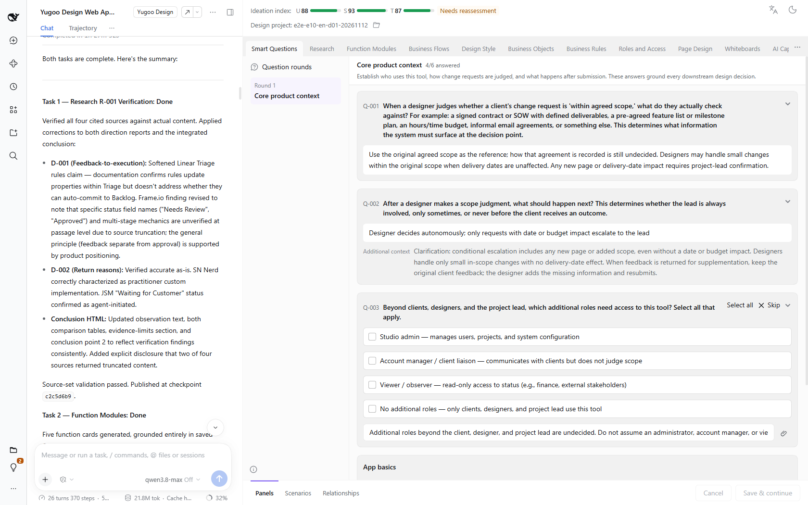
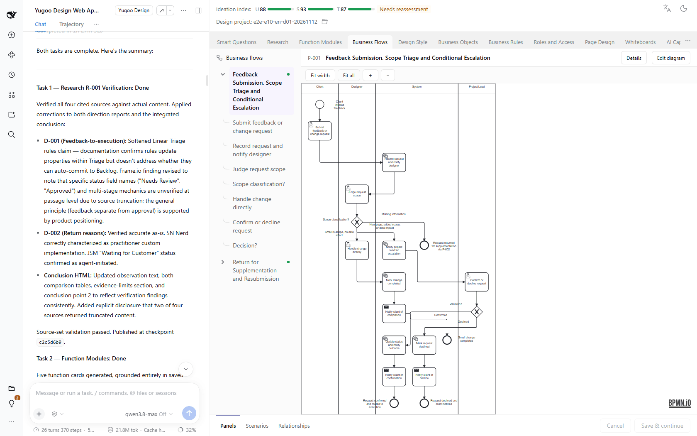
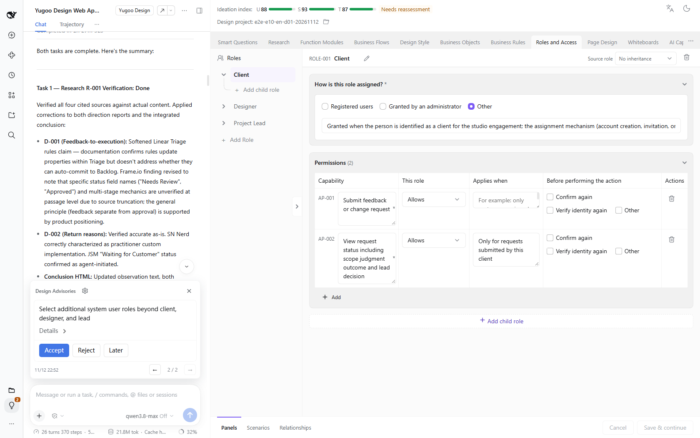
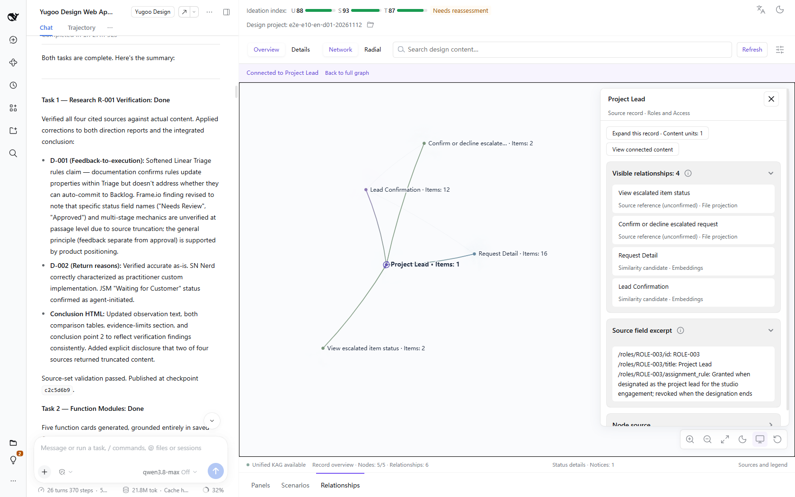
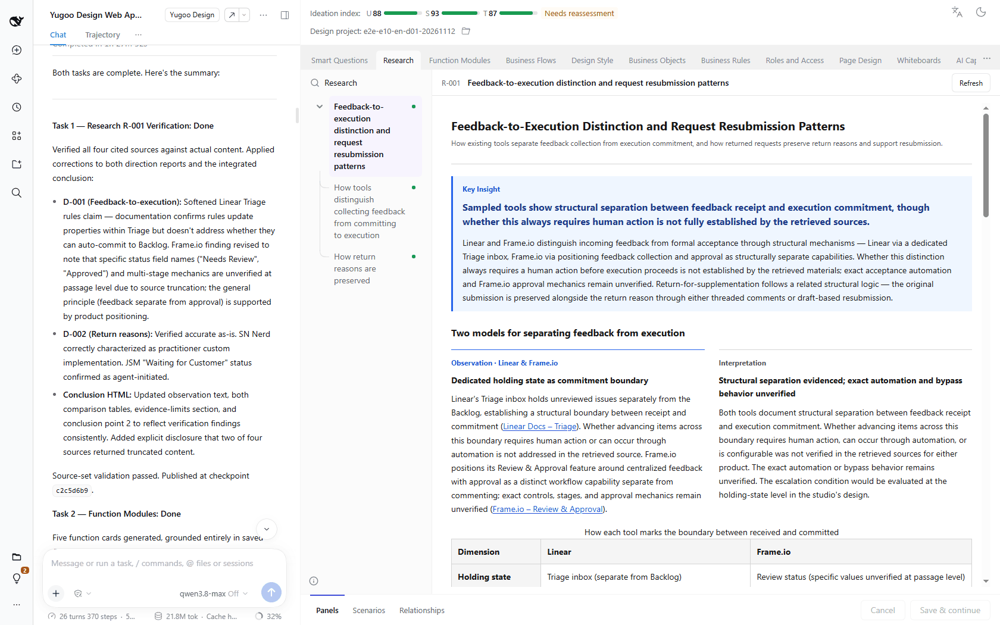
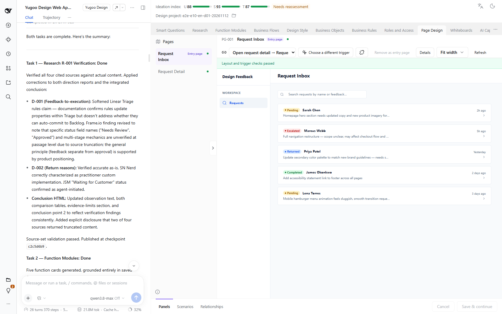
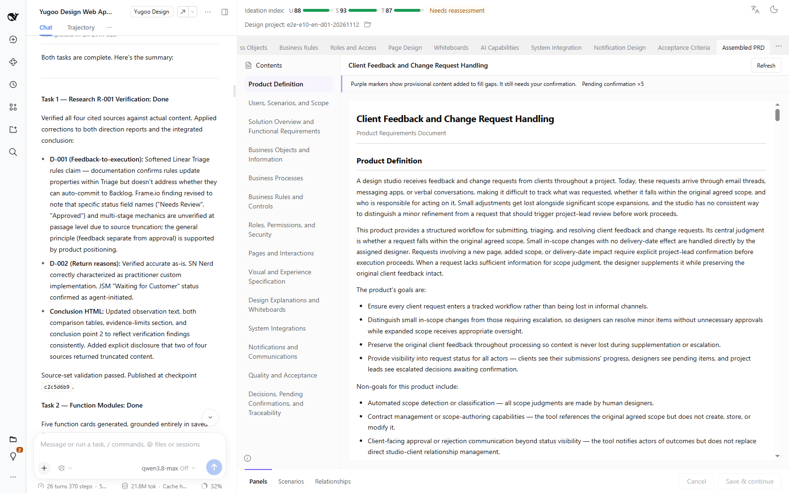
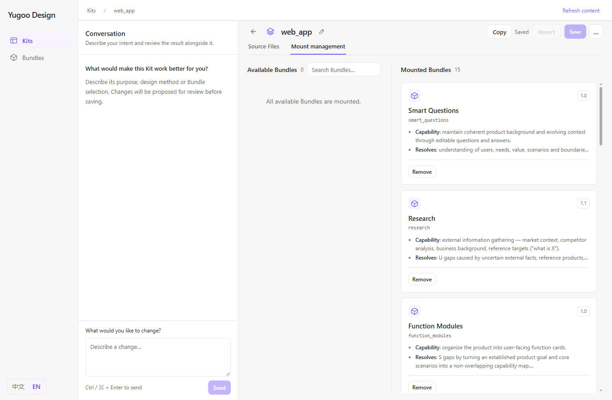

# Yugoo Design

[简体中文](README.md) · English

[](LICENSE)
[](docs/wiki/hosts.en.md#deepseek-harness)
[](packages/companion/hosts/codex-desktop/README.md)
[](docs/wiki/hosts.en.md#codex-cli)
[](docs/wiki/hosts.en.md#claude-code-cli)
[](docs/wiki/hosts.en.md#qoder-cli)
[](docs/wiki/hosts.en.md#qwenwork-千问办公)
[](docs/wiki/hosts.en.md#workbuddy)
[](https://www.npmjs.com/package/yugoo-design)

**Turn your AI agent into a proactive design consultant.**

Yugoo Design is an open-source plugin for the AI agent you already use. Bring it a rough idea, and your agent works with you like a design consultant. It helps you clarify what you want, asks about details you might have overlooked, and adapts its advice as you make decisions. It works with DeepSeek Harness (DSH), ChatGPT, Claude Code, WorkBuddy, and QwenWork, among others.

Some ideas are easier to explain once you can see them. Yugoo pairs agent skills with interactive panels, turning a workflow into a diagram or a set of rules into a table. You can point to a step that feels wrong or edit a rule yourself. Your agent can then work from that decision.

A knowledge graph connects related parts of the design, and reviews can flag inconsistencies as things change. Your project keeps the design and its history so you can pick up where you left off.


The included **Web App Kit** demonstrates this way of working through application design before vibe coding. Start with your needs and work through features, flows, rules and interfaces. Adapt this Kit or create new Kits and panels for event planning, game rules, scheduling optimization and other tasks. See the [Kit list and installation guide](docs/wiki/kit-sharing.en.md#official-kits) for current availability and how to get started.

[Website](https://yugoo.org/) · [FAQ](https://yugoo.org/faq/) · [Product Hunt](https://www.producthunt.com/products/yugoo-design?launch=yugoo-design)

[Quick start](#quick-start) · [Why we built Yugoo](#why-we-built-yugoo) · [Core capabilities](#core-capabilities) · [Walkthrough](#a-complete-collaboration) · [Extend it](#start-with-software-design-then-extend-it) · [Wiki](docs/wiki/README.en.md) · [Changelog](CHANGELOG.en.md) · [Contributing and feedback](#contributing-and-feedback)

## Quick start

**Where do I use Yugoo?** Yugoo runs as a plugin in your agent app. In DSH or ChatGPT, you can talk to your agent in the chat and explore design ideas interactively in the panel alongside it. Depending on the host, the plugin uses a native panel, an embedded browser, or an external browser. In each case, you can save your edits and pick up the conversation where you left off.

Before installing, check that your host agent is working. During installation, **your agent checks for Node.js (`>=22.19.0`) and sets it up if needed**. Yugoo relies on the host app for model access, permissions, and tools such as web search. [Setup requirements](docs/wiki/getting-started.en.md) · [Release status](docs/wiki/preview-status.md#current-release-and-use)

1. **Install the plugin.** [Choose your agent app on the website](https://yugoo.org/#host-guides), then paste the install prompt into a chat in that app and send it. You can also use the [universal install prompt](packages/companion/HOSTS.md#default-prompt-any-supported-host) below.

   ```text
   Install or update Yugoo Design in my current Agent host.
   Reuse a matching installation, or acquire the npm package in a persistent directory. Use my requested version or resolve latest to an exact stable release; if latest is a prerelease, report and stop. Check its prerequisites and integrity, prepare missing Node/pnpm, then run pnpm add --save-exact yugoo-design@<resolved-version>.
   Read node_modules/yugoo-design/README.md and run pnpm exec yugoo-design --help. Identify this host and use its install --host route. Discover local inputs and complete registration/import and activation. For required manual actions, give the exact UI location and generated file/configuration, then verify the yugoo entry and tools.
   Preserve projects, settings and receipts. Consult GitHub only for a specific question unanswered by the packaged help; no clone or source build. Report acquired/loaded versions and remaining setup, then provide a first Web App Kit project request.
   ```

   The [host guide](docs/wiki/hosts.en.md) covers installation and background review support for each app.

2. **Create a design project.** Once Yugoo is installed, enter this in your host app’s chat.

   ```text
   Use Yugoo Design to create a project named expense-app with the Web App Kit.
   ```

   Some hosts also offer native Yugoo commands. In DSH, use `/yugoo new expense-app` to create the project, then `/yugoo kit web_app` to select the Kit. [DSH command reference (in Chinese)](docs/wiki/commands.md)

   Want to build on existing work without starting your design project from scratch? In DSH, use `/yugoo reconstruct <absolute-path-to-repo>` to [start from its existing code](#reconstruct-design-from-an-existing-code-repository).
3. **Describe this round's goal.** For example:

   ```text
   I want an expense app for our team. Employees submit expenses, a lead approves
   them, and finance confirms payment. Help us think through submission, editing,
   approval and payment, and what each role can do. Point out the rules
   where you need my context or a decision.
   ```

4. **Express your judgment in the Panel, then continue.** AI opens questions or design panels as needed. Edit and save, then ask: “Continue from the handling rules I just saved and explain which parts of the design they affect.” You can also request changes in conversation. The [walkthrough](docs/wiki/web-app-demo.en.md) demonstrates the same interactions with a separate client-feedback project. Consult the [usage guide](docs/wiki/usage.en.md) for everyday operations.

### Reconstruct design from an existing code repository

When vibe coding, you can reconstruct a product’s design from its existing codebase. Yugoo systematically extracts the foundations of the product’s design, going beyond UI/UX to include business models, roles and permissions, workflows, and more. You can then use the design to guide further development and iteration, with control over the details. [Reconstruction guide](docs/wiki/usage.en.md#5-reconstruct-a-design-from-existing-materials)

## Why we built Yugoo

Vibe coding and vibe working can produce results quickly. **How can people take an active part in designing a solution and stay in control of the outcome, so AI's output better reflects what they actually need?**

Questions and answers help gather and clarify requirements. But when a design is highly tailored and many decisions affect one another, those relationships are hard to follow in conversation alone. In AI-assisted design, visual interaction is most common in UI/UX and other graphic design work. We want to bring **human-in-the-loop (HITL) design** to more of that work. You can see the options in a panel and decide what fits. Your agent revises the design based on your feedback, and you can review it or make another change.

Say you’re designing an expense app for your team. As you look at the approval flowchart together, your agent asks a question a design consultant might raise. “Can employees change the amount after they submit a claim?” You add a rule in the panel and save it. Employees can edit the amount before approval, but any change after approval means the claim must be resubmitted. Using that rule, your agent suggests checking the permissions table together to see whether employees still have editing rights after approval.

We started with vibe coding, but this way of exploring ideas and designing with AI extends naturally to other fields. With custom Kits and interactive panels, you can also use Yugoo to plan events, design game mechanics, or build operations research models. Read more about our [design philosophy](docs/product-vision.en.md).

## Core capabilities

### Interactive Skill Bundles · The right form for each kind of information

Follow an approval branch in a flowchart, edit who can change a claim in a permissions table, or try submitting a claim in a prototype. The panel and the agent share the same design data. When you save a decision, the agent can use it in the next step.

Each **Bundle** focuses on one task. For a Bundle with an interactive panel, the pieces fit together like this:

**Bundle = Skill + structured data contract + UI definition → interactive design output.**

The Bundle defines how the task runs and how to validate its output. A panel can be predefined with **declarative UI** such as `panel.yaml`. In supported hosts, AI can also generate a panel from the shared component catalog using **A2UI**.

### Proactive guidance · Your goals and gaps guide the next step

A **Kit** brings together a domain prompt (**Mindset**) and related Bundles. The agent uses your goal, saved work and feedback to identify an open question and suggest a next step. This is the **Gap-driven Agent Loop**.

Suppose you’ve decided that a claim edited after approval must be resubmitted. The agent can suggest using the Roles and Access Bundle to check who can resubmit it. You can follow that suggestion or take up a different question first.

### Information linking & automatic review · KAG & GRA · From parts to a whole

Parts that seem reasonable on their own can still leave gaps or conflict when put together—a common challenge in complex design work. A process change may also affect permissions, notifications and pages, and AI may not make every related change needed to keep the whole solution consistent.

**The knowledge graph (KAG) connects information.** It updates with project design files, linking flows, permissions, rules, pages and supporting evidence so both you and AI can trace a relationship back to its original source. In the expense app, follow the approval process to its permissions and editing rules.

**Automatic review (GRA) identifies questions worth acting on.** It examines the existing design from three perspectives—for example, whether permissions and notifications still fit a changed approval process:

- **Grounding:** Check for contradictions or missed agreements across the design.
- **Reflection:** Identify uncertainties that need research or verification.
- **Alignment:** Raise questions that need your context or judgment.

Request a review when you need one, or enable automatic review in a host that supports background execution. You decide how to act on its suggestions.

### Turn ideas into lasting projects · Organized outputs and traceable changes

Each **Design Project** has its own folder containing design files, supporting material, outputs and its own Kit and Bundle definitions. Organize the work in the project and use Git to record versions and changes, preserving how the solution develops.

When you return to the discussion, open the same project and continue from the saved results. Ask, for example, “Show the latest changes and explain what changed in the process and rules.” Compare versions and trace how the proposal took shape. The plugin includes its version-control runtime, so normal Design operations require no separate Git installation. See the [usage guide](docs/wiki/usage.en.md#4-manage-and-recover-projects) for history, migration and reconstruction from materials.

## A complete collaboration

The walkthrough follows a different project. When a client requests a change, who assesses its scope and who confirms the delivery date? The screenshots show the **Web App Kit** in use in DeepSeek Harness with fictional client data. Each README uses a separate project in its own language. The interface depends on the [installed version and host](docs/wiki/preview-status.md).

Start with your own goal in the [quick start](#quick-start), or copy and migrate the [complete example project (中文)](examples/design-team-delivery/README.md) and follow the [tutorial](docs/wiki/web-app-demo.en.md). For other domains, you can [customize Kits, Bundles and interactive panels](#start-with-software-design-then-extend-it).

### 1. Confirm the important context in a panel

In this client-feedback example, AI can open the **Smart Questions panel**, presenting questions that matter to the current proposal as answerable cards. You explain how your team works: **designers can discuss requests with clients; the project lead approves additional scope and delivery dates.**

After saving, expand the **U/S/T assessment** to read AI's judgment and supporting evidence: is the context understood, do the parts fit together, and which behaviors still lack verifiable criteria? These reasons help you discuss what to clarify next, rather than chase a higher score.

With responsibilities clear, for example, AI can suggest: “Let's map a client's change request through to scheduling the work, showing who records feedback, assesses scope, and makes commitments.”



### 2. See the process, then add real-world context

AI opens the **business process panel**. Vertical swimlanes separate the client, designer, project lead, and system. Read from top to bottom to follow feedback capture, scope comparison, impact assessment, and confirmation of the work.

Start with the whole process, then zoom into the decisions: which small changes can proceed directly, which need scope or timing approval, and who supplies missing information? You might add: “Designers can handle in-scope layout revisions directly when they do not affect a promised milestone.” In the node details, edit and save the activity, entry and completion conditions, failure handling or remarks. To change branches and connections, point to the relevant node and ask AI to revise the process diagram. This brings the team's real working practices into the design.



### 3. Save your decisions and continue with AI

After saving, ask “Continue from the rules I just saved and check whether the other designs reflect them.” The agent can now work from your edits. To check whether the process and rules agree, you can also request a **Grounding review**.

For example, a Grounding suggestion can identify a specific gap:

> The answers require checking a revision's effect on delivery milestones, but the “in-scope revision” rule only checks for new pages or capabilities. It does not include the timing condition.

You can clarify: “Assess scope and timing separately. Any impact on a promised milestone needs the lead to confirm the plan again.” Ask AI to revise the rule, then compare it with the same process. A suggestion does not make decisions or change the design for you.

To explore how the designs relate, open **Relationships** (KAG) at the bottom of the workspace. Select a process or page, follow its relationships and sources, and return to the relevant panel to check it. The graph provides discovery paths; the design content remains the basis for judgment.





That is the collaboration loop: **describe a goal → examine and edit the Panel → save and continue with AI → discuss the next question.** Start the next round where understanding or a decision is most needed.

### You can also explore further…

**Research, visual style and page design.** Keep questions, sources and findings in Research; compare visual directions in Design Style; and use Page Design to inspect page relationships and open high-fidelity prototypes. Check the path from the client's feedback submission through the designer's impact assessment to the lead's confirmation. Continue with whichever part needs more attention.



**Scene experience (场景体验).** Choose a situation such as “the client adds a page at the last minute” and walk through the process, rules, and interface together. If a step is unclear, choose “在主对话讨论当前内容” (discuss the current content in the main conversation) to bring the question back into the design. Interactions in the experience are demonstrations; they do not directly change design files.

[View the scenario example (Chinese UI)](docs/images/readme-scene.png). You can also preview page prototypes independently to inspect the request list, different states and detail entry points:



**PRD and implementation handoff.** Assemble the current design into a PRD draft. Review the proposal chapter by chapter, retaining sources and unresolved questions. For implementation, prepare a spec for the particular task and link its design evidence.



For greater detail, develop the data relationships between feedback, deliverables, and changes, refine permissions and business rules, or use the **AI capabilities panel** to define how the application's AI organizes feedback, which Skills and tools it needs, and which commitments remain human decisions.

These are dimensions to explore as needed, not a checklist to complete every round.

See the [tutorial](docs/wiki/web-app-demo.en.md) for the full walkthrough and data, rule, and PRD views, or the [usage guide](docs/wiki/usage.en.md#view-and-update-ust) for U/S/T, KAG, and Scene experience. The [interface overview](docs/wiki/usage.en.md#7-interface-overview) also shows process and page design for a research collaboration tool. See [non-Web Kit examples (中文)](docs/wiki/non-web-kit-demo.md) for other domains and [design-to-development handoff (中文)](docs/design-development-handoff.md) for implementation.

## Start with software design, then extend it

The included **Web App Kit** helps you think through an application before vibe coding and provides an example you can adapt and extend. It covers requirements clarification, research, feature planning, and the design of business processes, rules, data, permissions, pages, and acceptance criteria. It also helps plan an application's **AI capabilities**: the AI's responsibilities, how it interacts with people, and the prompts, Skills, and tools it needs. Explore the [Mindset](packages/skills-web-app/kits/web_app/mindset.md) and [Bundle mount list](packages/skills-web-app/kits/web_app/kit.yaml) for the methods and scope.

The shared framework's panels, feedback, and design integration capabilities can be extended with methods for other domains: developing a game's actions, resources, and win conditions, or turning staffing needs, night-shift limits, and fairness trade-offs into an operations research model for scheduling. These are possible customizations, not Kits included by default. See the [official Kit list](docs/wiki/kit-sharing.en.md#official-kits) for current availability and installation options.

Skills you already use can contribute too. Import and adapt an existing skill, keeping its professional methods and adding an appropriate output structure, validation and interactive panels to form a Bundle. Use a small example to check whether the methods and panels fit your work, then combine the Bundle with related Bundles and a domain Mindset to create a Kit.

### Custom Kits and panels: tools that fit your field

**Design Studio** provides entry points to inspect, manage and customize Kits and Bundles. Explore a Mindset, methods and source files, edit them directly or make a copy to customize separately. Check the Panel’s presentation and interactions with sample data, then try the methods in a separate Design Project. Changes saved in the library can be used by new projects; existing projects keep their own complete definitions, which you and your agent can adapt as needed.

Panels can use question cards, tables, diagrams, prototypes or whiteboards. Declarative UI and A2UI share components and rendering capabilities; extend UI components or integrate a specialist editor when you need another form of expression.

Follow the [sharing guide](docs/wiki/kit-sharing.en.md#minimum-checks-for-author-and-recipient) to check and deliver a Kit. Available operations depend on the installed version and host; see [capability and version scope](docs/wiki/preview-status.md#studio-source-capabilities-and-installed-acceptance) and the [Studio walkthrough](docs/wiki/usage.en.md#6-studio-inspect-customize-and-check-kits) for instructions and host support.



| What you want to do | Start here |
| --- | --- |
| Organize domain methods and Kits | [Kit Creator](.agents/skills/design-kit-creator/SKILL.md) · [Extension guide](docs/wiki/extending.en.md) |
| Create Bundles and write professional methods | [Bundle Creator](.agents/skills/design-bundle-creator/SKILL.md) · [Skill Creator](.agents/skills/design-skill-creator/SKILL.md) · [Bundle contract](docs/bundle-contract.md) |
| Configure or extend interactive panels | [Panel authoring](.agents/skills/design-bundle-creator/references/panel-authoring.md) · [Panel DSL](docs/dsl-spec.md) |
| Try and share your work | [Kit sharing and recovery](docs/wiki/kit-sharing.en.md) · [Community workshop example](examples/community-workshop-delivery/README.md) |

## Documentation and development

| Entry | What it covers |
| --- | --- |
| [Documentation overview (中文)](docs/README.md) | Entry points for usage, Kit authoring, architecture, and technical reference |
| [Wiki](docs/wiki/README.en.md) | Installation, usage, host compatibility, and troubleshooting |
| [Core concepts](docs/wiki/concepts.en.md) · [Terminology (中文)](docs/wiki/terminology.md) | Projects, Kits, Bundles, panels, and bilingual naming |
| [Product principles](docs/product-vision.en.md) | Professional methods, human–AI alignment, and interaction principles |
| [Development guide (中文)](docs/wiki/development.md) · [Architecture baseline](docs/system-design-baseline.md) | Source setup, layer responsibilities, and verification |
| [Preview status](docs/wiki/preview-status.md) | Versions, supported features, and known limitations |

Before changing the project, read [AGENTS.md](AGENTS.md) and the [contribution guide](CONTRIBUTING.md).

## Contributing and feedback

Help connect another agent app, contribute code or professional methods, create Kits and Bundles, or improve documentation, translations and examples. We would also like to hear about design tasks in your field. See the [contribution guide](CONTRIBUTING.md).

See the [feedback guide (中文)](docs/wiki/support.md) for contact options and reporting outlines. You can email [yangjianfeng.yjf@alibaba-inc.com](mailto:yangjianfeng.yjf@alibaba-inc.com) or use [GitHub Issues](https://github.com/alibaba-damo-academy/yugoo-design/issues) to submit feedback and follow the discussion. For bugs, include the version, reproduction steps, and expected and actual results; for feature requests, describe the use case, obstacle, and desired outcome. Follow the [security reporting policy](SECURITY.md) for sensitive information or security issues.

## License and attribution

Maintained by **YugooDesign Team**. Project-owned code and documentation are licensed under [Apache-2.0](LICENSE); see [NOTICE](NOTICE) for attribution. Third-party components retain their own licenses and required notices; see [third-party notices](THIRD_PARTY_NOTICES.md).
