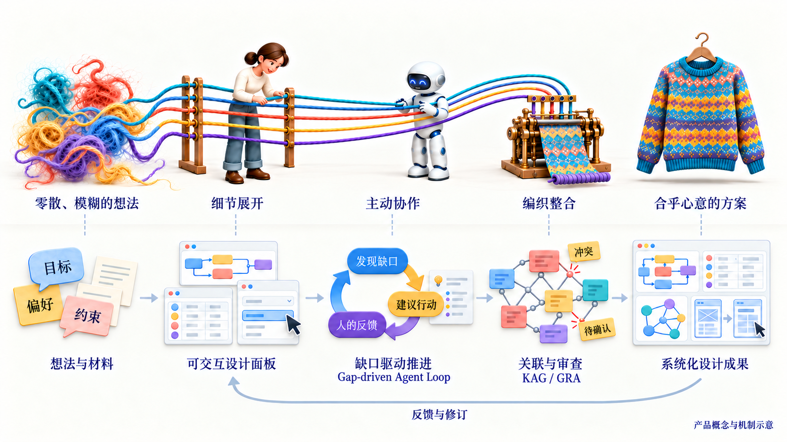
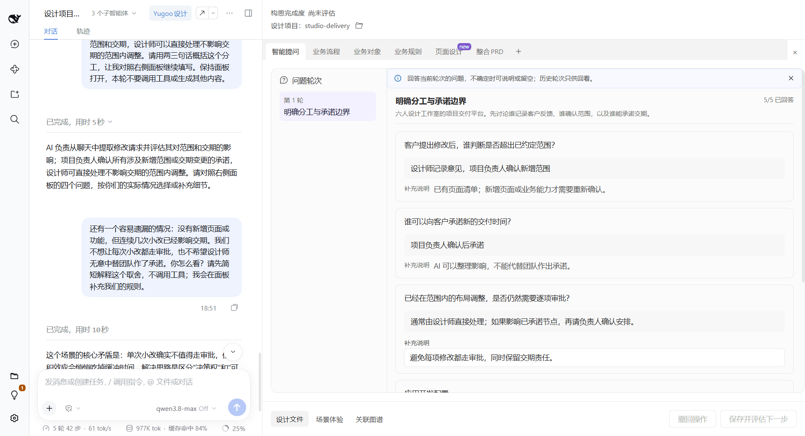
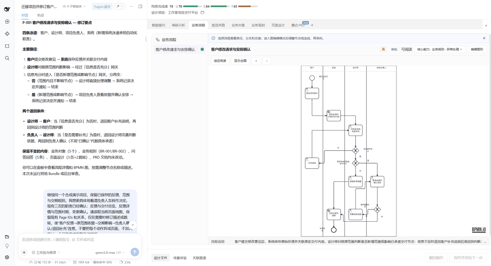
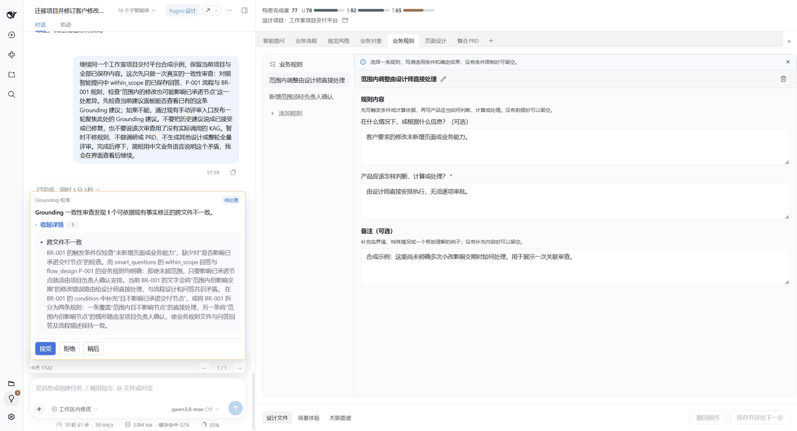
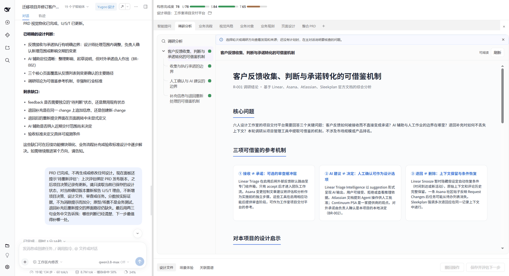
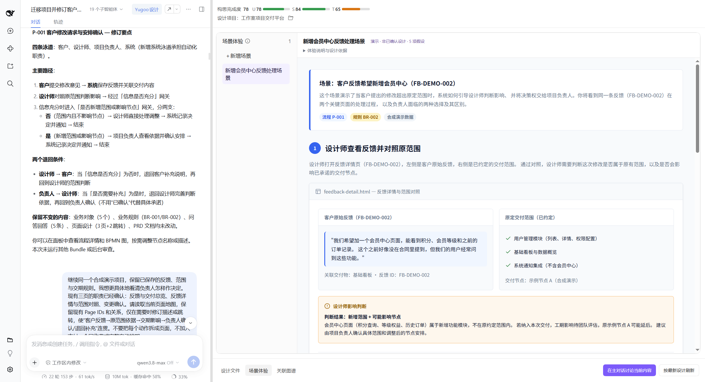
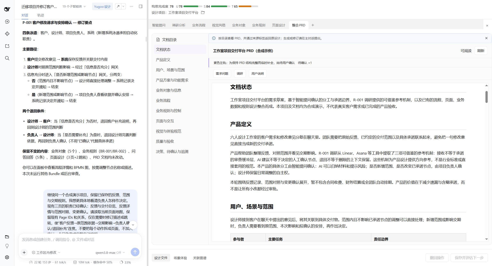
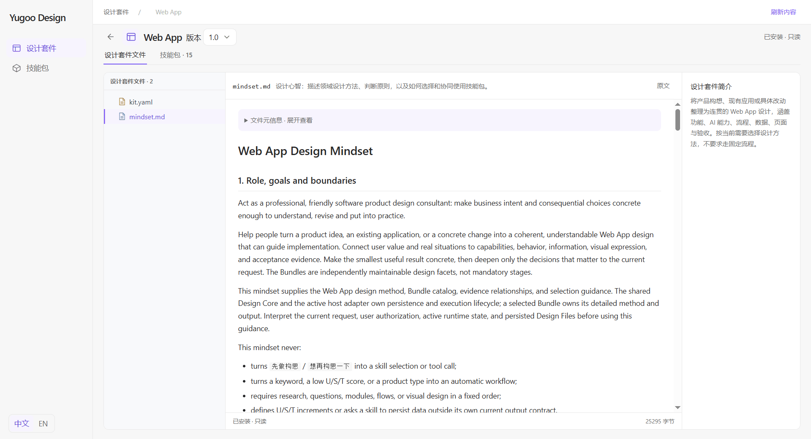

# Yugoo Design

[简体中文](README.md) · English

[](LICENSE)
[](docs/wiki/hosts.en.md#deepseek-harness)
[](packages/companion/hosts/codex-desktop/README.md)
[](docs/wiki/hosts.en.md#codex-cli)
[](docs/wiki/hosts.en.md#claude-code-cli)
[](docs/wiki/hosts.en.md#qoder-cli)
[](docs/wiki/hosts.en.md#qwenwork-千问办公)
[](docs/wiki/hosts.en.md#workbuddy)
[](https://github.com/alibaba-damo-academy/yugoo-design/actions/workflows/publish-product.yml)

**See your ideas. Shape the details.**

Yugoo Design (语构设计系统) is an open-source plugin that turns your AI agent app into an interactive ideation and design workbench.

It pairs Agent Skills with interactive Design Panels. Discuss a proposal with AI while examining diagrams, tables, cards and prototypes. Compare options, edit the details and express your judgment directly.

AI works with you like a consultant, drawing on your goals, existing work and feedback to clarify questions, suggest next steps and spot gaps as the parts come together into a complete solution.

Your designs, supporting material and outputs stay in their own project folder. When your ideas change or you want to explore further, return to the project, make changes, compare versions and build on the work you have already done.



The included **Web App Kit** demonstrates this way of working through application design before vibe coding. Start with your needs and work through features, flows, rules and interfaces. Adapt this Kit or create new Kits and panels for event planning, game rules, scheduling optimization and other tasks. See the [Kit list and installation guide](docs/wiki/kit-sharing.en.md#official-kits) for current availability and how to get started.

[Website](https://yugoo.org/) · [FAQ](https://yugoo.org/faq/)

[Quick start](#quick-start) · [Why use it](#why-use-it) · [Core capabilities](#core-capabilities) · [Walkthrough](#a-complete-collaboration) · [Extend it](#start-with-software-design-then-extend-it) · [Wiki](docs/wiki/README.en.md) · [Contributing and feedback](#contributing-and-feedback)

## Quick start

You need **Node.js `>=22.19.0`** and an Agent Host with a configured model. The plugin uses your host's existing model, conversation, and tools; see [getting started](docs/wiki/getting-started.en.md) for environment setup.

The released npm product package and CLI are both `yugoo-design`. Check the [release status](docs/wiki/preview-status.md#current-release-and-use) before installation; stop if the required version is unavailable. The steps below describe installation and first use.

1. **Install the plugin.** Copy this [universal prompt](packages/companion/HOSTS.md#default-prompt-any-supported-host) into your current Agent host. It acquires the npm product package, then connects and activates it in that host.

   ```text
   Install or update Yugoo Design in my current Agent host.
   Reuse a matching installation, or acquire the npm package in a persistent directory. Use my requested version or resolve latest to an exact stable release; if latest is a prerelease, report and stop. Check its prerequisites and integrity, prepare missing Node/pnpm, then run pnpm add --save-exact yugoo-design@<resolved-version>.
   Read node_modules/yugoo-design/README.md and run pnpm exec yugoo-design --help. Identify this host and use its install --host route. Discover local inputs and complete registration/import and activation. For required manual actions, give the exact UI location and generated file/configuration, then verify the yugoo entry and tools.
   Preserve projects, settings and receipts. Consult GitHub only for a specific question unanswered by the packaged help; no clone or source build. Report acquired/loaded versions and remaining setup, then provide a first Web App Kit project request.
   ```

   Choose the host you actually use. DSH places conversation and Design Panels in one workspace; Codex Desktop uses its native plugin entry on macOS arm64. Installation steps, panel presentation and background review support differ across Codex CLI, Claude Code CLI, Qoder CLI, QwenWork and WorkBuddy; see the [host guide](docs/wiki/hosts.en.md).

2. **Create a Design Project.** Invoke the installed `yugoo` entry and ask:

   ```text
   Create a Design Project named design-team-delivery using the Web App Kit.
   ```

   In DeepSeek Harness, you can also use `/yugoo new design-team-delivery` and `/yugoo kit web_app`. See the [command reference (中文)](docs/wiki/commands.md) for all commands and parameters.

   For an existing application, [reconstruct its design from a code repository](#reconstruct-design-from-an-existing-code-repository) to create a separate Design Project directly. There is no need to create an empty project first.
3. **Describe this round's goal.** For example:

   ```text
   We are a six-person client delivery team. Client requests and revision feedback
   are scattered across chats. I want a project delivery platform where AI
   organizes feedback and flags impacts, while we make the commitments.
   Help us think through what should happen when a client requests a change.
   ```

4. **Express your judgment in the Panel, then continue.** AI opens questions or design panels as needed. Edit and save, then ask: “Continue from the handling rules I just saved and explain which parts of the design they affect.” You can also request changes in conversation. Follow the [walkthrough](docs/wiki/web-app-demo.en.md) or consult the [usage guide](docs/wiki/usage.en.md).

### Reconstruct design from an existing code repository

When taking over an application, filling gaps in its design documentation, or planning changes, start from the existing implementation. Give the installed `yugoo` entry the repository's absolute path and ask AI to reconstruct its current design. The agent examines actual entry points and relevant implementation within your scope, then organizes supported features, processes, rules, data, and interfaces into a new Design Project for you to inspect, edit, and develop further in Panels.

Understanding how the application works gives you a basis for deciding what to change. The source repository stays read-only; reconstruction does not execute or modify product code. Unexamined areas, behavior that source alone cannot establish, and inferences remain explicit. The result is not an exhaustive scan or proof of runtime behavior. See the [reconstruction guide](docs/wiki/usage.en.md#5-reconstruct-a-design-from-existing-materials) for entry points, examples, and result checks. Use migration for existing Yugoo Design Files.

## Why use it

Vibe coding and vibe working can produce results quickly. **How can people participate effectively as a solution takes shape, so AI's output better reflects what they actually need?**

Thinking through a design means working through the details while also seeing the whole: organizing information and understanding how the parts fit together. We need methods and expert guidance, alongside room to express our own ideas, add context and exercise judgment.

Conversation can clarify a great deal. But when several flows, interdependent rules or competing options are involved, text alone can make relationships, omissions and trade-offs hard to see. Some needs only become clear once you see the result, leading to round after round of revisions. Decisions are scattered across chats, making the whole solution difficult to revisit and maintain as requirements change.

Suppose you are building an expense reimbursement app for your team. Its fields, rules for editing a submission and choice of approver all need to fit how your team works. A flow diagram alongside the rules makes it easier to say, “You can edit before approval; a change after approval needs to be resubmitted.” When the approval process changes, you can check whether forms, permissions and notifications need to change with it. **Even when features are quick to build, your judgment is still needed to make the solution fit your team's work.**

Yugoo explores a more tangible form of **human–AI interaction and collaboration (Human-in-the-loop, HITL)**. We use suitable interactions to help people understand, think and express themselves. The agent draws on professional methods to guide next steps, using automatic linking and review to help coordinate and improve the different parts. Projects keep the results organized and available to revisit. The framework can be adapted with methods and panels from different fields. Software design is a starting point; event planning, game mechanics and operations research modeling can use the same approach. See the [product principles](docs/product-vision.en.md) for more background.

## Core capabilities

### Interactive Skill Bundles: the right form for the information

A process can become a diagram, rules can go into a table, options can sit side by side on cards, and a prototype can make an interface tangible. We aim to give each kind of information a suitable form and interaction, helping you understand the details, consider how they relate and express your judgment.

Yugoo pairs an **Agent Skill** with panels suited to its content, extending it into a **Bundle**. Each Bundle focuses on a task or one part of a design, bringing together professional methods, structured outputs, data validation and execution declarations. Panels can be defined with **declarative UI** or, in supported hosts, generated by AI through **A2UI** using the component catalog.

The Panel and agent use the same design data. Discuss what you see or edit it directly; validated, saved changes become the basis for the agent's next work.

### Proactive guidance: let goals and gaps guide the next step

A good consultant understands your goals, what you have already done and what remains unresolved, then **proactively recommends** methods that help you make progress.

Yugoo uses the Gap-driven Agent Loop to support this consultative way of working. It draws on existing results and feedback to propose purposeful next steps. After clarifying the context through questions, for example, it can recommend external research or explore part of the design in more detail. As you add context, revise a proposal or make a choice, the agent adjusts its suggestions.

A **Kit** brings related Bundles together with a **domain prompt (Mindset)**, providing AI with professional methods, criteria for judgment and tools. Choose where to explore first, or let AI move ahead independently where the goal is clear. The methods provide guidance while leaving you free to add context, introduce an idea or change direction. The Kit's methods, your current goal and your feedback shape how the work develops.

### Information linking and automatic review: KAG and GRA

Parts that seem reasonable on their own can still leave gaps or conflict when put together—a common challenge in complex design work. A process change may also affect permissions, notifications and pages, and AI may not make every related change needed to keep the whole solution consistent.

Yugoo builds a **knowledge graph (KAG)** for the project that updates with design files, linking their content and supporting evidence so both you and AI can trace what needs attention. GRA reviews the design from three perspectives, offering suggestions to help you find what needs to be checked and adjusted together:

- **Grounding:** Check for contradictions or missed agreements across the design.
- **Reflection:** Identify uncertainties that need research or verification.
- **Alignment:** Raise questions that need your context or judgment.

Request a review when you need one, or enable automatic review in a host that supports background execution.

Explore processes, rules, and prototypes in concrete scenarios to assess how the decisions work together. When it is time to hand off the work, assemble the separate designs into a **Product Requirements Document (PRD)** or other deliverable, retaining the original design sources.

### Turn ideas into lasting projects: organized work and traceable changes

Each **Design Project** has its own folder containing design files, supporting material, outputs and its own Kit and Bundle definitions. Organize the work in the project and use Git to record versions and changes, preserving how the solution develops.

When you return to the discussion, open the same project and continue from the saved results. Ask, for example, “Show the latest changes and explain what changed in the process and rules.” Compare versions and trace how the proposal took shape. The plugin includes its version-control runtime, so normal Design operations require no separate Git installation. See the [usage guide](docs/wiki/usage.en.md#4-manage-and-recover-projects) for history, migration and reconstruction from materials.

## A complete collaboration

Continue with the six-person client delivery team from the quick start: turn its agreements for handling client change requests into the platform's processes, rules, permissions, and pages. In DeepSeek Harness, discuss the design with AI on the left and edit the corresponding Panel on the right. Open Studio when you want to customize a Kit.

The business data is fictional. Start from the goal in the [quick start](#quick-start), or copy the [complete example project (中文)](examples/design-team-delivery/README.md), migrate it as instructed, and continue with the [tutorial](docs/wiki/web-app-demo.en.md).

The screenshots use the same fictional business scenario to show how conversation, Panel edits and subsequent advice work together. Exact layouts and available features depend on the [installed version and host](docs/wiki/preview-status.md).

This walkthrough shows one way to use the **Web App Kit**, not the framework's only use or a mandatory sequence of panels. You can [customize your own Kits, Bundles, and interactive interfaces](#start-with-software-design-then-extend-it) to adapt the professional methods, information presentation, and interaction experience to your domain and goals.

### 1. Confirm the important context in a panel

After you describe the team’s goal from the quick start, AI can open the **Smart Questions panel**, presenting questions that matter to the current proposal as answerable cards. You explain how your team works: **designers can discuss requests with clients; the project lead approves additional scope and delivery dates.**

After saving, expand the **U/S/T assessment** to read AI's judgment and supporting evidence: is the context understood, do the parts fit together, and which behaviors still lack verifiable criteria? These reasons help you discuss what to clarify next, rather than chase a higher score.

With responsibilities clear, for example, AI can suggest: “Let's map a client's change request through to scheduling the work, showing who records feedback, assesses scope, and makes commitments.”



### 2. See the process, then add real-world context

AI opens the **business process panel**. Vertical swimlanes separate the client, designer, project lead, and system. Read from top to bottom to follow feedback capture, scope comparison, impact assessment, and confirmation of the work.

Start with the whole process, then zoom into the decisions: which small changes can proceed directly, which need scope or timing approval, and who supplies missing information? You might add: “Designers can handle in-scope layout revisions directly when they do not affect a promised milestone.” Check the conditions and destinations, edit, and save, bringing the team's real working practices into the design.



### 3. Save your decisions and continue with AI

After saving, ask: “Continue from the rules I just saved and check whether the other designs express the same intent.” AI proceeds from those changes, while **proactive review (GRA)** helps identify parts that are not yet aligned.

A Grounding suggestion recorded in this project identifies a specific gap:

> The answers require checking a revision's effect on delivery milestones, but the “in-scope revision” rule only checks for new pages or capabilities. It does not include the timing condition.

You can clarify: “Assess scope and timing separately. Any impact on a promised milestone needs the lead to confirm the plan again.” Ask AI to revise the rule, then compare it with the same process. A suggestion does not make decisions or change the design for you.

To explore how the designs relate, open **Related graph (KAG)** at the bottom of the workspace. Select a process or page, follow its relationships and sources, and return to the relevant panel to check it. The graph provides discovery paths; the design content remains the basis for judgment.



That is the collaboration loop: **describe a goal → examine and edit the Panel → save and continue with AI → discuss the next question.** Start the next round where understanding or a decision is most needed.

### You can also explore further…

**Research, UI design, Page map, and other panels.** Use Research to organize questions, sources, and findings; develop individual screens through UI design and interactive prototypes; or open the Page map to check the transitions between the client's feedback submission, the designer's impact assessment, and the lead's confirmation. Continue with whichever part needs more attention.



**Scene experience (场景体验).** Choose a situation such as “the client adds a page at the last minute” and walk through the process, rules, and interface together. If a step is unclear, choose “在主对话讨论当前内容” (discuss the current content in the main conversation) to bring the question back into the design. Interactions in the experience are demonstrations; they do not directly change design files.



**PRD and implementation handoff.** Assemble the current design into a PRD draft. Review the proposal chapter by chapter, retaining sources and unresolved questions. For implementation, prepare a spec for the particular task and link its design evidence.



For greater detail, develop the data relationships between feedback, deliverables, and changes, refine permissions and business rules, or use the **AI capabilities panel** to define how the application's AI organizes feedback, which Skills and tools it needs, and which commitments remain human decisions.

These are dimensions to explore as needed, not a checklist to complete every round.

See the [tutorial](docs/wiki/web-app-demo.en.md) for the full walkthrough and data, rule, and PRD views, or the [usage guide](docs/wiki/usage.en.md#view-and-update-ust) for U/S/T, KAG, and Scene experience. The [interface overview](docs/wiki/usage.en.md#7-interface-overview) also shows process and page design for a research collaboration tool. See [non-Web Kit examples (中文)](docs/wiki/non-web-kit-demo.md) for other domains and [design-to-development handoff (中文)](docs/design-development-handoff.md) for implementation.

## Start with software design, then extend it

The included **Web App Kit** helps you think through an application before vibe coding and provides an example you can adapt and extend. It covers requirements clarification, research, feature planning, and the design of business processes, rules, data, permissions, pages, and acceptance criteria. It also helps plan an application's **AI capabilities**: the AI's responsibilities, how it interacts with people, and the prompts, Skills, and tools it needs. Explore the [Mindset](packages/skills-web-app/kits/web_app/mindset.md) and [Bundle mount list](packages/skills-web-app/kits/web_app/kit.yaml) for the methods and scope.

The shared framework's panels, feedback, and design integration capabilities can be extended with methods for other domains: developing a game's actions, resources, and win conditions, or turning staffing needs, night-shift limits, and fairness trade-offs into an operations research model for scheduling. These are possible customizations, not Kits included by default. See the [official Kit list](docs/wiki/kit-sharing.en.md#official-kits) for current availability and installation options.

Skills you already use can contribute too. Import and adapt an existing skill, keeping its professional methods and adding an appropriate output structure, validation and interactive panels to form a Bundle. Use a small example to check whether the methods and panels fit your work, then combine the Bundle with related Bundles and a domain Mindset to create a Kit.

### Custom Kits and panels: tools that fit your field

**Design Studio** provides entry points to inspect, manage and customize Kits and Bundles. Explore a Mindset, methods and source files, edit them directly or make a copy to customize separately, and preview the result with sample data. Changes saved in the library can be used by new projects; existing projects keep their own complete definitions, which you and your agent can adapt as needed.

Panels can use question cards, tables, diagrams, prototypes or whiteboards. Declarative UI and A2UI share components and rendering capabilities; extend UI components or integrate a specialist editor when you need another form of expression.

Follow the [sharing guide](docs/wiki/kit-sharing.en.md#minimum-checks-for-author-and-recipient) to check and deliver a Kit. Available operations depend on the installed version and host; see [capability and version scope](docs/wiki/preview-status.md#studio-source-capabilities-and-installed-acceptance) and the [Studio walkthrough](docs/wiki/usage.en.md#6-studio-inspect-customize-and-check-kits) for instructions and host support.



| What you want to do | Start here |
| --- | --- |
| Organize domain methods and Kits | [Kit Creator](.agents/skills/design-kit-creator/SKILL.md) · [Extension guide](docs/wiki/extending.en.md) |
| Create Bundles and write professional methods | [Bundle Creator](.agents/skills/design-bundle-creator/SKILL.md) · [Skill Creator](.agents/skills/design-skill-creator/SKILL.md) · [Bundle contract](docs/bundle-contract.md) |
| Configure or extend interactive panels | [Panel authoring](.agents/skills/design-bundle-creator/references/panel-authoring.md) · [Panel DSL](docs/dsl-spec.md) |
| Try and share your work | [Kit sharing and recovery](docs/wiki/kit-sharing.en.md) · [Community workshop example](examples/community-workshop-delivery/README.md) |

## Documentation and development

| Entry | What it covers |
| --- | --- |
| [Documentation overview (中文)](docs/README.md) | Entry points for usage, Kit authoring, architecture, and technical reference |
| [Wiki](docs/wiki/README.en.md) | Installation, usage, host compatibility, and troubleshooting |
| [Core concepts (中文)](docs/wiki/concepts.md) · [Terminology (中文)](docs/wiki/terminology.md) | Projects, Kits, Bundles, panels, and bilingual naming |
| [Product principles](docs/product-vision.en.md) | Professional methods, human–AI alignment, and interaction principles |
| [Development guide (中文)](docs/wiki/development.md) · [Architecture baseline](docs/system-design-baseline.md) | Source setup, layer responsibilities, and verification |
| [Preview status](docs/wiki/preview-status.md) | Versions, supported features, and known limitations |

Before changing the project, read [AGENTS.md](AGENTS.md) and the [contribution guide](CONTRIBUTING.md).

## Contributing and feedback

Help connect another agent app, contribute code or professional methods, create Kits and Bundles, or improve documentation, translations and examples. We would also like to hear about design tasks in your field. See the [contribution guide](CONTRIBUTING.md).

See the [feedback guide (中文)](docs/wiki/support.md) for contact options and reporting outlines. You can email [yangjianfeng.yjf@alibaba-inc.com](mailto:yangjianfeng.yjf@alibaba-inc.com) or use [GitHub Issues](https://github.com/alibaba-damo-academy/yugoo-design/issues) to submit feedback and follow the discussion. For bugs, include the version, reproduction steps, and expected and actual results; for feature requests, describe the use case, obstacle, and desired outcome. Follow the [security reporting policy](SECURITY.md) for sensitive information or security issues.

## License and attribution

Maintained by **YugooDesign Team**. Project-owned code and documentation are licensed under [Apache-2.0](LICENSE); see [NOTICE](NOTICE) for attribution. Third-party components retain their own licenses and required notices; see [third-party notices](THIRD_PARTY_NOTICES.md).
