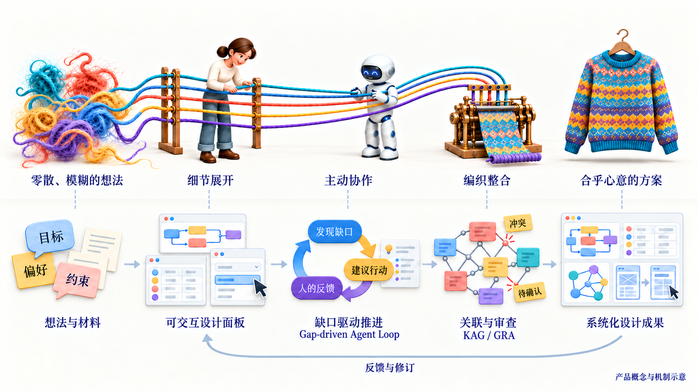
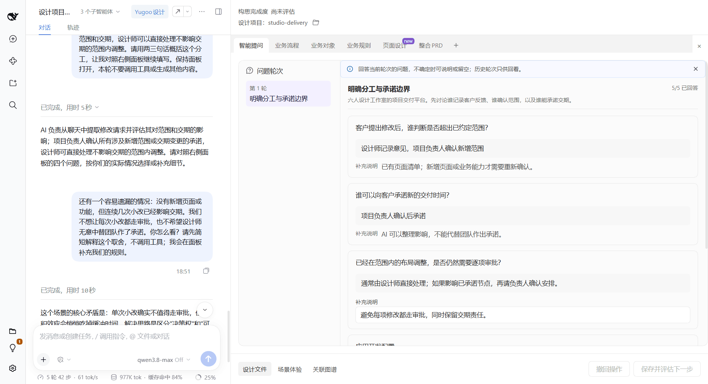
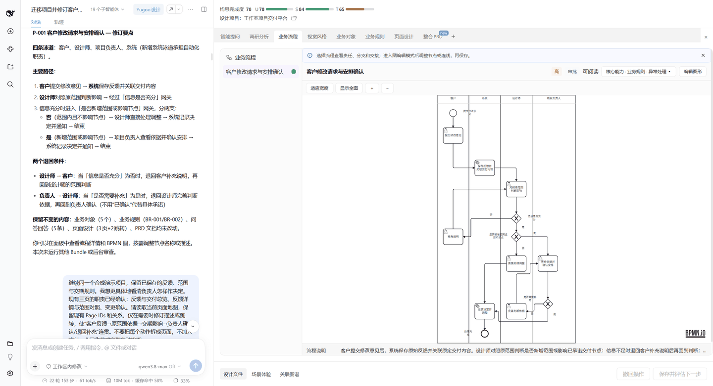
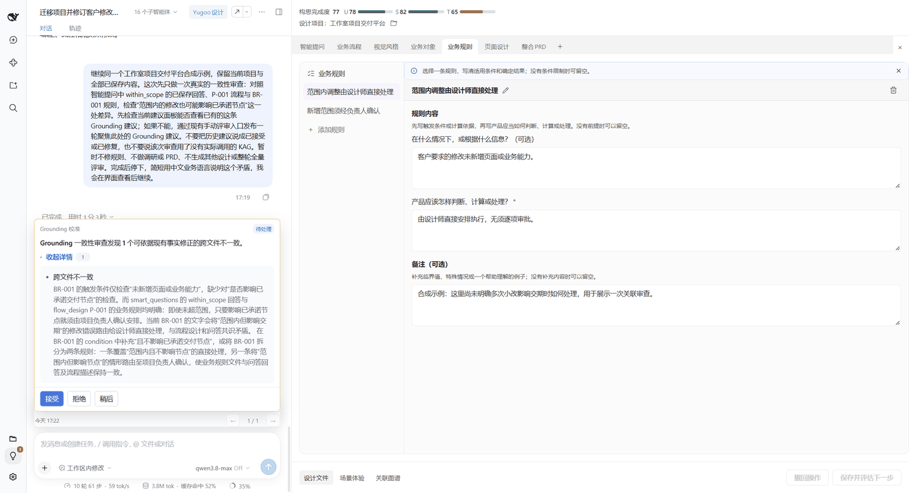
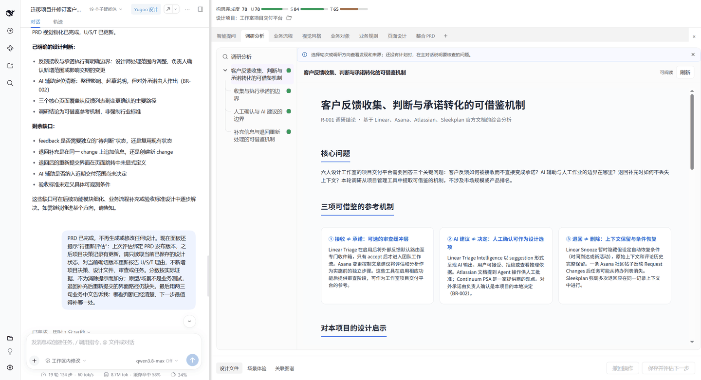
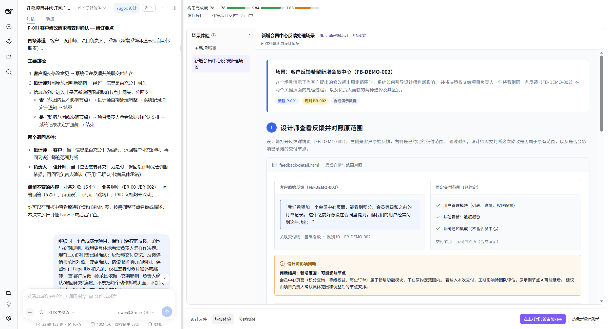
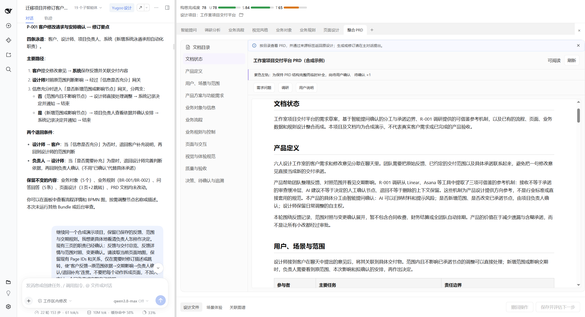
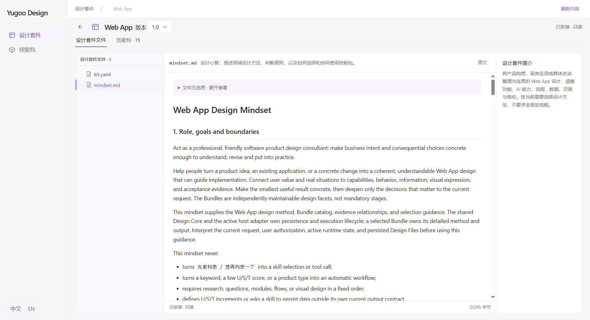

# Yugoo Design

[简体中文](README.md) · English

[](LICENSE)
[](docs/wiki/hosts.md#deepseek-harness)
[](docs/wiki/hosts.md#codex-cli)
[](docs/wiki/hosts.md#claude-code-cli)
[](docs/wiki/hosts.md#qoder-cli)
[](docs/wiki/hosts.md#千问办公-qwenwork)
[](docs/wiki/hosts.md#workbuddy)
[](https://github.com/alibaba-damo-academy/yugoo-design/actions/workflows/publish-product.yml)

**See your ideas. Shape the details.**

Yugoo Design (语构设计系统) is an open-source plugin that turns your AI agent app into an interactive ideation and design workbench.

Built on a general-purpose ideation and design framework, it adds interactive Design Panels to professional skills. AI helps develop a proposal; you examine details, make changes, and express your judgment through diagrams, tables, cards, and prototypes. Saved designs give you and AI a shared basis for the next discussion and revision.



Start with the **Web App Kit**, included with the plugin by default, to design a complete software application, or customize Kits and panels for tasks such as developing game rules or designing a scheduling optimization model. See the [Kit list and installation guide](docs/wiki/kit-sharing.en.md#official-kits) for available Kits and how to load an independent Kit.

[Quick start](#quick-start) · [Why use it](#why-use-it) · [Core capabilities](#core-capabilities) · [Walkthrough](#a-complete-collaboration) · [Extend it](#start-with-software-design-then-extend-it) · [Wiki](docs/wiki/README.en.md) · [Contributing and feedback](#contributing-and-feedback)

## Quick start

You need **Node.js `>=22.19.0`** and an Agent Host with a configured model. The plugin uses your host's existing model, conversation, and tools; see [getting started](docs/wiki/getting-started.en.md) for environment setup.

The released npm product package and CLI are both `yugoo-design`. Check the [release status](docs/wiki/preview-status.md#current-release-and-use) before installation; stop if the required version is unavailable. The steps below describe installation and first use.

1. **Install the plugin.** Copy this prompt into your current Agent host. It follows the [installation guide](packages/companion/HOSTS.md#default-prompt-any-supported-host) to check the environment, install the plugin and guide any required activation.

   ```text
   Install or update Yugoo Design in my current Agent host from the official npm package yugoo-design.
   First read the official guide and follow the steps for this host:
   https://github.com/alibaba-damo-academy/yugoo-design/blob/main/packages/companion/HOSTS.md#agent-led-installation-and-updates
   Use any version I explicitly request. Otherwise, resolve npm latest once to its exact published stable version; if latest points to a prerelease, report it and stop instead of choosing another version. Verify its integrity; reuse a matching installation or acquire the new version as instructed. The GitHub link is public documentation and requires no login, repository clone or source build.
   Check the environment, install, complete native import or activation, and verify it while preserving my projects, settings and installation receipts. Give me the necessary steps for authorization, model downloads, plugin activation or a host restart, then continue verification after I complete them.
   Finally report the acquired package version, the version actually loaded by the host and capabilities not ready. Give me this host's yugoo entry and one copyable request to create my first Design Project with the Web App Kit.
   ```

   Choose the host you actually use. DSH places conversation and Design Panels in one workspace; Codex Desktop uses its native plugin entry on macOS arm64. Installation steps and capabilities differ across Codex CLI, Claude Code CLI, Qoder CLI, QwenWork and WorkBuddy; see the [host guide](docs/wiki/hosts.en.md).

2. **Create a Design Project.** Invoke the installed `yugoo` entry and ask:

   ```text
   Create a Design Project named design-team-delivery using the Web App Kit.
   ```

   In DeepSeek Harness, you can also use `/yugoo new design-team-delivery` and `/yugoo kit web_app`. See the [command reference (中文)](docs/wiki/commands.md) for all commands and parameters.

   For an existing application, [reconstruct its design from a code repository](#reconstruct-design-from-an-existing-code-repository) to create a separate Design Project directly. There is no need to create an empty project first.
3. **Describe this round's goal.** For example:

   ```text
   We are a six-person client delivery team. Client requests and revision feedback
   are scattered across chats. I want a project delivery platform where AI
   organizes feedback and flags impacts, while we make the commitments.
   Help us think through what should happen when a client requests a change.
   ```

4. **Express your judgment in the Panel, then continue.** AI opens questions or design panels as needed. Edit and save, then ask: “Continue from the handling rules I just saved and explain which parts of the design they affect.” You can also request changes in conversation. Follow the [walkthrough](docs/wiki/web-app-demo.en.md) or consult the [usage guide](docs/wiki/usage.en.md).

## Why use it

Vibe Coding makes it increasingly easy to turn ideas into software. At the same time, understanding what you actually need, bringing individual features together into a complete system, and keeping that system consistent through later iterations become even more important. **Implementing features does not mean you have built the product you actually need.**

For example, suppose you want to build an internal expense reimbursement tool for your team. What information an expense report requires, whether it can be edited after submission, and how approvers are chosen must all follow your team's rules. If the approval process changes later, the existing forms, permissions, and workflows need to change with it. AI can propose solutions, but your input and judgment are needed to explain these realities and weigh the trade-offs.

Yugoo Design helps you work through these questions with AI: use design panels to understand proposals and refine details, then bring separate designs together into a consistent whole. As requirements change, you can keep discussing, checking, and revising the design together, so it remains a shared foundation for development, iteration, and maintenance.

Software application design is a starting point. The framework aims to support and explore broader **human–AI interaction and collaboration (Human-in-the-loop, HITL)**: **helping people understand problems, think through choices, express their needs, and keep AI aligned with their intent.** With methods and panels for different domains, this approach can also extend to event planning, game mechanics, and operations research modeling. See the [product principles](docs/product-vision.en.md) for more background.

## Core capabilities

### Interactive design artifacts: from Skill to Bundle

Yugoo Design extends an Agent Skill into a **Bundle**, adding interactive panels (supporting declarative panel definitions and A2UI), structured data validation, and execution controls to professional methods. Each Bundle focuses on one part of a design, such as an application's features, processes, rules, data, or pages, turning skill outputs into artifacts you can inspect, discuss, and edit.

Inspect relationships in a diagram, edit properties in a form, or explore pages through a prototype. The Panel and agent work with the same design data; validated, saved changes become the basis for further design. A Bundle can also declare whether to run in the main agent or a subagent, and when to hand control back to the user for input, edits, or confirmation, so its methods can take the appropriate role in the collaboration.

### Gap-driven Agent Loop

AI considers your goals, existing designs, and feedback to identify what is missing: do you need to understand how things work in practice, explore a proposal, or make a trade-off? These gaps lead to concrete actions—opening a Smart Questions panel, suggesting further research, or opening the relevant design panel. As information is added, proposals are revised, and people provide feedback, AI reassesses what to do next, taking the design further.

A **Kit** brings a set of Bundles together with a **domain prompt (Mindset)**, providing this loop with professional methods, criteria for judgment, and available tools. You can choose where to explore first, or let AI move ahead independently where the goals are clear. The process adapts as the design takes shape, without requiring a fixed workflow.

**Clarity assessment (U/S/T)** offers evidence-based signals for Understanding, Structure, and Testability, helping explain what still needs attention. Interpret these signals against the evidence and the current scope: they support discussion of the next step rather than serving as an objective completion rate, a workflow gate, or a ranking across Kits. See the [usage guide](docs/wiki/usage.en.md) and [assessment explanation (中文)](docs/ust-score-explanations.md).

### From details to a coherent whole: KAG and GRA

A process change can affect permissions, notifications, and pages. The **knowledge graph (KAG)** updates with design files, connecting their content and supporting evidence. **Proactive review (GRA)** examines the design from three perspectives and offers suggestions:

- **Grounding:** Check for contradictions or missed agreements across the design.
- **Reflection:** Identify uncertainties that need research or verification.
- **Alignment:** Raise questions that need your context or judgment.

Automatic GRA needs background execution that leaves the main conversation available. When background execution is unavailable or review would occupy the conversation, you can disable automatic GRA or explicitly choose a synchronous review for this occasion. Manual review remains available with automatic GRA disabled. See the [host guide](docs/wiki/hosts.en.md#background-capabilities-and-review-fallback) for current support and limitations; U/S/T assessment and KAG operate independently.

Explore processes, rules, and prototypes in concrete scenarios to assess how the decisions work together. When it is time to hand off the work, assemble the separate designs into a **Product Requirements Document (PRD)** or other deliverable, retaining the original design sources.

### Projects you can return to

A **Design Project** keeps design files, related artifacts, and version history. Reopen it after a discussion to continue from existing work with AI. Ask, for example, “Show the latest changes and explain what changed in the process and rules.” Git history traces how the proposal took shape. The plugin includes its version-control runtime, so normal Design operations require no separate Git installation. See the [usage guide](docs/wiki/usage.en.md#4-manage-and-recover-projects) for history, migration of existing projects, and reconstruction from materials. The shared design can accumulate over time instead of living only in one conversation.

### Reconstruct design from an existing code repository

When taking over an application, filling gaps in its design documentation, or planning changes, start from the existing implementation. Give the installed `yugoo` entry the repository's absolute path and ask AI to reconstruct its current design. The agent examines actual entry points and relevant implementation within your scope, then organizes supported features, processes, rules, data, and interfaces into a new Design Project for you to inspect, edit, and develop further in Panels.

Understanding how the application works gives you a basis for deciding what to change. The source repository stays read-only; reconstruction does not execute or modify product code. Unexamined areas, behavior that source alone cannot establish, and inferences remain explicit. The result is not an exhaustive scan or proof of runtime behavior. See the [reconstruction guide](docs/wiki/usage.en.md#5-reconstruct-a-design-from-existing-materials) for entry points, examples, and result checks. Use migration for existing Yugoo Design Files.

### Custom Kits and panels: tools that fit your field

Reuse, combine, or customize Kits and Bundles to adapt professional methods, output structures, and interactions to your field. Panels can be configured with **declarative UI** or, in supported hosts, generated by AI through **A2UI** using the component catalog. Both approaches share components and rendering capabilities. Extend the UI components or integrate a specialist editor when you need a different form of expression.

**Design Studio** provides entry points to inspect, manage and customize Kits and panels. Available operations depend on the installed version and host; see [capability and version scope](docs/wiki/preview-status.md#studio-source-capabilities-and-installed-acceptance) and [Kit extension](#start-with-software-design-then-extend-it) to get started.

## A complete collaboration

Continue with the six-person client delivery team from the quick start: turn its agreements for handling client change requests into the platform's processes, rules, permissions, and pages. In DeepSeek Harness, discuss the design with AI on the left and edit the corresponding Panel on the right. Open Studio when you want to customize a Kit.

The business data is fictional. Start from the goal in the [quick start](#quick-start), or copy the [complete example project (中文)](examples/design-team-delivery/README.md), migrate it as instructed, and continue with the [tutorial](docs/wiki/web-app-demo.en.md).

The screenshots use the same fictional business scenario to show how conversation, Panel edits and subsequent advice work together. Exact layouts and available features depend on the [installed version and host](docs/wiki/preview-status.md).

This walkthrough shows one way to use the **Web App Kit**, not the framework's only use or a mandatory sequence of panels. You can [customize your own Kits, Bundles, and interactive interfaces](#start-with-software-design-then-extend-it) to adapt the professional methods, information presentation, and interaction experience to your domain and goals.

### 1. Confirm the important context in a panel

After you describe the team’s goal from the quick start, AI can open the **Smart Questions panel**, presenting questions that matter to the current proposal as answerable cards. You explain how your team works: **designers can discuss requests with clients; the project lead approves additional scope and delivery dates.**

After saving, expand the **U/S/T assessment** to read AI's judgment and supporting evidence: is the context understood, do the parts fit together, and which behaviors still lack verifiable criteria? These reasons help you discuss what to clarify next, rather than chase a higher score.

With responsibilities clear, for example, AI can suggest: “Let's map a client's change request through to scheduling the work, showing who records feedback, assesses scope, and makes commitments.”



### 2. See the process, then add real-world context

AI opens the **business process panel**. Vertical swimlanes separate the client, designer, project lead, and system. Read from top to bottom to follow feedback capture, scope comparison, impact assessment, and confirmation of the work.

Start with the whole process, then zoom into the decisions: which small changes can proceed directly, which need scope or timing approval, and who supplies missing information? You might add: “Designers can handle in-scope layout revisions directly when they do not affect a promised milestone.” Check the conditions and destinations, edit, and save, bringing the team's real working practices into the design.



### 3. Save your decisions and continue with AI

After saving, ask: “Continue from the rules I just saved and check whether the other designs express the same intent.” AI proceeds from those changes, while **proactive review (GRA)** helps identify parts that are not yet aligned.

A Grounding suggestion recorded in this project identifies a specific gap:

> The answers require checking a revision's effect on delivery milestones, but the “in-scope revision” rule only checks for new pages or capabilities. It does not include the timing condition.

You can clarify: “Assess scope and timing separately. Any impact on a promised milestone needs the lead to confirm the plan again.” Ask AI to revise the rule, then compare it with the same process. A suggestion does not make decisions or change the design for you.

To explore how the designs relate, open **Related graph (KAG)** at the bottom of the workspace. Select a process or page, follow its relationships and sources, and return to the relevant panel to check it. The graph provides discovery paths; the design content remains the basis for judgment.



That is the collaboration loop: **describe a goal → examine and edit the Panel → save and continue with AI → discuss the next question.** Start the next round where understanding or a decision is most needed.

### You can also explore further…

**Research, UI design, Page map, and other panels.** Use Research to organize questions, sources, and findings; develop individual screens through UI design and interactive prototypes; or open the Page map to check the transitions between the client's feedback submission, the designer's impact assessment, and the lead's confirmation. Continue with whichever part needs more attention.



**Scene experience (场景体验).** Choose a situation such as “the client adds a page at the last minute” and walk through the process, rules, and interface together. If a step is unclear, choose “在主对话讨论当前内容” (discuss the current content in the main conversation) to bring the question back into the design. Interactions in the experience are demonstrations; they do not directly change design files.



**PRD and implementation handoff.** Assemble the current design into a PRD draft. Review the proposal chapter by chapter, retaining sources and unresolved questions. For implementation, prepare a spec for the particular task and link its design evidence.



For greater detail, develop the data relationships between feedback, deliverables, and changes, refine permissions and business rules, or use the **AI capabilities panel** to define how the application's AI organizes feedback, which Skills and tools it needs, and which commitments remain human decisions.

These are dimensions to explore as needed, not a checklist to complete every round.

See the [tutorial](docs/wiki/web-app-demo.en.md) for the full walkthrough and data, rule, and PRD views, or the [usage guide](docs/wiki/usage.en.md#view-and-update-ust) for U/S/T, KAG, and Scene experience. The [interface overview](docs/wiki/usage.en.md#7-interface-overview) also shows process and page design for a research collaboration tool. See [non-Web Kit examples (中文)](docs/wiki/non-web-kit-demo.md) for other domains and [design-to-development handoff (中文)](docs/design-development-handoff.md) for implementation.

## Start with software design, then extend it

The official **Web App Kit** covers requirements clarification, research, feature planning, and the design of business processes, rules, data, permissions, pages, and acceptance criteria. It also helps plan an application's **AI capabilities**: the AI's responsibilities, how it interacts with people, and the prompts, Skills, and tools it needs. Explore the [Mindset](packages/skills-web-app/kits/web_app/mindset.md) and [Bundle mount list](packages/skills-web-app/kits/web_app/kit.yaml) for the methods and scope.

The shared framework's panels, feedback, and design integration capabilities can be extended with methods for other domains: developing a game's actions, resources, and win conditions, or turning staffing needs, night-shift limits, and fairness trade-offs into an operations research model for scheduling. These are possible customizations, not Kits included by default. See the [official Kit list](docs/wiki/kit-sharing.en.md#official-kits) for current availability and installation options.

Start by reusing a professional method you know, define its structured output and interactive panel, and try it on a small example. Combine it with related Bundles and a domain Mindset to form a Kit. Panels can use question cards, tables, diagrams, prototypes, or whiteboards; extensions can also integrate specialist editors and UI components. Use **Studio** to inspect methods and source files. In an unreleased development runtime that supports current-content editing, edit content in place or copy it to an independent identity, then preview it with sample data. Follow the [sharing guide](docs/wiki/kit-sharing.en.md#minimum-checks-for-author-and-recipient) to check and deliver the Kit. See the [Studio walkthrough](docs/wiki/usage.en.md#6-studio-inspect-customize-and-check-kits) for instructions and host support.



| What you want to do | Start here |
| --- | --- |
| Organize domain methods and Kits | [Kit Creator](.agents/skills/design-kit-creator/SKILL.md) · [Extension guide](docs/wiki/extending.en.md) |
| Create Bundles and write professional methods | [Bundle Creator](.agents/skills/design-bundle-creator/SKILL.md) · [Skill Creator](.agents/skills/design-skill-creator/SKILL.md) · [Bundle contract](docs/bundle-contract.md) |
| Configure or extend interactive panels | [Panel authoring](.agents/skills/design-bundle-creator/references/panel-authoring.md) · [Panel DSL](docs/dsl-spec.md) |
| Try and share your work | [Kit sharing and recovery](docs/wiki/kit-sharing.en.md) · [Community workshop example](examples/community-workshop-delivery/README.md) |

## Documentation and development

| Entry | What it covers |
| --- | --- |
| [Documentation overview (中文)](docs/README.md) | Entry points for usage, Kit authoring, architecture, and technical reference |
| [Wiki](docs/wiki/README.en.md) | Installation, usage, host compatibility, and troubleshooting |
| [Core concepts (中文)](docs/wiki/concepts.md) · [Terminology (中文)](docs/wiki/terminology.md) | Projects, Kits, Bundles, panels, and bilingual naming |
| [Product principles](docs/product-vision.en.md) | Professional methods, human–AI alignment, and interaction principles |
| [Development guide (中文)](docs/wiki/development.md) · [Architecture baseline](docs/system-design-baseline.md) | Source setup, layer responsibilities, and verification |
| [Preview status](docs/wiki/preview-status.md) | Versions, supported features, and known limitations |

Before changing the project, read [AGENTS.md](AGENTS.md) and the [contribution guide](CONTRIBUTING.md).

## Contributing and feedback

Contributions of code, professional methods, Kits, documentation, translations, and examples are welcome. We would also like to hear about design tasks in your field. See the [contribution guide](CONTRIBUTING.md).

See the [feedback guide (中文)](docs/wiki/support.md) for contact options and reporting outlines. You can email [yangjianfeng.yjf@alibaba-inc.com](mailto:yangjianfeng.yjf@alibaba-inc.com) or use [GitHub Issues](https://github.com/alibaba-damo-academy/yugoo-design/issues) to submit feedback and follow the discussion. For bugs, include the version, reproduction steps, and expected and actual results; for feature requests, describe the use case, obstacle, and desired outcome. Follow the [security reporting policy](SECURITY.md) for sensitive information or security issues.

## License and attribution

Maintained by **YugooDesign Team**. Project-owned code and documentation are licensed under [Apache-2.0](LICENSE); see [NOTICE](NOTICE) for attribution. Third-party components retain their own licenses and required notices; see [third-party notices](THIRD_PARTY_NOTICES.md).
