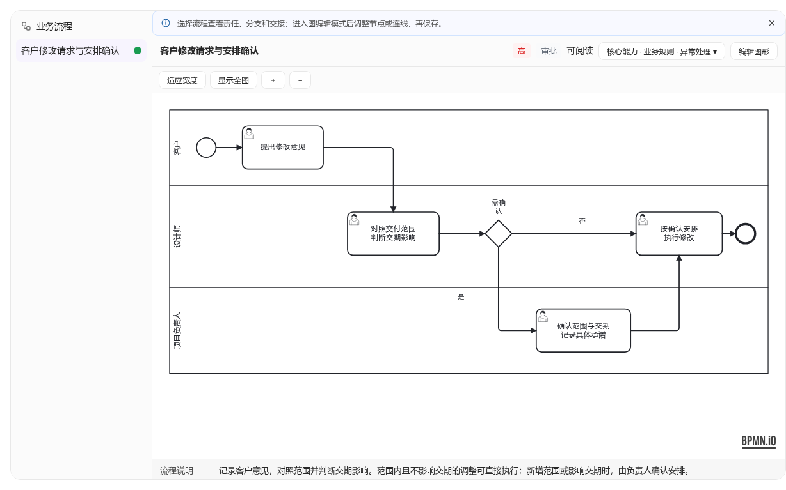
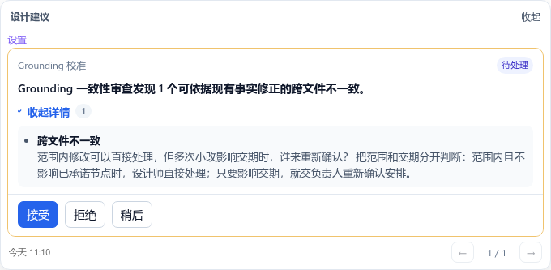
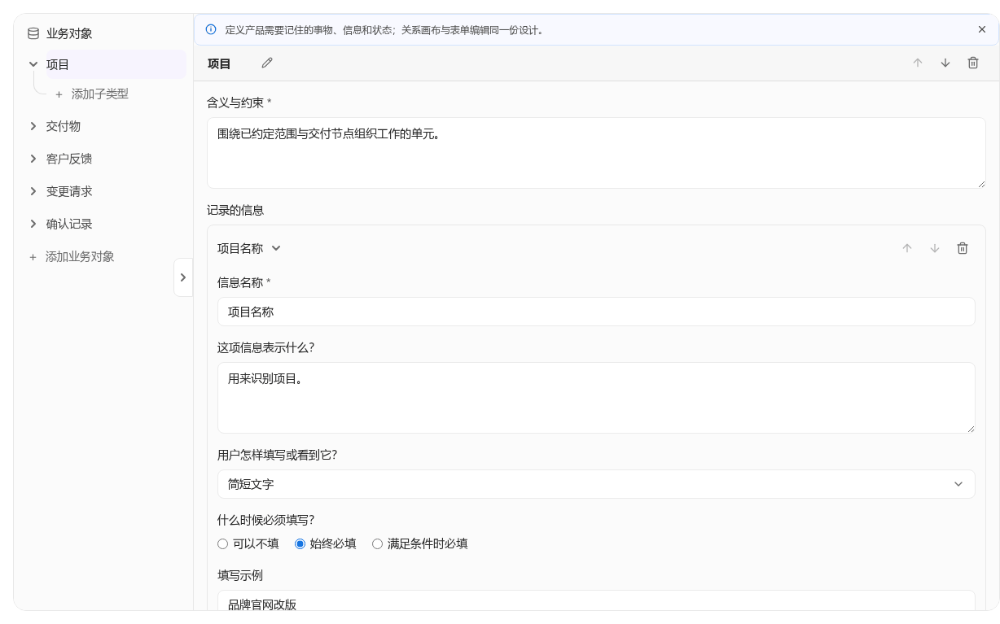

# 语构设计系统（Yugoo Design）

**让构思看得见，让细节有把握。**

简体中文 · [English](README.en.md)

[](LICENSE)
[](docs/wiki/hosts.md#deepseek-harness)
[](docs/wiki/hosts.md#codex-cli)
[](docs/wiki/hosts.md#claude-code-cli)
[](docs/wiki/hosts.md#qoder-cli)
[](docs/wiki/hosts.md#千问办公-qwenwork)
[](docs/wiki/hosts.md#workbuddy)

语构设计系统（Yugoo Design）是一款兼容主流 AI 智能体（Agent）应用的开源插件，为专业技能配上可交互的设计面板（Design Panel）。AI 帮你展开方案，你在图、表、卡片与原型中看清细节、表达判断；保存后的设计成为继续讨论和完善的共同依据。


你可以先用默认随插件交付的 **Web App Kit** 设计完整的软件应用，也可以定制套件与面板，用于推敲游戏规则、设计排班优化模型等任务。[官方套件清单与获取指引](docs/wiki/kit-sharing.md#official-kits)列出其他套件的用途与实际接入范围。

[快速开始](#快速开始) · [为什么需要它](#为什么需要它) · [核心能力](#核心能力) · [协作示例](#一次完整的协作) · [扩展套件](#从应用设计开始按需扩展) · [Wiki](docs/wiki/README.md) · [贡献与反馈](#参与与反馈)

## 快速开始

**环境要求：** 当前 npm 预览版需要 Node.js `>=22.19.0 <23`，以及已配置生成模型的兼容 Agent 宿主。KAG 的本地文本向量化（Embedding）使用 CPU，无需 GPU；依赖安装与模型准备见[安装指南](docs/wiki/getting-started.md)。版本管理运行库随包提供，正常设计操作无需另装 Git；平台与验证范围见[预览状态](docs/wiki/preview-status.md)。

> **发行预览：** 最近一次登记的公开版本为 `@yugoo-design/companion@0.1.0-beta.3`（2026-10-17 UTC）。当前默认套件为 Web App；历史 npm 发行、后续本地候选和逐宿主验收分别记录于[预览状态](docs/wiki/preview-status.md)。安装时解析所选渠道的精确版本，并遵循其随包说明；接入范围见[宿主兼容](docs/wiki/hosts.md)。

1. **让当前宿主中的 Agent 安装插件。** 复制[通用安装提示词](packages/companion/HOSTS.md#default-prompt-any-supported-host)，由 Agent 获取精确 npm 版本，再按当前宿主安装所需组件；无需分别安装 DSH 与 Companion。只有无法确认宿主或必须人工授权、导入、启用时才补充必要操作。宿主要求的重启或新会话按提示完成。环境准备、专用入口与人工兜底见[安装指南](docs/wiki/getting-started.md)。
2. **创建或打开设计项目，描述你的目标。** 通过宿主中已安装的 `yugoo` 入口开始。例如：

   ```text
   我们是六人的设计工作室，客户需求和修改意见都在聊天里。
   想做一个项目交付平台，让 AI 帮忙整理反馈、提示影响，
   关键承诺由我们决定。先一起想清楚客户提出修改后应该怎样处理。
   ```

3. **查看面板，反馈并保存。** 在面板中检查和修改可编辑内容，也可以通过对话提出调整。保存后，让 AI 接着这些修改继续设计。完整操作见[使用指南](docs/wiki/usage.md)。

插件沿用宿主的生成模型、会话与工具。接入范围涵盖 Codex CLI、Claude Code CLI、Qoder CLI 等环境，并在持续扩展。**DeepSeek Harness** 这类支持界面定制的宿主，可以把对话、面板与设计工作室（Studio）放在同一工作区；其他宿主通过浏览器使用面板。**桌面端目前只有 DeepSeek Harness（DSH）能够承载完整功能与一体化交互体验**；其他桌面宿主按各自已验证的能力范围使用。ChatGPT 桌面应用（Codex 模式）接入列为第二轮开发目标，Claude Code 桌面端尚未测试。具体版本和能力范围见[宿主指南](docs/wiki/hosts.md)。

## 为什么需要它

Vibe Coding 让把想法变成软件越来越容易。与此同时，想清楚真正需要什么、让各项功能组成完整的系统，并在后续迭代中保持一致，变得更加重要。**把功能实现出来，并不意味着做出了真正需要的产品。**

例如，你想给团队做一套内部报销工具。报销单要填哪些信息、提交后能否修改、审批人如何确定，都要符合团队自己的规则。以后审批方式变了，原有的表单、权限和流程也需要配合调整。AI 可以提出方案，但这些实际情况和取舍，需要你参与表达和判断。

Yugoo Design 帮助你与 AI 一起把这些问题想清楚：通过具体面板理解方案、推敲细节，再把分散的设计组织成一致的整体。需求变化时，你们可以继续讨论、检查和修订，让共同的设计持续成为开发、迭代与维护的依据。

软件应用设计是一个起点。这套框架希望支持更普遍的**人在回路中（Human-in-the-loop，HITL）**协作：**帮助人理解问题、思考选择、表达诉求，并让 AI 持续与人的意图对齐。** 配合不同领域的方法与面板，这套协作方式也可以用于活动策划、游戏机制设计、运筹建模等任务。更多背景见[产品理念](docs/product-vision.md)。

## 核心能力

### 可交互的设计成果：从 Skill 到 Bundle

语构设计系统将智能体技能（Agent Skill）扩展为**设计技能包（Bundle）**，为专业方法加上交互面板、结构化数据校验和执行控制。每个 Bundle 聚焦一部分设计，例如应用的功能、流程、规则、数据或页面，把技能产出变成可查看、可讨论、可修改的成果。

你可以在图中查看关系，在表单中修改属性，或通过原型体验页面。面板与 Agent 使用同一份设计数据；经过校验和保存的修改，会成为后续构思的依据。Bundle 还可以声明由主 Agent 或子智能体（Subagent）运行，以及何时交还给用户补充、修改或确认，让专业方法按适合的方式参与协作。

### 缺口驱动的持续构思：Gap-driven Agent Loop

AI 结合你的目标、已有设计和反馈，判断当前还缺什么：是需要了解实际情况、推敲一个方案，还是请你作出取舍？这些缺口会转化为具体行动——展开智能提问（Smart Questions）面板、建议进一步调研，或打开相应的设计面板。随着信息补充、方案修改和人的反馈，AI 重新判断下一步，让构思持续深入。

**设计套件（Kit）**将一组 Bundle 与**领域主提示词（Mindset）**组织在一起，为这个循环提供专业方法、判断依据和可用工具。你可以决定先深入哪里，也可以让 AI 在目标明确的部分自主推进；整个过程随着设计逐渐清晰而调整，无须遵循固定流程。

### 从局部到整体：KAG 与 GRA

改了一条流程，权限、通知和页面可能都要随之调整。**知识图谱（KAG）**随设计文件更新，关联不同部分的内容与依据。**主动审查（GRA）**从三个视角检查设计并提出建议：

- **一致性审查（Grounding）**：检查各部分设计是否相互矛盾或遗漏了约定。
- **知识反思（Reflection）**：发现需要进一步研究、查证的疑点。
- **意图对齐（Alignment）**：提出需要你补充背景或作出判断的问题。

自动 GRA 需要能保持主对话可用的后台执行。已检查的千问办公（QwenWork）`1.3.2` 桌面版关闭后台 Agent；WorkBuddy `5.8.3` 的用户实测中，原生异步评审仍占用主对话。后台不可用或仍占用对话时，共享实现先让你选择“关闭自动 GRA”或“本次在主对话同步评审（会占用对话）”；关闭自动 GRA 后仍保留手动评审。**千问办公的本地 beta.18 候选已完成一次经用户确认的前台 G/R/A 评审；WorkBuddy 的对应流程与后台能力仍分别待验收。** U/S/T 评估和 KAG 不因此停用。精确候选、方法与范围见[宿主兼容](docs/wiki/hosts.md#后台能力与评审降级)。

结合具体场景查看流程、规则和原型，可以继续推敲这些决定能否配合。需要交接时，再把分散的设计整合成产品需求文档（PRD）等成果，并保留原始设计依据。

### 可以继续的设计项目

**设计项目（Design Project）**保存设计文件、相关产物和版本记录。一次讨论结束后，你可以重新打开项目，和 AI 接着已有成果推进；通过 Git 历史追溯修改，了解当前方案如何形成。共同的设计因此能够持续积累，而不只存在于某一次对话里。

### 定制套件与交互面板：让工具适合你的领域

你可以复用、组合或定制 Kit 与 Bundle，调整专业方法、成果结构和交互方式，为自己的领域构建设计工具。面板可以通过**声明式 UI** 预先配置，也可以在支持的宿主中由 AI 通过 **A2UI** 从组件目录生成。两种方式共用组件与渲染能力；需要专门的表达时，还可以扩展 UI 组件或接入专业编辑器。

**Studio** 提供查看、管理与定制入口，让方法和面板可以持续完善、重复使用。如何开始见[套件扩展](#从应用设计开始按需扩展)。

## 一次完整的协作

下面是已有科研协作示例在 DeepSeek Harness 中的界面：左侧保留对话与设计建议，右侧展开业务流程。你可以一边讨论，一边对照具体设计。


*上图保留已有版本的宿主对话与面板界面；页面地图与 PRD 面板见[界面概览](docs/wiki/usage.md#7-界面概览)。下方截图与短动图使用当前共享面板和 Studio，展示工作室项目交付平台的合成示例。*

> **演示范围：** 示例数据、设计建议和 PRD 为演示而编排，在隔离的本地项目中呈现。短动图展示界面操作片段；生成、保存后继续及后台审查的支持范围见[宿主指南](docs/wiki/hosts.md)。

以下是当前源码的 DeepSeek Harness 命令；旧安装版按随包帮助使用对应入口（`mindset` 是旧名）。创建项目并手动启用 Web App Kit：

```text
/yugoo new studio-delivery
/yugoo kit web_app
```

也可以先描述目标，让 Agent 结合已有设计选择合适的 Kit。其他宿主使用各自的 `yugoo` 技能或工具入口，见[宿主指南](docs/wiki/hosts.md)。

### 1. 在面板中确认关键背景

你提出快速开始中的工作室想法后，AI 可以打开 **Smart Questions 面板**，把影响当前方案的问题呈现为可作答的卡片。你补充实际分工：**设计师可以与客户讨论，项目负责人确认新增范围和交期。**

保存后，AI 建议：“先把客户提出修改到安排执行的过程画出来，看看谁记录意见、谁判断范围、谁作出承诺。”


### 2. 看见流程，再补充真实情况

AI 展开**业务流程面板**，用泳道图区分客户、设计师与负责人，呈现反馈记录、范围对照、影响评估和确认安排。

看到所有修改都经过负责人，你补充：“已有范围内的布局调整可以由设计师直接处理；新增页面或业务能力才需要讨论范围。”AI 修订流程分支，你对照面板继续讨论、修改并保存，让实际工作方式进入设计。



### 3. 用一条建议，检查前后是否一致

在支持 GRA 的宿主中，设计推进后可能出现这样的**设计建议**：

> 你允许设计师直接处理范围内的修改，同时要求负责人确认交期。如果大量范围内修改影响了已承诺的交付节点，应该怎样处理？

你进一步决定：“范围和交期分开判断；只要影响已承诺节点，就交负责人重新确认安排。”请 AI 修订相应规则与流程，再在面板中检查。一次关联审查，帮助你想清楚此前没有单独表达的取舍。



### 4. 按需要展开其他部分

接着，你们可以设计反馈、交付物和变更之间的数据关系，客户与团队的权限，以及查看影响、确认安排的页面。也可以展开 **AI 能力面板**，明确应用中的 AI 如何整理反馈、起草影响说明，需要哪些 Skills 和工具，以及哪些承诺仍由人作出。

这些内容各自有对应面板，KAG 帮助查找它们之间的关联。下一步围绕当前需要理解和决定的问题展开。



### 5. 把设计整合为 PRD

这一轮设计清楚后，你提出：“把当前设计整合成一份 PRD，保留各部分的依据和未决问题。”AI 打开 **PRD 面板**，组织已有的需求、流程、页面、权限与 AI 能力设计。你可以浏览目录、追溯来源；发现问题，再回到对应面板修改。

进入开发时，再结合具体任务和开发项目的规范准备 spec，关联相应的设计依据。照着练习见[完整协作教程](docs/wiki/web-app-demo.md)，交接方式见[设计到开发交接](docs/design-development-handoff.md)，其他领域的已有记录见[非 Web Kit 演示](docs/wiki/non-web-kit-demo.md)。


## 从应用设计开始，按需扩展

官方提供开箱即用的 **Web App Kit**，覆盖需求澄清、调研、功能规划，以及业务流程、规则、数据、权限、页面和验收等设计。它也支持规划应用中的 **AI 能力**：AI 承担什么职责、怎样与人交互，以及需要哪些提示词、Skills 和工具。具体方法见 [Mindset](packages/skills-web-app/kits/web_app/mindset.md) 与 [Bundle 挂载清单](packages/skills-web-app/kits/web_app/kit.yaml)。

共享框架中的交互面板、反馈与设计整合能力，可以配合不同领域的方法继续扩展。例如，把游戏里的行动、资源和胜负规则做成可推敲的设计；或把排班所需的人手、夜班限制和公平取舍整理成运筹优化模型。游戏设计仍是扩展方向；**决策与运筹建模（Decision Modeling）Kit** 暂用于内部验证，不随默认产品发行，也不包含在公开源码中。默认套件与独立 Kit 的接入说明见[官方套件清单](docs/wiki/kit-sharing.md#official-kits)。

你可以先复用一项熟悉的专业方法，为它定义结构化成果和交互面板，用小样例验证后，再与相关 Bundle、领域 Mindset 组合成 Kit。面板可以使用问题卡片、表格、图、原型、白板，也可以通过扩展接入专业编辑器和 UI 组件。**Studio** 提供查看、管理方法与源文件、定制工作副本的入口，具体创作能力以安装版本为准；操作见 [Studio 指南](docs/wiki/usage.md#6-studio查看定制和检验套件)，分享前完成[作者与接收者验证](docs/wiki/kit-sharing.md#作者与接收者的最小验证)。


| 想做什么 | 从这里开始 |
| --- | --- |
| 组织领域方法与套件 | [Kit Creator](.agents/skills/design-kit-creator/SKILL.md) · [扩展指南](docs/wiki/extending.md) |
| 创建 Bundle、编写专业方法 | [Bundle Creator](.agents/skills/design-bundle-creator/SKILL.md) · [Skill Creator](.agents/skills/design-skill-creator/SKILL.md) · [Bundle 契约](docs/bundle-contract.md) |
| 配置或扩展交互面板 | [Panel 创作指南](.agents/skills/design-bundle-creator/references/panel-authoring.md) · [Panel DSL](docs/dsl-spec.md) |
| 试用与分享 | [Kit 分享与恢复](docs/wiki/kit-sharing.md) · [社区工作坊示例](examples/community-workshop-delivery/README.md) |

## 文档与开发

| 入口 | 内容 |
| --- | --- |
| [Wiki](docs/wiki/README.md) | 安装、使用、宿主兼容与排障 |
| [核心概念](docs/wiki/concepts.md) · [术语规范](docs/wiki/terminology.md) | 项目、套件、技能包、面板及中英文命名 |
| [产品理念](docs/product-vision.md) | 专业方法、人机对齐与交互原则 |
| [开发指南](docs/wiki/development.md) · [架构基线](docs/system-design-baseline.md) | 源码环境、分层职责与验证流程 |
| [预览状态](docs/wiki/preview-status.md) | 候选身份与验证范围 |

修改项目前，请阅读 [AGENTS.md](AGENTS.md) 与[贡献指南](CONTRIBUTING.md)。

## 参与与反馈

欢迎贡献代码、专业方法、套件、文档、翻译和实例，也欢迎分享你所在领域的构思任务。参与方式见[贡献指南](CONTRIBUTING.md)。

反馈问题时，请提供使用版本、操作步骤、预期与实际结果，见[反馈指南](docs/wiki/support.md)。联系邮箱：[yangjianfeng.yjf@alibaba-inc.com](mailto:yangjianfeng.yjf@alibaba-inc.com)。涉及敏感信息或安全问题，请按[安全报告政策](SECURITY.md)处理。

## 许可证与作者

本项目由 **YugooDesign Team** 维护。项目自有代码和文档采用 [Apache-2.0](LICENSE)，署名见 [NOTICE](NOTICE)。第三方组件保留各自的许可证和必要声明，见[第三方说明](THIRD_PARTY_NOTICES.md)。
