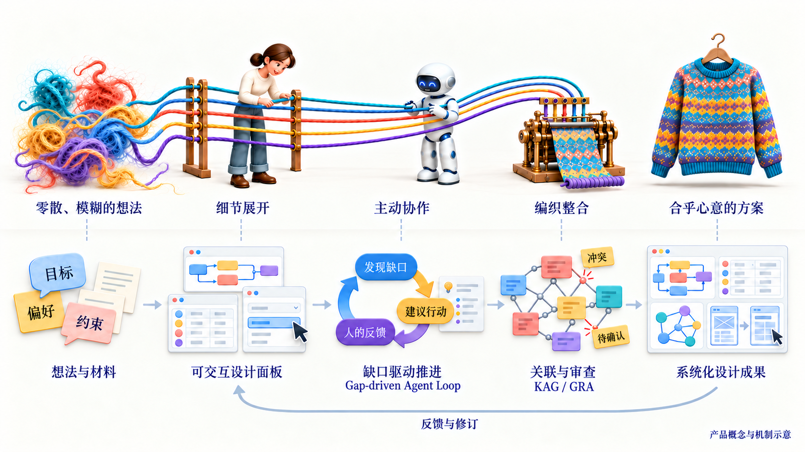
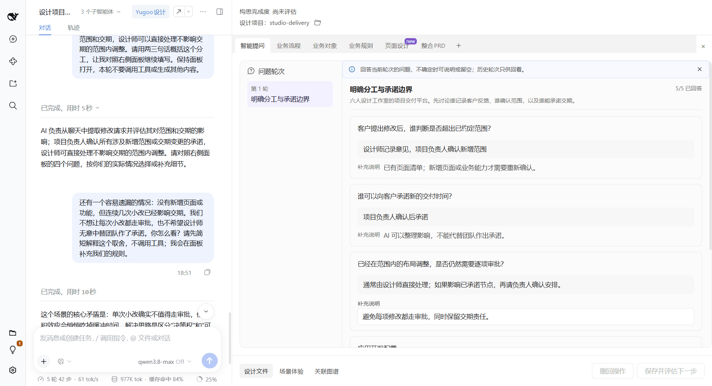
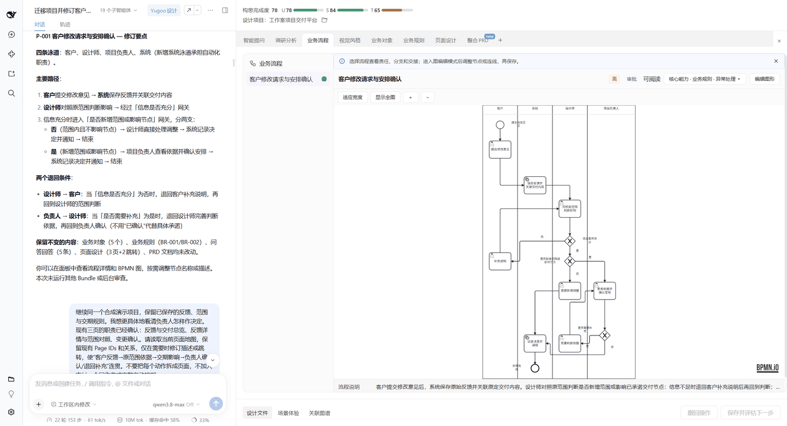
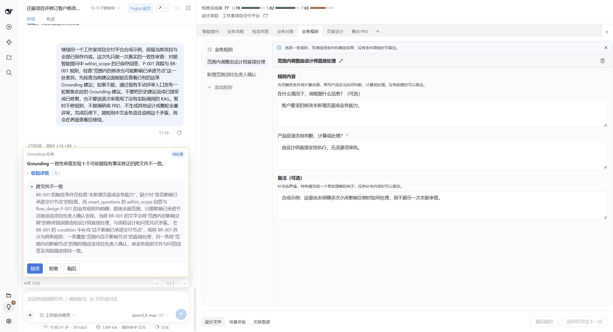
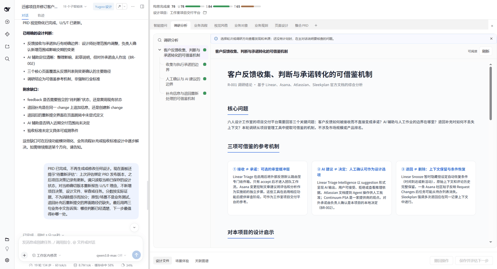
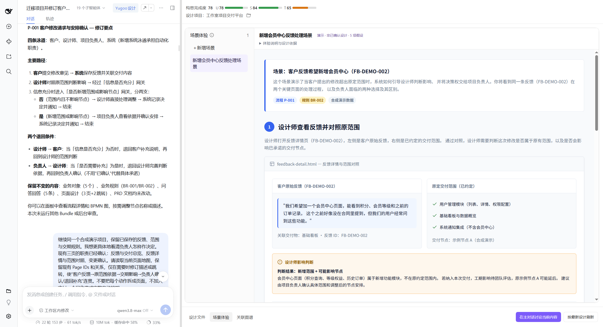
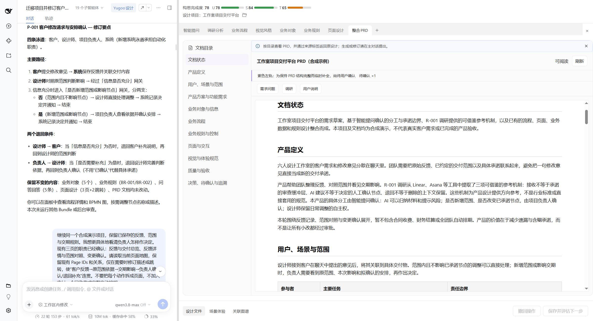
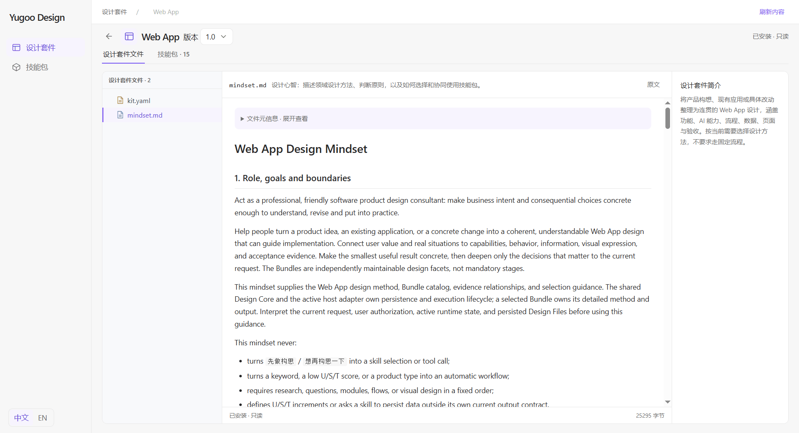

# 语构设计系统（Yugoo Design）

简体中文 · [English](README.en.md)

[](LICENSE)
[](docs/wiki/hosts.md#deepseek-harness)
[](packages/companion/hosts/codex-desktop/README.md)
[](docs/wiki/hosts.md#codex-cli)
[](docs/wiki/hosts.md#claude-code-cli)
[](docs/wiki/hosts.md#qoder-cli)
[](docs/wiki/hosts.md#千问办公-qwenwork)
[](docs/wiki/hosts.md#workbuddy)
[](https://github.com/alibaba-damo-academy/yugoo-design/actions/workflows/publish-product.yml)

**让构思看得见，让细节有把握。**

语构设计系统（Yugoo Design）是一款开源插件，能将你熟悉的 AI 智能体（Agent）应用升级为交互式构思设计工作台。

它为专业技能（Agent Skill）配上可交互的设计面板（Design Panel）。你可以一边与 AI 讨论，一边在图、表、卡片和原型中查看方案、比较选择，直接修改并表达自己的判断。

AI 像专业顾问一样，结合你的目标、已有成果和反馈，帮助你澄清问题、推荐下一步，并在整合不同部分的设计时查缺补漏，逐步形成完整方案。

设计成果与相关资料保存在独立的项目文件夹中。想法有了变化，或需要继续深入时，你可以回到项目，修改内容、比较版本，在已有成果上继续完善。



随插件提供的 **Web App Kit**，以 Vibe coding 前的应用构思为例，展示这套协作方式。你可以用它从需求出发，逐步推敲功能、流程、规则与界面；也可以改造这套 Kit，或为活动策划、游戏规则、排班优化等工作创建新的 Kit 与面板。当前可用套件与获取方式见[套件清单与获取指引](docs/wiki/kit-sharing.md#official-kits)。

[官网](https://yugoo.org/zh/) · [常见问题](https://yugoo.org/zh/faq/)

[快速开始](#快速开始) · [为什么需要它](#为什么需要它) · [核心能力](#核心能力) · [协作示例](#一次完整的协作) · [扩展套件](#从应用设计开始按需扩展) · [Wiki](docs/wiki/README.md) · [贡献与反馈](#参与与反馈)

## 快速开始

准备好 **Node.js `>=22.19.0`**，以及一个已配置模型的智能体宿主（Agent Host）。插件沿用宿主已有的模型、会话与工具；安装环境见[开始使用](docs/wiki/getting-started.md)。

统一 npm 产品包和命令行入口均为 `yugoo-design`。安装前请核对[发行状态](docs/wiki/preview-status.md#current-release-and-use)；所需精确版本不存在时停止安装。下列步骤说明安装与首次协作。

1. **安装插件。** 将下面的[通用提示词](packages/companion/HOSTS.md#default-prompt-any-supported-host)复制给当前宿主的智能体（Agent）。它会获取 npm 产品包，再完成当前宿主的接入与启用。

   ```text
   请在我当前的 Agent 宿主中安装或更新语构设计系统（Yugoo Design）。
   先复用匹配的已有安装；需要新版本时，在持久目录使用 pnpm 获取 npm 正式包 yugoo-design。优先使用我指定的版本，否则将 latest 解析为精确稳定版本，核对该版本的安装前提及完整性，准备缺少的 Node、pnpm 后执行 pnpm add --save-exact yugoo-design@<解析版本>。如果 latest 指向预发布版本，请说明并停止。
   读取安装目录下 node_modules/yugoo-design/README.md，运行 pnpm exec yugoo-design --help，识别当前宿主并使用对应的 install --host 路径。自行发现本机所需参数，完成注册或导入及启用。需要我操作界面时，给出准确位置和本次生成的文件或配置，完成后继续验证 yugoo 入口与工具。
   保留项目、设置与安装回执。只有随包说明未解决的具体问题才查 GitHub 文档，不克隆或源码构建。最后报告安装及实际加载版本、未完成步骤，并给出第一条 Web App Kit 项目请求。
   ```

   选择你实际使用的宿主。DSH 将对话与设计面板放在同一工作区；Codex Desktop 使用 macOS arm64 的原生插件入口。Codex CLI、Claude Code CLI、Qoder CLI、千问办公（QwenWork）和 WorkBuddy 的安装方式、面板呈现与后台审查支持有所不同，见[宿主指南](docs/wiki/hosts.md)。

2. **创建设计项目。** 调用已安装的 `yugoo` 入口，直接请求：

   ```text
   新建一个名为 design-team-delivery 的设计项目，使用 Web App 设计套件。
   ```

   DeepSeek Harness 也可以使用 `/yugoo new design-team-delivery` 和 `/yugoo kit web_app`；完整命令与参数见[命令参考](docs/wiki/commands.md)。

   已有应用时，可直接[从现有代码仓库重建设计](#从现有代码仓库重建设计)，由重建入口创建独立项目，无需先新建空项目。
3. **说出这轮目标。** 例如：

   ```text
   我们是六人的项目交付团队，客户需求和修改意见都在聊天里。
   想做一个项目交付平台，让 AI 帮忙整理反馈、提示影响，
   关键承诺由我们决定。先一起想清楚客户提出修改后应该怎样处理。
   ```

4. **在面板里表达判断，再继续。** AI 根据当前需要展开提问或设计面板。你可以修改内容并保存，再说：“按我刚保存的处理规则继续，说明它会影响哪些设计。”也可以在对话中提出修改。跟着[协作教程](docs/wiki/web-app-demo.md)练习，日常操作查[使用指南](docs/wiki/usage.md)。

### 从现有代码仓库重建设计

接手已有应用、补齐设计资料或准备改版时，可以从现有实现开始。通过已安装的 `yugoo` 入口提供代码仓库的绝对路径，请 AI 还原现有设计。Agent 按目标查看真实入口与相关实现，将有证据支持的功能、流程、规则、数据和界面等内容整理到新的设计项目中，供你在面板里核对、修改和继续推敲。

这让“现在怎样工作”成为讨论“接下来怎样改”的依据。原仓库保持只读，重建不执行或修改产品代码；没有检查的内容、源码无法确认的行为和推断会保留说明，不将重建结果当作完整扫描或运行验收。入口、示例和结果检查见[重建指南](docs/wiki/usage.md#5-从既有材料重建设计)；已有 Yugoo 设计文件则使用迁移入口。

## 为什么需要它

Vibe coding 和 Vibe working 能很快给出结果。我们关心的是：**怎样让人有效参与方案形成的过程，让 AI 的产出更符合我们的真实需要？**

构思设计需要深入细节，也需要从全局梳理信息、协调各部分之间的关系。我们既需要专业方法的引导，也需要充分的空间，自由表达想法、补充实际情况、作出判断。

对话问答能够澄清很多事情。但涉及多条流程、相互影响的规则或几种备选方案时，仅靠文字往往不容易看清关系、发现遗漏和表达选择。有些需求直到看到结果才逐渐清楚，于是又要经历一轮轮修改。讨论中的决定散落在聊天记录里，后续需求变化时，重新梳理和维护整个方案也变得困难。

例如，给团队做一套报销应用，表单字段、提交后能否修改、审批人如何确定，都要符合团队自己的规则。对照一张流程图和对应的规则，你更容易指出：“审批前可以直接修改；审批后要改动，就需要重新提交。”当审批方式改变时，也能继续检查表单、权限和通知是否需要一起调整。**功能实现得再快，仍然需要你参与判断，才能让方案符合团队的实际需要。**

语构希望让人与 AI 的互动协作（Human-in-the-loop，HITL）更直观。我们用适合内容的交互帮助你理解、思考和表达，让 Agent 用专业方法主动引导下一步，并借助自动关联与审查，帮助协调、完善各部分设计，再把成果保存在项目中持续维护。这套构思设计框架可以配合不同领域的方法与面板使用；软件设计是一个起点，活动策划、游戏机制设计、运筹建模等工作也可以采用这样的协作方式。更多背景见[产品理念](docs/product-vision.md)。

## 核心能力

### 可交互的技能包：让信息以合适的形式呈现

流程适合画成图，规则可以放进表格，备选方案可以用卡片并排比较，界面可以通过原型体验。我们希望为不同的信息选择合适的表达与交互方式，帮助你看懂细节、思考它们之间的关系，也更方便表达自己的判断。

语构将智能体技能（Agent Skill）与适合其内容的面板结合，扩展为 **设计技能包（Bundle）**。每个 Bundle 聚焦一种工作或一个设计维度，组织专业方法、结构化成果、数据校验和执行声明。面板可以通过 **声明式 UI** 预先定义，也可以在支持的宿主中由 AI 通过 **A2UI** 从组件目录生成。

面板与 Agent 使用同一份设计数据。你可以边看边讨论，也可以直接修改；经过校验和保存的内容，会成为 AI 继续工作的依据。

### 主动式专业引导：围绕目标与缺口推进

好的专业指导，需要了解你的目标、已经完成的工作，以及还有哪些问题没有解决，再 **主动推荐** 合适的方法，帮助你继续推进。

为此，语构采用缺口驱动循环（Gap-driven Agent Loop），让 AI 像顾问一样有目的地推进工作。它结合已有成果和反馈推荐下一步：例如，在背景澄清问答后，根据实际情况建议开展外部调研，或深入某部分的细节设计。你补充实际情况、修改方案或作出选择后，AI 再据此调整建议。

**设计套件（Kit）** 将相关 Bundle 与**领域主提示词（Mindset）** 组织在一起，为 AI 提供专业方法、判断依据和可用工具。你可以选择先深入哪里，也可以让 AI 在目标明确的部分自主推进。专业方法提供引导，你仍然可以补充背景、提出新的想法，或调整当前方向。具体怎样展开，由套件的方法、当前目标与你的反馈共同决定。

### 信息关联与自动审查：KAG 与 GRA

各部分分别看起来合理，放在一起仍可能有遗漏或矛盾，这是复杂构思设计中的常见难题。改了一条流程，权限、通知和页面可能都需要跟着调整，而 AI 也未必能一次完成所有相关修改、保持整个方案自洽。

为此，语构为项目构建 **知识图谱（KAG）**，随设计文件的变化更新，将不同部分的内容与依据关联起来，帮助你和 AI 沿关系找到需要核对的地方。GRA 从三个视角检查设计并提出建议，帮助你发现需要一起核对和调整的地方：

- **一致性审查（Grounding）**：检查各部分设计是否相互矛盾或遗漏了约定。
- **知识反思（Reflection）**：发现需要进一步研究、查证的疑点。
- **意图对齐（Alignment）**：提出需要你补充背景或作出判断的问题。

你可以按需发起审查，也可以在支持后台执行的宿主中启用自动审查。

结合具体场景查看流程、规则和原型，可以继续推敲这些决定能否配合。需要交接时，再把分散的设计整合成产品需求文档（PRD）等成果，并保留原始设计依据。

### 把构思沉淀为项目：成果与变化集中管理

每个 **设计项目（Design Project）** 都有独立的文件夹，保存设计文件、相关资料与产物，以及项目自己的 Kit 和 Bundle 定义。你可以在项目中组织内容，通过 Git 记录版本和变化，保留方案的演进过程。

下次再讨论时，打开同一个项目，就可以从保存的成果继续推敲。你可以请求“查看最近一次修改，解释流程和规则改了什么”，也可以比较版本、追溯方案如何形成。版本管理运行库随插件提供，正常设计操作无需另装 Git。日常历史查看、旧项目迁移与材料重建见[使用指南](docs/wiki/usage.md#4-管理与恢复)。

## 一次完整的协作

沿用快速开始中的六人项目交付团队：把客户修改请求的处理约定，转成项目交付平台的流程、规则、权限与页面。在 DeepSeek Harness 中，你可以在左侧与 AI 讨论，在右侧对照设计面板修改；定制套件时再打开 Studio。

示例使用虚构的业务数据。你可以从[快速开始](#快速开始)的目标重新构思，也可以复制[完整示例项目](examples/design-team-delivery/README.md)，按说明迁移后，对照[协作教程](docs/wiki/web-app-demo.md)继续修改。

以下截图使用同一虚构业务案例，展示对话、面板修改与后续建议怎样衔接。具体布局和可用功能以[安装版本与宿主](docs/wiki/preview-status.md)为准。

这里展示的是基于 **Web App Kit** 的一种使用流程，不是框架唯一的用法，也不要求每次按相同顺序使用所有面板。你可以[定制自己的 Kit、Bundle 和交互界面](#从应用设计开始按需扩展)，让专业方法、信息表达与交互体验更贴合具体领域和使用目标。

### 1. 在面板中确认关键背景

你提出快速开始中的项目交付平台想法后，AI 可以打开 **Smart Questions 面板**，把影响当前方案的问题呈现为可作答的卡片。你补充实际分工：**设计师可以与客户讨论，项目负责人确认新增范围和交期。**

保存后，你可以展开 **U/S/T 评估**，查看 AI 对当前设计的判断和依据：背景是否清楚、各部分能否配合、哪些行为还缺少可验证的约定。比起追求更高的分数，这些理由更适合用来讨论“接下来先想清楚什么”。

例如，分工已经明确，AI 可以建议：“先把客户提出修改到安排执行的过程画出来，看看谁记录意见、谁判断范围、谁作出承诺。”



### 2. 看见流程，再补充真实情况

AI 展开**业务流程面板**，用纵向泳道区分客户、设计师、负责人和系统，从上往下呈现反馈记录、范围对照、影响评估和确认安排。

先看完整流程，再放大关键分支：哪些小改可以直接处理，哪些请求需要确认范围或交期，信息不足时又退回给谁补充？你可以补充：“已有范围内、又不影响已承诺节点的布局调整，设计师可以直接处理。”对照图中的条件和去向修改并保存，让实际工作方式进入设计。



### 3. 保存判断，让 AI 继续推敲

保存后，你可以说：“按我刚保存的规则继续，看看其他设计是否也表达了这个意思。”AI 以这些修改为依据推进，**主动审查（GRA）** 则帮助发现不同部分之间尚未对齐的地方。

这个项目中的一条一致性建议指出：

> 问答已经要求检查修改对交付节点的影响，但“范围内修改”的业务规则只检查是否新增页面或能力，没有写入交期条件。

你可以据此明确：“范围和交期分开判断；只要影响已承诺节点，就交负责人重新确认安排。”请 AI 修订相应规则，再对照同一流程检查；建议不会自动替你决定或改写设计。

想进一步查看这些设计如何关联，可以打开底部的**关联图谱（KAG）**，选择流程或页面对象，沿关系查看来源，再回到相应面板核对。图谱提供查找线索，具体判断仍以设计内容为依据。



这就是协作循环：**提出目标 → 在面板中看清并修改 → 保存后让 AI 继续 → 带着新的问题再讨论。** 下一轮从最需要理解或决定的地方开始。

### 你还可以继续展开……

**研究调研、UI 设计、页面地图等等面板。** 需要查证时，用调研面板整理问题、来源与结论；想看清具体界面时，展开 UI 设计与交互原型；需要梳理页面之间的关系时，打开页面地图，检查客户提交反馈、设计师判断影响、负责人确认安排之间的跳转。你可以从当前最需要深入的部分继续。



**场景体验。** 选择“客户临时追加一个页面”这样的情境，把流程、规则和界面放在一起试走。发现某一步不清楚，点击“在主对话讨论当前内容”，把问题带回设计；体验中的操作用于演示，不会直接改写设计文件。



**PRD 与开发交接。** 把当前设计整合为 PRD 草案，按章节检查方案，保留来源与未决问题。进入开发时，再结合具体任务准备 spec，关联相应设计依据。



还需要深入时，你们可以设计反馈、交付物和变更的数据关系，细化权限与业务规则，或通过 **AI 能力面板**明确应用中的 AI 如何整理反馈、需要哪些 Skills 和工具，以及哪些承诺仍由人决定。

这些是可以按需深入的维度，不是每轮必须完成的清单。

完整操作和数据、规则、PRD 界面见[协作教程](docs/wiki/web-app-demo.md)；U/S/T、KAG 和场景体验的入口见[使用指南](docs/wiki/usage.md#查看和更新-ust)。[界面概览](docs/wiki/usage.md#7-界面概览)另展示科研协作工具的流程与页面设计；其他领域见[非 Web Kit 演示](docs/wiki/non-web-kit-demo.md)，开发交接见[设计到开发交接](docs/design-development-handoff.md)。

## 从应用设计开始，按需扩展

随插件提供的 **Web App Kit**，用于在开始 Vibe coding 前推敲应用，也提供一套可以改造和扩展的例子。它覆盖需求澄清、调研、功能规划，以及业务流程、规则、数据、权限、页面和验收等设计。它也支持规划应用中的 **AI 能力**：AI 承担什么职责、怎样与人交互，以及需要哪些提示词、Skills 和工具。具体方法见 [Mindset](packages/skills-web-app/kits/web_app/mindset.md) 与 [Bundle 挂载清单](packages/skills-web-app/kits/web_app/kit.yaml)。

共享框架中的交互面板、反馈与设计整合能力，可以配合不同领域的方法继续扩展。例如，把游戏里的行动、资源和胜负规则做成可推敲的设计；或把排班所需的人手、夜班限制和公平取舍整理成运筹优化模型。这些是你可以定制的方向，不是默认附带的套件；当前可用套件与获取方式见[官方套件清单](docs/wiki/kit-sharing.md#official-kits)。

你常用的 Skills 也可以参与其中。导入并适配一项已有技能，保留其中的专业方法，再为它补充合适的成果结构、校验与交互面板，就可以扩展成 Bundle。先用一个小案例检查方法与面板是否适合你的工作，再与相关 Bundle、领域 Mindset 组合成 Kit。

### 定制套件与交互面板：让工具适合你的领域

**设计工作室（Studio）** 提供查看、管理与定制 Kit 和 Bundle 的入口。你可以查看 Mindset、方法与源文件，直接编辑，或复制一份再单独定制，并用样例预览。你在内容库中保存的修改，可以供新项目使用；已有项目保留自己的完整定义，由你和 Agent 按需要继续调整。

面板可以使用问题卡片、表格、图、原型或白板。声明式 UI 和 A2UI 共用组件与渲染能力；需要专门的表达时，还可以扩展 UI 组件或接入专业编辑器。

按[分享指南](docs/wiki/kit-sharing.md#作者与接收者的最小验证)检查并交付套件。不同安装版本与宿主提供的操作有所不同，见[功能与版本范围](docs/wiki/preview-status.md#studio-source-capabilities-and-installed-acceptance)；具体操作与宿主支持见 [Studio 指南](docs/wiki/usage.md#6-studio查看定制和检验套件)。



| 想做什么 | 从这里开始 |
| --- | --- |
| 组织领域方法与套件 | [Kit Creator](.agents/skills/design-kit-creator/SKILL.md) · [扩展指南](docs/wiki/extending.md) |
| 创建 Bundle、编写专业方法 | [Bundle Creator](.agents/skills/design-bundle-creator/SKILL.md) · [Skill Creator](.agents/skills/design-skill-creator/SKILL.md) · [Bundle 契约](docs/bundle-contract.md) |
| 配置或扩展交互面板 | [Panel 创作指南](.agents/skills/design-bundle-creator/references/panel-authoring.md) · [Panel DSL](docs/dsl-spec.md) |
| 试用与分享 | [Kit 分享与恢复](docs/wiki/kit-sharing.md) · [社区工作坊示例](examples/community-workshop-delivery/README.md) |

## 文档与开发

| 入口 | 内容 |
| --- | --- |
| [文档总览](docs/README.md) | 按安装使用、套件创作、架构与技术参考选择入口 |
| [Wiki](docs/wiki/README.md) | 安装、使用、宿主兼容与排障 |
| [核心概念](docs/wiki/concepts.md) · [术语规范](docs/wiki/terminology.md) | 项目、套件、技能包、面板及中英文命名 |
| [产品理念](docs/product-vision.md) | 专业方法、人机对齐与交互原则 |
| [开发指南](docs/wiki/development.md) · [架构基线](docs/system-design-baseline.md) | 源码环境、分层职责与验证流程 |
| [预览状态](docs/wiki/preview-status.md) | 版本、支持范围与已知限制 |

修改项目前，请阅读 [AGENTS.md](AGENTS.md) 与[贡献指南](CONTRIBUTING.md)。

## 参与与反馈

欢迎为其他 Agent 客户端适配接入，贡献代码、专业方法、Kit 与 Bundle、文档、翻译和实例，也欢迎分享你所在领域的构思任务。参与方式见[贡献指南](CONTRIBUTING.md)。

问题与建议的渠道及填写提纲见[反馈指南](docs/wiki/support.md)。可通过邮箱 [yangjianfeng.yjf@alibaba-inc.com](mailto:yangjianfeng.yjf@alibaba-inc.com) 联系，也可使用 [GitHub Issues](https://github.com/alibaba-damo-academy/yugoo-design/issues) 提交并查看后续讨论。反馈缺陷时请附版本、复现步骤及预期与实际结果；功能建议请说明场景、阻碍和期望。涉及敏感信息或安全问题，请按[安全报告政策](SECURITY.md)处理。

## 许可证与作者

本项目由 **YugooDesign Team** 维护。项目自有代码和文档采用 [Apache-2.0](LICENSE)，署名见 [NOTICE](NOTICE)。第三方组件保留各自的许可证和必要声明，见[第三方说明](THIRD_PARTY_NOTICES.md)。
