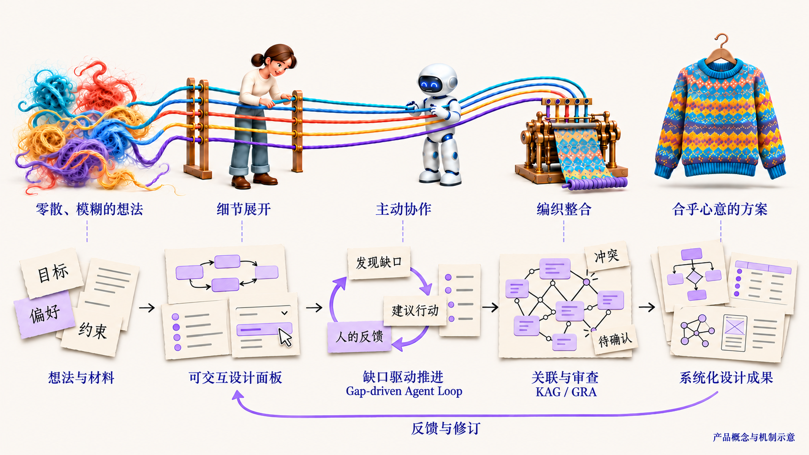
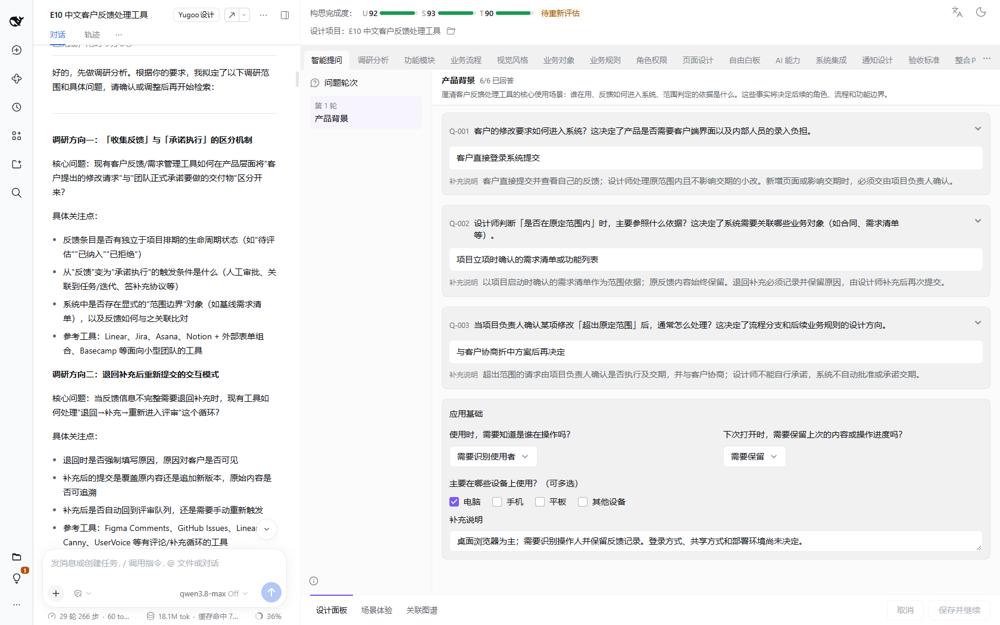
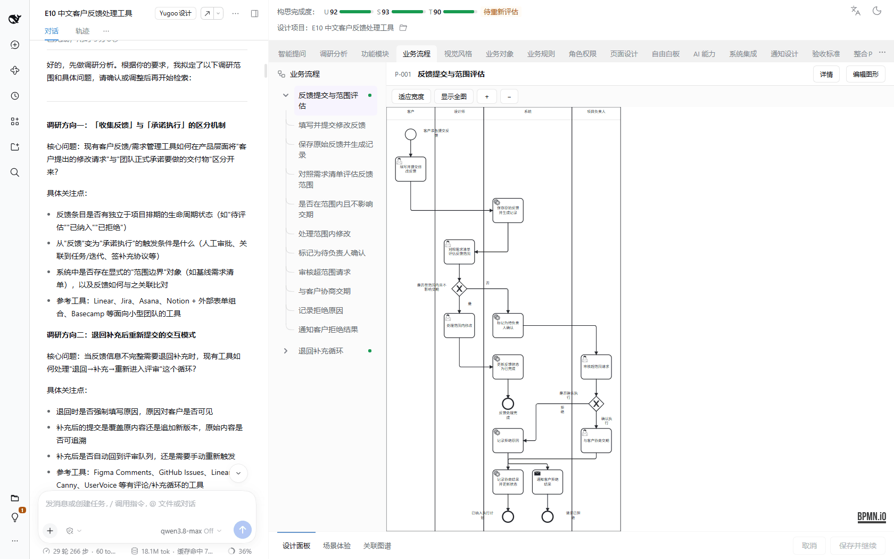
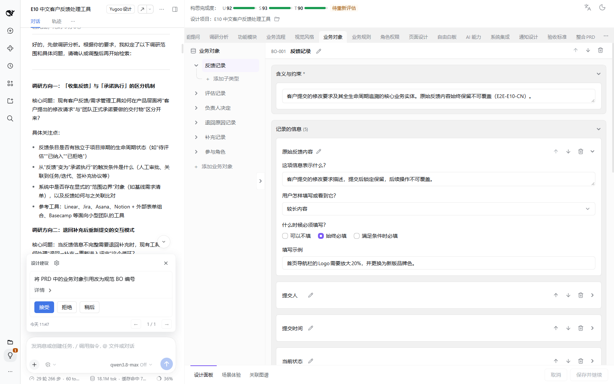
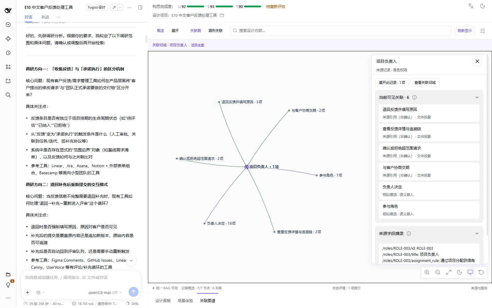
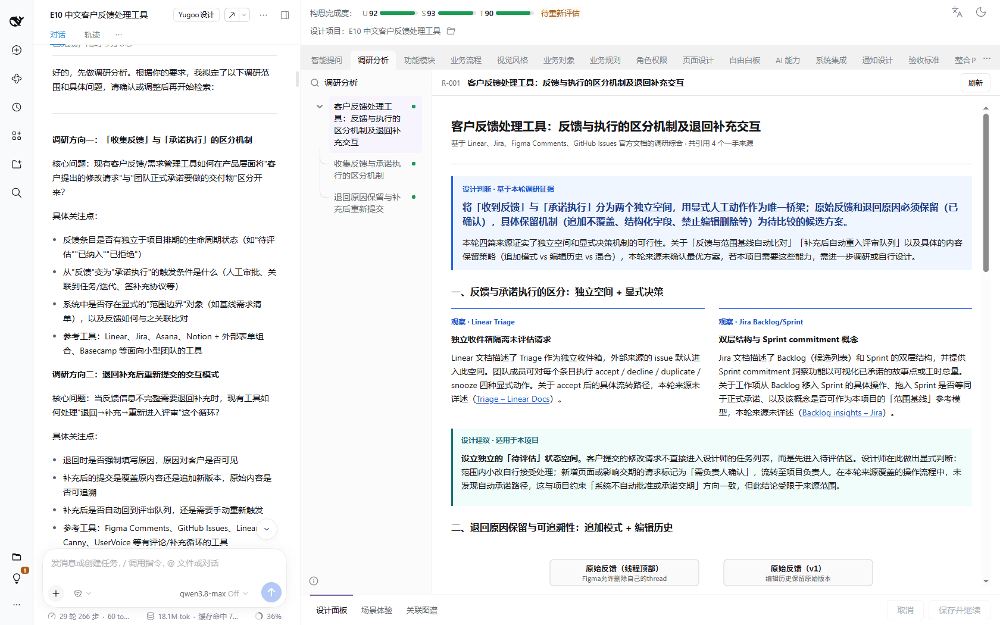
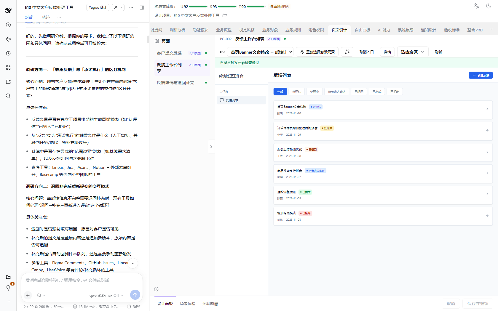
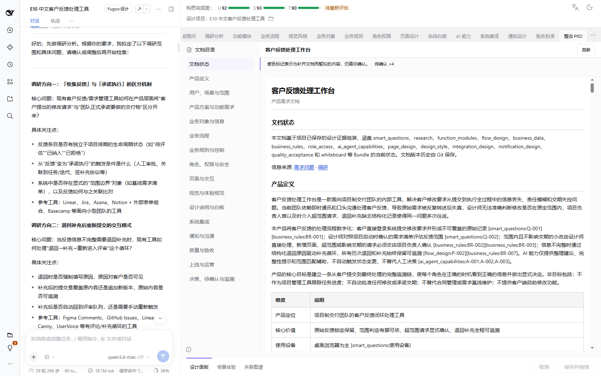
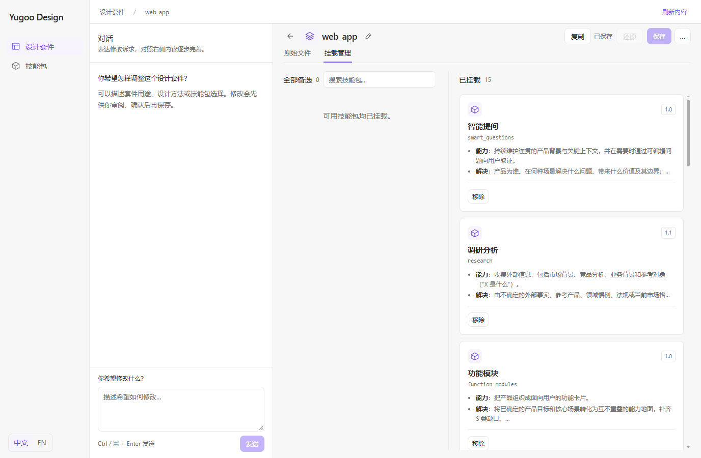

# 语构设计系统（Yugoo Design）

简体中文 · [English](README.en.md)

[](LICENSE)
[](docs/wiki/hosts.md#deepseek-harness)
[](packages/companion/hosts/codex-desktop/README.md)
[](docs/wiki/hosts.md#codex-cli)
[](docs/wiki/hosts.md#claude-code-cli)
[](docs/wiki/hosts.md#qoder-cli)
[](docs/wiki/hosts.md#千问办公-qwenwork)
[](docs/wiki/hosts.md#workbuddy)
[](https://www.npmjs.com/package/yugoo-design)

**让你的 AI 成为主动设计顾问。**

语构设计系统（Yugoo Design）是一款开源插件，让你熟悉的 AI 助手像设计顾问一样参与构思。你可以带着一个模糊的想法开始。AI 帮你理清目标，主动提出容易忽略的问题，再根据你的选择建议下一步。支持 DeepSeek Harness（DSH）、ChatGPT、Claude Code、WorkBuddy 和千问办公等 Agent 应用。

有些想法，看见了才说得清。语构为专业技能（Skill）配上交互面板（Panel），把讨论中的流程画成图，把规则整理成表。你可以指出哪一步不合适，也可以直接改好一条规则，让 AI 带着你的判断继续设计。

随着方案演进，知识图谱会把相关设计联系起来，审查能帮你发现前后不一致的地方。决定和修改记录都保存在项目里，下次打开就能接着推敲。



随插件提供的 **Web App Kit**，以 Vibe coding 前的应用构思为例，展示这套协作方式。你可以用它从需求出发，逐步推敲功能、流程、规则与界面；也可以改造这套 Kit，或为活动策划、游戏规则、排班优化等工作创建新的 Kit 与面板。当前可用套件与获取方式见[套件清单与获取指引](docs/wiki/kit-sharing.md#official-kits)。

[官网](https://yugoo.org/zh/) · [常见问题](https://yugoo.org/zh/faq/) · [Product Hunt](https://www.producthunt.com/products/yugoo-design?launch=yugoo-design)

[快速开始](#快速开始) · [为什么做这个项目](#为什么做这个项目) · [核心能力](#核心能力) · [协作示例](#一次完整的协作) · [扩展套件](#从应用设计开始按需扩展) · [Wiki](docs/wiki/README.md) · [更新日志](CHANGELOG.md) · [贡献与反馈](#参与与反馈)

## 快速开始

**语构在哪里用？** 语构以插件的形式运行在你的 Agent 应用里。在 DSH 或 ChatGPT 里，你可以在聊天窗口里与 Agent 对话，并在一旁展开的面板里进行交互式设计构思。根据宿主的不同，插件会使用原生面板、内嵌浏览器或外部浏览器。你都可以在面板里修改、保存，再回到对话继续设计。

开始前，请确认宿主 Agent 可以正常工作。安装时，**Agent 会检查和处理 Node.js 依赖（`>=22.19.0`）**。语构依赖宿主 Agent 应用的模型调用、权限和工具，例如联网搜索。[环境要求](docs/wiki/getting-started.md) · [发行状态](docs/wiki/preview-status.md#current-release-and-use)

1. **安装插件。** 在[官网安装入口](https://yugoo.org/zh/#host-guides)选择你正在用的 Agent 应用，把对应的安装提示词粘贴到该应用的对话里发送。也可以直接使用下面的[通用安装提示词](packages/companion/HOSTS.md#default-prompt-any-supported-host)。

   ```text
   请在我当前的 Agent 宿主中安装或更新语构设计系统（Yugoo Design）。
   先复用匹配的已有安装；需要新版本时，在持久目录使用 pnpm 获取 npm 正式包 yugoo-design。优先使用我指定的版本，否则将 latest 解析为精确稳定版本，核对该版本的安装前提及完整性，准备缺少的 Node、pnpm 后执行 pnpm add --save-exact yugoo-design@<解析版本>。如果 latest 指向预发布版本，请说明并停止。
   读取安装目录下 node_modules/yugoo-design/README.md，运行 pnpm exec yugoo-design --help，识别当前宿主并使用对应的 install --host 路径。自行发现本机所需参数，完成注册或导入及启用。需要我操作界面时，给出准确位置和本次生成的文件或配置，完成后继续验证 yugoo 入口与工具。
   保留项目、设置与安装回执。只有随包说明未解决的具体问题才查 GitHub 文档，不克隆或源码构建。最后报告安装及实际加载版本、未完成步骤，并给出第一条 Web App Kit 项目请求。
   ```

   各宿主的安装方式和后台审查支持见[宿主指南](docs/wiki/hosts.md)。

2. **创建设计项目。** 安装完成后，在宿主的对话窗口里输入下面这句话。

   ```text
   用语构新建一个名为 expense-app 的设计项目，使用 Web App 设计套件。
   ```

   语构也为部分宿主提供原生命令。例如在 DSH 里，输入 `/yugoo new expense-app` 创建项目，再用 `/yugoo kit web_app` 选择套件。[DSH 命令参考](docs/wiki/commands.md)

   想在已有基础上构建设计项目，而不用从头开始？在 DSH 里用 `/yugoo reconstruct <仓库绝对路径>` 直接[从现有代码仓库重建设计](#从现有代码仓库重建设计)。
3. **说出这轮目标。** 例如：

   ```text
   我想给团队做一个报销应用。员工提交报销，负责人审批，财务确认付款。
   先一起想清楚提交、修改、审批和付款的流程，以及每个角色能做什么。
   有哪些规则需要我补充或决定，请明确指出。
   ```

4. **在面板里表达判断，再继续。** AI 根据当前需要展开提问或设计面板。你可以修改内容并保存，再说：“按我刚保存的处理规则继续，说明它会影响哪些设计。”也可以在对话中提出修改。[协作教程](docs/wiki/web-app-demo.md)使用另一个客户反馈处理项目演示同样的操作方式；日常操作查[使用指南](docs/wiki/usage.md)。

### 从现有代码仓库重建设计

对于 Vibe Coding 场景，我们可以从现有的代码仓库进行设计还原。语构将系统性地提取现有产品的设计基础，包括业务模型、角色权限、流程设计等，不仅仅是 UI/UX。然后，你可以从设计端继续开发和迭代你的项目，体验对设计细节的把控。[重建指南](docs/wiki/usage.md#5-从既有材料重建设计)

## 为什么做这个项目

Vibe coding 和 Vibe working 能很快给出结果。我们关心的是：**怎样让人有效地参与方案设计并掌控结果，让 AI 的产出更符合我们的真实需要？**

传统问答可以收集和澄清需求。但当方案需要高度定制，许多设计决策又相互影响时，仅靠对话很难理清这些关系。目前，AI 辅助设计中的可视化交互主要集中在 UI/UX 等图形设计场景。我们希望把**人在回路**（Human-in-the-loop，HITL）带到更多设计环节。你在面板里看清选项、作出取舍，AI 根据你的反馈调整方案，再由你确认或继续修改。

比如，给团队设计报销应用时，你和 AI 一起看审批流程图。AI 像一位设计顾问，主动问起员工提交后还能不能改金额。你在面板里补上“审批前可以改，审批后要改就得重新提交”并保存。AI 根据这条规则建议你打开权限表，核对员工的编辑权限是否在审批后收回。

Vibe Coding 场景是我们的起点，但人与 AI 共同构思和设计的方式可以自然延伸到其他场景。通过定制相应的 Kit 和交互面板，语构还可以用于活动策划、游戏机制设计和运筹建模。更多背景见[产品理念](docs/product-vision.md)。

## 核心能力

### 可交互的技能包 · 让信息以自然、合适的形式呈现

在流程图上查看审批分支，在权限表里调整谁能修改报销单，在原型里试走员工提交报销的过程。面板与 Agent 使用同一份设计数据，你保存的判断会成为 AI 继续工作的依据。

每个 **设计技能包（Bundle）** 聚焦一项工作。带有交互面板的 Bundle 可以概括为：

**Bundle = Skill + 结构化数据契约 + UI 定义 → 可交互的设计成果。**

Bundle 声明如何执行任务、校验成果。面板可以用**声明式 UI**（如 `panel.yaml`）预先定义，也可以在支持的宿主中由 AI 通过 **A2UI** 从共享组件目录生成。

### 主动式专业引导 · 围绕目标与缺口，推进下一步

**设计套件（Kit）** 把领域主提示词（Mindset）和相关 Bundle 组织在一起。AI 根据你的目标、已保存的设计和反馈，找出还有哪些问题需要解决，再推荐合适的下一步。这就是**缺口驱动循环（Gap-driven Agent Loop）**。

比如，你已确定报销单在审批后改动需要重新提交。AI 可以建议用角色权限 Bundle 核对谁有权重新提交。你可以采纳建议，也可以先讨论其他问题。

### 信息关联与自动审查 · KAG 与 GRA · 从局部到整体

各部分分别看起来合理，放在一起仍可能有遗漏或矛盾，这是复杂构思设计中的常见难题。改了一条流程，权限、通知和页面可能都需要跟着调整，而 AI 也未必能一次完成所有相关修改、保持整个方案自洽。

**知识图谱（KAG）负责关联信息。** 它随项目设计文件的变化更新，将流程、权限、规则、页面及其依据联系起来，帮助你和 AI 沿关系回到原始来源核对。在报销应用中，可以从审批流程找到相关权限和修改规则。

**自动审查（GRA）负责发现值得处理的问题。** 它从三个视角检查已有设计并提出建议，例如审批方式变了，权限或通知约定是否仍与之对应：

- **一致性审查（Grounding）**：检查各部分设计是否相互矛盾或遗漏了约定。
- **知识反思（Reflection）**：发现需要进一步研究、查证的疑点。
- **意图对齐（Alignment）**：提出需要你补充背景或作出判断的问题。

你可以按需发起审查，也可以在支持后台执行的宿主中启用自动审查。由你决定如何处理建议。

### 把构思沉淀为项目 · 成果集中管理，演进有迹可循

每个 **设计项目（Design Project）** 都有独立的文件夹，保存设计文件、相关资料与产物，以及项目自己的 Kit 和 Bundle 定义。你可以在项目中组织内容，通过 Git 记录版本和变化，保留方案的演进过程。

下次再讨论时，打开同一个项目，就可以从保存的成果继续推敲。你可以请求“查看最近一次修改，解释流程和规则改了什么”，也可以比较版本、追溯方案如何形成。版本管理运行库随插件提供，正常设计操作无需另装 Git。日常历史查看、旧项目迁移与材料重建见[使用指南](docs/wiki/usage.md#4-管理与恢复)。

## 一次完整的协作

下面换一个项目。客户提出修改时，谁来判断范围，谁来确认交期？截图记录了在 DeepSeek Harness 中用 **Web App Kit** 设计客户反馈工具的实际操作。业务数据为虚构，中英文版各用对应语言的示例项目。界面取决于[安装版本与宿主](docs/wiki/preview-status.md)。

你可以从[快速开始](#快速开始)提出自己的目标，也可以按说明复制并迁移[完整示例项目](examples/design-team-delivery/README.md)，跟着[协作教程](docs/wiki/web-app-demo.md)操作。其他领域可以[定制 Kit、Bundle 和交互面板](#从应用设计开始按需扩展)。

### 1. 在面板中确认关键背景

在这个客户反馈处理示例中，AI 可以打开 **Smart Questions 面板**，把影响当前方案的问题呈现为可作答的卡片。你补充实际分工：**设计师可以与客户讨论，项目负责人确认新增范围和交期。**

保存后，你可以展开 **U/S/T 评估**，查看 AI 对当前设计的判断和依据：背景是否清楚、各部分能否配合、哪些行为还缺少可验证的约定。比起追求更高的分数，这些理由更适合用来讨论“接下来先想清楚什么”。

例如，分工已经明确，AI 可以建议：“先把客户提出修改到安排执行的过程画出来，看看谁记录意见、谁判断范围、谁作出承诺。”



### 2. 看见流程，再补充真实情况

AI 展开**业务流程面板**，用纵向泳道区分客户、设计师、负责人和系统，从上往下呈现反馈记录、范围对照、影响评估和确认安排。

先看完整流程，再放大关键分支：哪些小改可以直接处理，哪些请求需要确认范围或交期，信息不足时又退回给谁补充？你可以补充：“已有范围内、又不影响已承诺节点的布局调整，设计师可以直接处理。”在节点详情中补充活动、进入和完成条件、异常处理或备注并保存；需要调整分支和连线时，指出对应节点，请 AI 修订流程图。这样，实际工作方式就能进入设计。



### 3. 保存判断，让 AI 继续推敲

保存后，你可以说：“按我刚保存的规则继续，看看其他设计是否也表达了这个意思。”AI 会依据这些修改继续工作。需要核对流程与规则时，你还可以发起一次**一致性审查（Grounding）**。

例如，一条一致性建议可以指出：

> 问答已经要求检查修改对交付节点的影响，但“范围内修改”的业务规则只检查是否新增页面或能力，没有写入交期条件。

你可以据此明确：“范围和交期分开判断；只要影响已承诺节点，就交负责人重新确认安排。”请 AI 修订相应规则，再对照同一流程检查；建议不会自动替你决定或改写设计。

想进一步查看这些设计如何关联，可以打开底部的**关联图谱（KAG）**，选择流程或页面对象，沿关系查看来源，再回到相应面板核对。图谱提供查找线索，具体判断仍以设计内容为依据。





这就是协作循环：**提出目标 → 在面板中看清并修改 → 保存后让 AI 继续 → 带着新的问题再讨论。** 下一轮从最需要理解或决定的地方开始。

### 你还可以继续展开……

**调研、视觉风格与页面设计。** 用调研面板保存问题、来源和分析结论；在视觉风格中比较适合产品的方向；通过页面设计查看页面关系，并打开具体页面的高保真原型，检查客户提交反馈、设计师判断影响、负责人确认安排之间的路径。你可以从当前最需要深入的部分继续。



**场景体验。** 选择“客户临时追加一个页面”这样的情境，把流程、规则和界面放在一起试走。发现某一步不清楚，点击“在主对话讨论当前内容”，把问题带回设计；体验中的操作用于演示，不会直接改写设计文件。

[查看场景体验示例](docs/images/readme-scene.png)。页面原型也可以单独预览，检查反馈列表、不同状态和详情入口：



**PRD 与开发交接。** 把当前设计整合为 PRD 草案，按章节检查方案，保留来源与未决问题。进入开发时，再结合具体任务准备 spec，关联相应设计依据。



还需要深入时，你们可以设计反馈、交付物和变更的数据关系，细化权限与业务规则，或通过 **AI 能力面板** 明确应用中的 AI 如何整理反馈、需要哪些 Skills 和工具，以及哪些承诺仍由人决定。

这些是可以按需深入的维度，不是每轮必须完成的清单。

完整操作和数据、规则、PRD 界面见[协作教程](docs/wiki/web-app-demo.md)；U/S/T、KAG 和场景体验的入口见[使用指南](docs/wiki/usage.md#查看和更新-ust)。[界面概览](docs/wiki/usage.md#7-界面概览)另展示科研协作工具的流程与页面设计；其他领域见[非 Web Kit 演示](docs/wiki/non-web-kit-demo.md)，开发交接见[设计到开发交接](docs/design-development-handoff.md)。

## 从应用设计开始，按需扩展

随插件提供的 **Web App Kit**，用于在开始 Vibe coding 前推敲应用，也提供一套可以改造和扩展的例子。它覆盖需求澄清、调研、功能规划，以及业务流程、规则、数据、权限、页面和验收等设计。它也支持规划应用中的 **AI 能力**：AI 承担什么职责、怎样与人交互，以及需要哪些提示词、Skills 和工具。具体方法见 [Mindset](packages/skills-web-app/kits/web_app/mindset.md) 与 [Bundle 挂载清单](packages/skills-web-app/kits/web_app/kit.yaml)。

共享框架中的交互面板、反馈与设计整合能力，可以配合不同领域的方法继续扩展。例如，把游戏里的行动、资源和胜负规则做成可推敲的设计；或把排班所需的人手、夜班限制和公平取舍整理成运筹优化模型。这些是你可以定制的方向，不是默认附带的套件；当前可用套件与获取方式见[官方套件清单](docs/wiki/kit-sharing.md#official-kits)。

你常用的 Skills 也可以参与其中。导入并适配一项已有技能，保留其中的专业方法，再为它补充合适的成果结构、校验与交互面板，就可以扩展成 Bundle。先用一个小案例检查方法与面板是否适合你的工作，再与相关 Bundle、领域 Mindset 组合成 Kit。

### 定制套件与交互面板：让工具适合你的领域

**设计工作室（Studio）** 提供查看、管理与定制 Kit 和 Bundle 的入口。你可以查看 Mindset、方法与源文件，直接编辑，或复制一份再单独定制。用样例预览检查面板的表达与交互，再在独立设计项目中试用方法。你在内容库中保存的修改，可以供新项目使用；已有项目保留自己的完整定义，由你和 Agent 按需要继续调整。

面板可以使用问题卡片、表格、图、原型或白板。声明式 UI 和 A2UI 共用组件与渲染能力；需要专门的表达时，还可以扩展 UI 组件或接入专业编辑器。

按[分享指南](docs/wiki/kit-sharing.md#作者与接收者的最小验证)检查并交付套件。不同安装版本与宿主提供的操作有所不同，见[功能与版本范围](docs/wiki/preview-status.md#studio-source-capabilities-and-installed-acceptance)；具体操作与宿主支持见 [Studio 指南](docs/wiki/usage.md#6-studio查看定制和检验套件)。



| 想做什么 | 从这里开始 |
| --- | --- |
| 组织领域方法与套件 | [Kit Creator](.agents/skills/design-kit-creator/SKILL.md) · [扩展指南](docs/wiki/extending.md) |
| 创建 Bundle、编写专业方法 | [Bundle Creator](.agents/skills/design-bundle-creator/SKILL.md) · [Skill Creator](.agents/skills/design-skill-creator/SKILL.md) · [Bundle 契约](docs/bundle-contract.md) |
| 配置或扩展交互面板 | [Panel 创作指南](.agents/skills/design-bundle-creator/references/panel-authoring.md) · [Panel DSL](docs/dsl-spec.md) |
| 试用与分享 | [Kit 分享与恢复](docs/wiki/kit-sharing.md) · [社区工作坊示例](examples/community-workshop-delivery/README.md) |

## 文档与开发

| 入口 | 内容 |
| --- | --- |
| [文档总览](docs/README.md) | 按安装使用、套件创作、架构与技术参考选择入口 |
| [Wiki](docs/wiki/README.md) | 安装、使用、宿主兼容与排障 |
| [核心概念](docs/wiki/concepts.md) · [术语规范](docs/wiki/terminology.md) | 项目、套件、技能包、面板及中英文命名 |
| [产品理念](docs/product-vision.md) | 专业方法、人机对齐与交互原则 |
| [开发指南](docs/wiki/development.md) · [架构基线](docs/system-design-baseline.md) | 源码环境、分层职责与验证流程 |
| [预览状态](docs/wiki/preview-status.md) | 版本、支持范围与已知限制 |

修改项目前，请阅读 [AGENTS.md](AGENTS.md) 与[贡献指南](CONTRIBUTING.md)。

## 参与与反馈

欢迎为其他 Agent 客户端适配接入，贡献代码、专业方法、Kit 与 Bundle、文档、翻译和实例，也欢迎分享你所在领域的构思任务。参与方式见[贡献指南](CONTRIBUTING.md)。

问题与建议的渠道及填写提纲见[反馈指南](docs/wiki/support.md)。可通过邮箱 [yangjianfeng.yjf@alibaba-inc.com](mailto:yangjianfeng.yjf@alibaba-inc.com) 联系，也可使用 [GitHub Issues](https://github.com/alibaba-damo-academy/yugoo-design/issues) 提交并查看后续讨论。反馈缺陷时请附版本、复现步骤及预期与实际结果；功能建议请说明场景、阻碍和期望。涉及敏感信息或安全问题，请按[安全报告政策](SECURITY.md)处理。

## 许可证与作者

本项目由 **YugooDesign Team** 维护。项目自有代码和文档采用 [Apache-2.0](LICENSE)，署名见 [NOTICE](NOTICE)。第三方组件保留各自的许可证和必要声明，见[第三方说明](THIRD_PARTY_NOTICES.md)。
