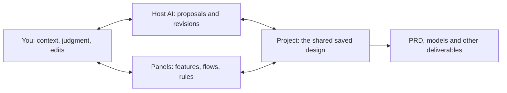

# Core concepts

[简体中文](concepts.md) · English

This page explains names used in Yugoo Design. Follow the [terminology guide](terminology.md) for bilingual names. Read the [runtime overview](architecture.md) for mechanisms and [project files](project-files.md) for storage and backups. The [architecture baseline](../system-design-baseline.md) and [Bundle contract](../bundle-contract.md) own the technical contracts.

## Who is collaborating, and what are you designing?

For a client-delivery platform, **you** supply real working context and make trade-offs; **AI** develops, explains and revises proposals; **Yugoo Design** supplies methods, Panels and the saved design you share; the **delivery platform** is the thing you are designing.

Conversation helps explain reasons and compare choices. Panels make the details visible and editable. The project retains the basis for continuing. A Kit organizes domain methods; a Bundle develops one design dimension. Goals and gaps guide the next step, while connections and review help the separate outputs fit together. Try the [complete walkthrough](web-app-demo.en.md), then return here for names and execution details.

## From a goal to a design result

You describe a goal in the host conversation. The Agent chooses suitable Kit and Bundle methods from that goal and existing evidence, then generates and validates design outputs. Panels let you inspect and edit them. After saving, both you and AI continue from the same design. Whether a task runs in the main conversation or an independent Agent depends on its Bundle and host; see [execution and review](#execution-and-review).

This helps when work needs continuing clarification and trade-offs. In a reimbursement app, editing after submission and choosing an approver depend on actual team agreements. A scheduling model depends on business rules for shift changes and consecutive work. AI can propose a solution; you supply missing context and judge or revise its details. Small tasks can need this participation too. Task size does not determine whether collaboration matters.

## Three complementary mechanisms

The aim is to **help people understand, think, express themselves and align with AI**. Three mechanisms support work involving preferences, real circumstances or value judgments:

- **Interactive development:** present a design dimension as something people can inspect, judge and edit. “Information Slice” is a metaphor for such a dimension, not another file format.
- **Gap-driven progress:** choose the next useful action from the goal, evidence and unresolved questions. It can develop something new or revisit existing work, without requiring every Panel or Bundle.
- **Structured integration and calibration:** use connections and review to identify conflicts, uncertainties and unresolved choices, so human feedback continues to inform the whole design.

These form a loop rather than three fixed stages. Project storage, version history, domain methods, scenario experiences and Studio support that collaboration. See the [product principles](../product-vision.en.md) for the fuller explanation and concept diagram.

## Names and responsibilities

| Name | Responsibility |
| --- | --- |
| Agent Host | Conversations, models, credentials, tools, native Agents and presentation capabilities |
| Design Project | Independent Design Files, artifacts, its own Kit/Bundle files, project identity, checkpoints and provenance |
| Kit | A domain method composed of a Mindset and mounted Bundles; the local library retains each identity's current content |
| Mindset | The domain expert's identity, character, reasoning, considerations and guidance for choosing capabilities; no mandatory sequence |
| Bundle | Self-contained methods, resources, output contract, validation, presentation and execution declarations for a design dimension |
| Producer | The isolated executor in `subagent` mode; `main` mode uses the existing main conversation |
| Worker | An optional, restricted artifact executor when the host supports it |
| Design Files | The authoritative entry points for independent design facts and artifacts |
| Design Panel | The shared workspace for reading, editing and saving designs |
| Studio | Inspect and edit current methods and source files, copy independent content, preview and try it; operations depend on the installed version |
| KAG | Connect independent Design Files and artifacts to help locate relationships and evidence |
| GRA | Grounding, Reflection and Alignment review perspectives, producing suggestions |

Editable diagrams and detail forms share design data. Assembled documents derive from existing designs. Kits and Bundles own domain methods; the shared runtime and host adapters own execution and integration.

## Three kinds of material and where to edit them

Using the delivery-platform example:

| Material | Example | Where to change it |
| --- | --- | --- |
| Methods and Panel definitions | How to analyze features, and which fields and views express them | The Kit/Bundle authoring source or Studio library for general methods; an existing project's own `design_kit` files for that project |
| Current design results | Feedback handling, scope and timing rules, confirmations and pages | Design Panel or a revision through the owning Bundle |
| Assembled handoff | A PRD or task-level spec | Regenerate through assembly or handoff, and check its sources |

A new project receives complete Kit and mounted Bundle files in its own `design_kit` when it first selects a Kit. Later library copies, saves and removals do not automatically change it. Editing a project's result does not rewrite a general method. Studio's sample previews and trials test the tools; ordinary Design Panels develop your own design. This file model describes current source; consult [host and release scope](hosts.en.md) for your installation.

## Mindset and system instructions

Think of a Kit as a domain expert's working methods and toolbox. Its Mindset supplies the expert's identity, character, reasoning and special considerations; Bundles provide focused capabilities. A Mindset may guide a gradual consultation or, with a clear user request, develop several outputs before reviewing them together. Domain methods, Bundle handoff declarations and current user intent shape the rhythm. The shared framework does not require all experts to have the same character or fixed workflow.

The Mindset combines with host instructions, Design Core policy and current design state in the Agent's context. It guides the domain without replacing host instructions or overriding user intent, saved facts or Bundle constraints. The shared runtime and host adapter still own execution and scheduling. See the [architecture baseline](../system-design-baseline.md#agent-host-and-user-interface-integration).

## Clarity assessment and next steps

Core supplies gap-driven guidance; the Mindset supplies domain methods and calibration. U/S/T considers Understanding, Structure and Testability. It is an evidence-based heuristic, not an objective completion percentage, stage gate or ranking across Kits.

A gap might be an unclear rule, an unexamined choice, an unsupported assumption or a contradiction introduced by a change. For example, requiring the lead to confirm changes affecting a promised milestone has consequences for flows, access and pages. The next action should address that impact rather than mechanically select the lowest score. You can request a specific result, ask for a draft, narrow the scope, defer work or finish; those choices change what is useful next.

An assessment belongs to the current goal and a particular saved design version. Read the reasons and version with the score. A design edit does not necessarily update the assessment immediately. See [assessment troubleshooting](troubleshooting.md#清晰度或下一步建议没有更新) for older or missing results.

How assessments are recorded and updated

Saved changes supply differences and assessment inputs to the original conversation. As it continues, the main Agent uses `report_design_clarity` to record an assessment of the current version. A completed Bundle's valid assessment for the same inputs can be reused. Panel saving, notification processing, assessment updates and GRA have independent states; inspect the affected operation when one fails. See [release scope](preview-status.md) for host support and recorded use.

## Design Files and derived material

Design Files, project versions and accepted human decisions each have their own authority. See [project files](project-files.md) for `project.json`, `design_files/`, `design_records/`, `.git/`, external runtime state and derived caches. KAG and model summaries help retrieval and understanding. PRD/spec assemblies are derived handoffs, not new independent design facts. Suggestions do not automatically become accepted design content.

## Execution and review

The Bundle contract and host capabilities determine execution placement. Unsupported requested modes must fail explicitly. The main Agent or Producer has the same integration, validation and publication responsibilities. An optional Worker handles assigned artifacts without expanding its scope or bypassing logs. When delegation is unavailable, the selected executor can work serially. A Worker return or queued task does not mean the Bundle completed; a foreground invocation needs an explicit terminal result. See the [execution contract](../bundle-contract.md#execution-placement) and [host guide](hosts.en.md).

Presentation is declared separately. Omitting `presentation` means no interactive Panel; generated presentation explicitly selects `auto`. Generated UI still reads and writes the existing design data, without becoming another authority.

## Knowledge connections and review

KAG tracks independent design sources and artifacts, providing paths to related evidence. It is a rebuildable projection: stale or temporarily unavailable knowledge does not prevent design work. Semantic similarity suggests candidates, not confirmed dependencies or user requirements. PRD/spec assemblies and model-facing summaries remain derived. See [knowledge and review responsibilities](../system-design-baseline.md#grounding-reflection-and-alignment).

GRA has three perspectives. Automatic execution needs host background support; manual requests and automatic scheduling are separate:

| Perspective | Question |
| --- | --- |
| Grounding | Are designs consistent, and do their references and evidence need checking? |
| Reflection | Which uncertainties need further research? |
| Alignment | Which ambiguities need the user's context or judgment? |

Results appear as suggestions to view, accept, reject or defer. You can disable automatic review and still request a check. Without new evidence, avoid repeating the same pending or rejected suggestion. Suggestions do not become facts or grant write authority; accepted design changes use the ordinary revision, validation and publication path. Review can miss problems, and background support depends on the [host version](hosts.en.md).

Where background execution is unavailable or still occupies the main conversation, a host supporting synchronous review can perform that particular check in the main conversation after your explicit choice, without another Agent. It temporarily occupies the conversation and does not automatically change future policy. See [review modes](hosts.en.md#background-capabilities-and-review-fallback). The main Agent assesses U/S/T and KAG is maintained independently; both remain usable when background GRA is unavailable.

## Web App Kit design tasks

The included Web App Kit supplies requirements clarification, research, features, AI capabilities, flows, business objects and rules, access, integration, notifications, acceptance, visual style, page prototypes, whiteboards and PRD assembly. See the [content-package guide](../../packages/skills-web-app/README.md) for Bundles, methods and versions.

These methods bring human intent into software design: examine the desired behavior and details before handing the evidence to implementation. This applies the product's principles to software without limiting the framework to coding. See the [handoff guide](../design-development-handoff.md).

The Agent chooses a suitable Kit and Bundles from the goal and saved design. DSH also offers `/yugoo kit`. Ask for a specific result or choose a proposed activity without executing every Bundle in order. Panels show progress, structured results, diagrams and artifacts. Supported edits are validated and saved for later work.

## Versioning and saving

A Design Project is independent of a host conversation; closing the conversation does not delete it. New projects default to `YuGoo/Projects` under the operating system's Documents directory. Explicit configuration takes precedence, and registered projects are not automatically moved. WSL uses the Linux user directory. The registry, journal, locks and caches manage execution; Design Files remain the design authority. See [projects and persistence](../system-design-baseline.md#design-projects-and-persistence).

A library identity has one current saved Kit/Bundle state. Editing saves in place; copying creates an independent identity. Projects run their complete `design_kit` files, so library edits do not change existing projects. To incorporate new methods, ask the Agent to compare files and preserve project customizations, then use normal validation and Git. Source versions provide provenance, not a local publication or confirmation gate. Panel and Agent edits to results still use shared validation and Design Files publication. See [Kit sharing and project maintenance](kit-sharing.en.md).

For actions, see [usage](usage.en.md); for methods, [extension development](extending.en.md); and for delivery or exact original-source recovery, [sharing](kit-sharing.en.md). Content formats are not automatically compatible across versions. `migrate` preserves the original and adapts recognized Design Files in a new project; it does not copy complete history unchanged. Use `reconstruct` for ordinary materials. See [commands](commands.md) for parameters and prerequisites.
