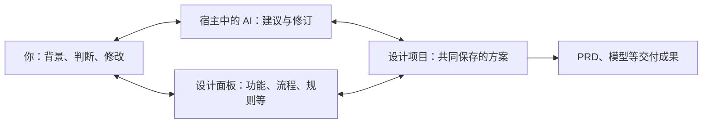

# 核心概念

本页介绍语构设计系统（Yugoo Design）使用时出现的名称，中英文对照遵循[命名与术语翻译规范](terminology.md)。当前技术契约以[系统架构基线](../system-design-baseline.md)和 [Bundle contract](../bundle-contract.md)为准。

## 先看清谁在协作，设计的是什么

以设计工作室的项目交付平台为例：**你**提供团队实际情况并作出取舍；**AI**帮助展开、解释和修订方案；**Yugoo Design**提供专业方法、面板与共同保存的设计；**项目交付平台**是你们正在设计的对象。

对话帮助解释原因和比较选择，面板让具体内容可见、可修改，项目保留双方继续工作的依据。Kit 把领域方法组织起来，Bundle 展开某个设计维度；下一步根据缺口选择，分散成果通过关联与审查继续整合。你可以先读[完整协作教程](web-app-demo.md)，再按需要查下方名称与执行细节。

## 从目标到设计结果

用户在已有宿主会话中提出目标，主 Agent 根据目标和已有设计选择 Kit/Bundle。Bundle 按其执行声明进入主会话或隔离 Producer，生成候选、验证并发布设计文件。Panel 展示和编辑同一份设计；保存后可继续讨论。

这种协作适合需要持续澄清和取舍的任务：设计团队的报销工具时，提交后能否修改、审批人怎样确定取决于实际工作约定；建立排班优化模型时，临时换班和连续工作限制取决于实际业务。AI 可以提出方案，你补充它还不了解的背景，判断并修改具体细节。一个小任务也可能需要这样的参与；任务大小不决定协作的必要性。

## 三个核心机制

产品哲学是**让人理解，让人思考，让人表达，与人对齐**。当设计需要人的偏好、实际处境或价值取舍时，系统用三种相互配合的方式支持协作：

- **可交互展开**：将具体设计维度呈现为可以查看、判断和修改的成果。“信息切片（Information Slice）”是对这种维度的比喻，不是新增文件类型。
- **缺口驱动推进（Gap-driven Agent Loop）**：根据当前目标、证据与未解决的问题选择下一步。它可以展开新设计，也可以重新讨论已有设计；不要求填满所有面板或运行全部 Bundle。
- **结构化整合与校准**：通过知识关联与审查，发现分散设计之间的冲突、知识疑点和未决取舍，让人的反馈持续进入整体方案。

三者构成循环，不是固定的三步流水线。项目存储、版本记录、专业方法包、场景体验与 Studio 提供支撑和增强。完整说明与概念图见[产品理念](../product-vision.md#3-各层分别承载什么)。

## 名称与职责

| 名称 | 职责 |
| --- | --- |
| 智能体宿主（Agent Host） | 管理会话、模型、凭据、工具、原生 Agent 和呈现能力 |
| 设计项目（Design Project） | 独立保存设计文件、artifacts、项目身份、版本化 checkpoint 和精确版本引用 |
| 设计套件（Kit） | 挂载精确 Mindset 与 Bundle 版本，组合一个领域的方法 |
| 领域主提示词（Mindset） | 定义领域专家的身份、个性、思考方式、特殊考虑与能力选择引导，不强制固定顺序 |
| 设计技能包（Bundle） | 围绕一个设计维度的自包含技能包：专业方法、资源、输出契约、校验、呈现及执行声明 |
| Producer | `subagent` 模式下的隔离执行者；`main` 模式使用现有主会话 |
| Worker | 宿主支持时，可选的受限 artifact 执行者 |
| 设计文件（Design Files） | 独立设计事实和产物的权威入口 |
| 设计面板（Design Panel） | 查看、编辑和保存这些设计的共同工作区，简称面板（Panel） |
| 设计工作室（Studio） | 查看方法与源文件，创建本地副本、预览和检验内容的入口；可用操作取决于安装版本 |
| 知识图谱（KAG） | 对独立源文件和产物建立可追溯的知识投影和检索线索 |
| 主动审查（GRA） | Grounding、Reflection、Alignment 三个审查视角及建议 |

图与详情表单编辑同一份设计数据，整合文档从已有设计派生。领域方法由 Kit 和 Bundle 承载，共享运行时和宿主适配器负责执行与接入。

## 三种材料，三个操作位置

以设计工作室的项目交付平台为例：

| 材料 | 例子 | 在哪里修改 |
| --- | --- | --- |
| 设计方法与面板定义 | 如何梳理功能、用什么字段和视图表达 | Kit/Bundle 作者源或 Studio 工作副本 |
| 当前设计成果 | 反馈处理流程、范围与交期规则、确认记录和页面 | Design Panel，或负责该维度的 Bundle 修订 |
| 整合交接输出 | 当前设计汇总成的 PRD 或任务级 Spec | 通过组装/交接重新生成，并核对来源 |

复制或保存一种方法，不会自动改变使用该方法的项目；修改项目成果，也不等于把通用方法改写。Studio 的样例预览和试运行用于检验工具，普通 Design Panel 用于持续完善自己的设计。

## Mindset 与系统提示词

可以将 Kit 理解为领域专家的工作方式与工具箱：Mindset 定义身份、个性、思考方式和特殊考虑，Bundle 提供具体专业能力。Mindset 可以采用咨询式逐步澄清，也可以在用户授权明确时连续展开多项成果、再集中审阅；协作节奏由领域方法、Bundle 交接声明及当前用户意图共同决定。共享机制不要求每个专家采用同一种个性或固定流程。

Mindset 与宿主基础指令、Design Core 系统策略和当前设计状态共同构成 Agent 的工作上下文。它提供领域指导，不替换宿主系统指令，也不覆盖用户意图、已保存事实或 Bundle 的执行约束。执行与调度仍由共享运行时和宿主适配负责，具体分层见[架构基线](../system-design-baseline.md#agent-host-and-user-interface-integration)。

## 清晰度评估与下一步建议

共享 Core 已有缺口驱动的推进指导，Mindset 提供领域方法与评估校准。U/S/T 分别关注理解度（Understanding）、结构化（Structure）与可验证性（Testability），是结合证据的启发式评估，不是客观完成率、阶段门槛或跨 Kit 排名。

缺口可能是尚不明确的业务规则、没有比较过的选择、缺少依据的假设，或修改后产生的矛盾。例如，“影响已承诺交期的修改由负责人确认”会影响流程、权限和页面；下一步应围绕这项影响展开，而不是机械选择分数最低的维度。你可以直接指定结果、要求先看草案、简化范围、延后或结束；这些选择会改变下一步的判断。

评估要对应当前目标与已保存的设计。有意义的面板保存会向原会话提供保存差异与评估输入，由主智能体（Main Agent）在继续设计的回合中通过 `report_design_clarity` 报告当前版本的评估。如果已完成的 Bundle 已返回相同输入的有效评估，则复用该结果，不重复报告。面板保存、原会话接收与处理通知、评估更新和 GRA 审查分别有自己的结果，不能从其中一项成功推断其余项已经完成。各宿主已验证的范围见[预览状态](preview-status.md)。

## 设计文件与派生内容

设计文件、项目版本与被接受的人类决定有各自权威。KAG 和模型摘要帮助检索与理解；PRD/Spec 是派生交接输出，不重新成为独立设计事实。建议也不会自动成为已接受的设计内容。

## 执行与审查

Bundle 的执行位置由契约及宿主能力决定；请求的执行模式不受支持时应明确报错。主 Agent 或 Producer 承担相同的整合、验证和发布责任，可选 Worker 只处理被分配的产物，不能扩大权限、写入范围或绕过日志。无法委派 Worker 时，选定执行者仍能串行完成任务。Worker 返回或任务进入队列不等于 Bundle 完成，前台调用必须得到明确终态。详见 [Bundle 执行契约](../bundle-contract.md#execution-placement)和[宿主兼容](hosts.md)。

面板与执行位置分别声明：省略 `presentation` 表示没有交互面板，生成式面板需显式选择 `auto`。生成的界面仍读写原有设计数据，不产生第二份数据权威。

## 知识关联与审查

KAG 跟踪独立设计来源及 artifacts，提供相关依据和关系的检索线索。它是可重建投影，陈旧或暂时不可用不阻止继续设计；语义相似只提供候选线索，不等于已证实的依赖或用户需求。PRD/Spec 整合文档和模型状态摘要属于派生内容，不重新作为独立知识来源。详见[知识关联与审查契约](../system-design-baseline.md#grounding-reflection-and-alignment)。

GRA 提供三个审查视角；自动执行需要宿主后台能力，手动请求与自动调度分别处理：

| 视角 | 关注的问题 |
| --- | --- |
| 一致性审查（Grounding） | 设计文件之间是否一致，引用与证据是否需要复查 |
| 知识反思（Reflection） | 当前设计是否存在知识疑点，需要研究什么 |
| 意图对齐（Alignment） | 哪些模糊项仍需用户澄清或作出判断 |

这些结果以建议呈现，用户可以查看、接受、拒绝或稍后处理。用户可以关闭自主审查，也可以在关闭后明确要求重新检查；没有新证据时，应避免反复提出待处理或已拒绝的同一建议。建议不会自动成为设计事实或授予写入权限，被采纳的修改仍走正常修订、校验和发布路径。审查可能遗漏问题，执行与后台能力以具体[宿主版本](hosts.md)为准。

后台不可用或原生异步仍占用主对话时，本轮共享源码支持在用户确认后由主 Agent 在当前对话同步完成本次评审，而非强制再启动独立子 Agent；这不是永久自动同步模式。当前实现与验证状态见[评审降级](hosts.md#后台能力与评审降级)。U/S/T 由主 Agent 评估，KAG 独立维护，均不因 GRA 后台不可用而自动关闭。

## Web App Kit 的设计任务

官方 Web App Kit 提供需求澄清、调研、功能模块、AI 能力、流程、业务数据与规则、权限、集成、通知、质量验收、视觉样式、页面原型、白板和 PRD 组装。具体 Bundle、方法及版本见[内容包指南](../../packages/skills-web-app/README.md)。

这组方法把人的意图（Intent）带入软件设计：先把希望 AI 实现的目标和细节推敲清楚，再将设计依据交给后续实现。它是产品理念在软件领域的一种应用，不限定系统只能服务于编码。设计与开发之间的衔接见[交接指南](../design-development-handoff.md)。

Agent 根据目标与当前设计选择适合的 Kit 和 Bundle；DSH 也可以用 `/yugoo kit` 显式选择。用户可以直接请求所需结果，或选择建议的活动，无需按固定顺序执行全部 Bundle。面板可以查看执行进度、结构化结果、图表及产物，支持的修改经过校验和保存后用于后续设计。

## 版本与保存

设计项目独立于宿主会话，关闭会话不删除项目。新项目默认位于操作系统 Documents 下的 `YuGoo/Projects`；显式配置优先，已有注册路径不会因此迁移，WSL 使用 Linux 用户目录。registry、journal、锁和缓存各有用途，不替代 canonical 设计文件；具体规则见[项目与持久化](../system-design-baseline.md#design-projects-and-persistence)。

项目保留确切内容引用，Panel 与 Agent 修改走共享校验/发布机制。切换或升级遵循显式版本操作，不能仅凭编辑源码推断现有项目已采用新版本。详见 [Kit 分享与恢复](kit-sharing.md)。

具体操作见[使用指南](usage.md)，自定义方法见[扩展开发](extending.md)，交付和精确原件恢复见[分享指南](kit-sharing.md)。首发不承诺所有旧内容格式自动迁移，既有设计材料可以通过实际宿主的 `recover` 入口保留原件并在新项目中验证、适配。
