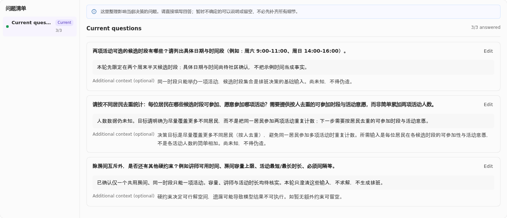

# 非 Web Kit 演示：记录编辑与决策澄清

语构设计系统（Yugoo Design）也可以帮助人梳理配送需求、登记作业风险，或澄清需要建模的业务问题。本页先介绍可获取的领域示例，再展示记录编辑和决策澄清的使用过程。

想制作自己的领域工具，可从[最小创作闭环](extending.md#一个最小创作闭环)开始；如何分享完整内容、选择版本和恢复原件，见[Kit 分享与恢复](kit-sharing.md)。

## 从公开示例开始

可以先选择以下内容包，再按[分享指南](kit-sharing.md)交给当前宿主采用：

| 公开内容 | 适合观察什么 | 下一步 |
| --- | --- | --- |
| [社区工坊配送 Kit](../../examples/community-workshop-delivery/README.md) | 原生 Agent 根据领域方法生成记录，人通过面板修改、保存和继续 | 按该示例 README 采用内容，提出一个有界请求 |
| [现场作业 Kit](../../examples/field-operations-shared/README.md) | 风险记录怎样用声明式表单呈现、手工新增和保存 | 先阅读下面的现场作业案例，区分样例导入和 Agent 生成 |

已有对应 Kit 的项目，可以这样开始：

```text
请使用当前 Kit 处理一个小规模教学情境，先说明需要哪些实际背景。
把我能查看和修改的记录展开在面板里，样例或假设要标明。
我保存修改后，请沿着新内容继续解释和完善。
```

项目沿用所选 Kit 的方法和版本；新创作按[最小定制教程](custom-kit-tutorial.md)开始。社区工坊配送 Kit 由原生 Agent 根据教学参考改写，目录附有方法、输出契约、schema、双语声明及 LICENSE/NOTICE，分享内容不含用户项目或会话日志。使用 ZIP 时先解压，再按宿主入口加载和选择套件。

配送示例的作者与 ZIP 接收者曾分别完成生成、面板编辑、保存后继续和重开。接收者使用同一套安装依赖中的独立配置；该记录限于当时环境，跨机器或跨宿主使用仍需另行检查。

下面保留两条已实际走过的教学路径：现场作业风险登记册从合成样例导入开始，展示记录编辑；社区工作坊的历史决策澄清从原生 Agent 生成开始，展示反馈如何改变问题。两例都不生成网页，后者也尚未进入模型求解。

## 示例一：现场作业风险登记册

设计系统的 Bundle 也可以承载业务记录，而不生成网页。本例使用独立作者创建的
`field_operations@0.1` Kit 和 `hazard_register` Bundle：用户在声明式面板中选择风险、
修改记录、新增记录，并保存后重开继续编辑。

本例在已安装的 DSH 宿主中完成。初始数据来自作者提供的合成教学样例，用于练习编辑；它们由样例导入，尚未经过 Agent 生成或现场核实。

### 1. 作者提供领域方法和可编辑记录

Kit 包含 Mindset，以及 Bundle 的方法、输出契约、schema、validation、`panel.yaml`、
中英文语言资源和 `reference/example.json`。面板复用已有的 `record_workspace` 与
`record_inspector`，无需新增共享组件或原生 Panel。

每条风险有稳定 ID、短标题、场景、应对措施、确定性和证据说明。确定性只允许
`observed`、`proposed`、`unknown`；语言切换只改变界面标签，不翻译用户记录。
创作与字段绑定步骤见[扩展开发](extending.md)。

### 2. 通过公开接口校验，再导入教学样例

集成方先用实际安装的 `dsh-design-core/kit` 加载 Kit，用 `dsh-design-core` 的 schema
和 state/completion 校验检查非空样例，并用 `dsh-design-core/dsl` 校验中英文面板。
本例的两条样例记录通过这些公开接口；不支持的确定性值在 schema 校验中被拒绝，
证据说明不足的完成状态由适用的 completion 规则检查。

通过校验后，集成方在使用该 Kit 的设计项目中，调用宿主的公开 `savePanel` 保存入口
导入样例。这里描述的是集成操作，并不意味着界面提供“导入 JSON”按钮。
使用宿主实际支持的 Kit 加载与项目创建入口；本文不提供尚未确认的发行安装命令。

初始记录是“可能延迟交付”和“未知的入场限制”，两条均明确标为合成样例，
保留未验证的证据说明。不要把样例的应对措施当成现场授权或已达成的决定。

### 3. 在真实面板中修改和新增

打开“风险登记册”，选择第一条风险并修改短标题和证据说明；保留第二条记录。
点击 **Add Hazard** 新增第三条“天气应急”教学记录，填写所有必填字段：

| 字段 | 教学内容示例 |
| --- | --- |
| 短标题 | Synthetic: weather contingency |
| 场景 | 天气可能影响计划中的到访；尚未核实实际预报。 |
| 应对措施 | 出发前核实预报，并与现场联系人确认是否调整计划。 |
| 确定性 | `unknown` |
| 证据说明 | 仅为教学样例；尚无实际天气或作业结果证据。 |

表中的中文内容是填写示意，不是实际验收数据的逐字复现。点击面板共享的保存操作。
本次实际操作中，新记录起初漏填应对措施和证据说明，随后补齐并再次保存；
最终通过的是完整保存后的状态。

### 4. 重开并读回保存结果

关闭并重开面板，再刷新浏览器，确认修改后的第一条和字段完整的第三条仍在。
实际读回也通过公开 workspace 接口核对了 canonical 状态与保存 checkpoint，
第二条记录保持不变。随后以同一安装依赖图正常重启官方宿主进程，面板仍读回修改后的第一条和字段完整的第三条，公开 workspace 的 checkpoint 与 Git HEAD 一致；无需重新生成或再次保存。这个结果说明该非 Web Bundle 的声明式编辑、保存和重开流程可用。

### 已确认的范围

本例确认了独立 Kit 内容加载与公开校验、synthetic 样例导入，以及真实 UI 的修改、
新增、保存、面板重开、浏览器刷新及同一安装依赖图下的宿主进程重启读回。Agent 生成尝试因未配置模型凭据失败，
因此不宣称模型生成、完整 Bundle Agent 执行、跨平台或设计转代码通过；这份已安装版本的结果也不替代后续新发行包的验收。
本例也不作为 G/R/A 或 KAG 全链路验收。

本例的实测截图含私人路径与会话信息，因此这里以文字介绍操作。

## 示例二：社区工作坊的决策澄清（历史内部验证）

这条历史路径使用当时已安装的 `decision_modeling` Kit 与 `decision_brief` Bundle，通过宿主的原生模型路由执行。示例是合成教学情境，展示决策澄清与反馈过程；Kit 的当前可用状态见[套件清单](kit-sharing.md#official-kits)。

### 提出一个有限的澄清任务

当时的澄清任务可表述为：

```text
社区计划举办皮具和园艺两个工作坊，只有一个共用房间，同一时段只能举办一项。
希望尽量覆盖更多不同居民，但日期、时段、人数、容量、讲师和活动时长尚未核实。
本轮只用 decision_brief 澄清必要输入，提出最多三个可编辑问题。
不要编造数据，不生成排班，不运行求解器，也不要启动其他 Bundle。
```

实际生成得到三个问题，分别询问候选时段、居民可参加时段与活动意愿、硬约束。
Agent 读取输出契约、写入设计文件、校验并发布交接；用户在面板中填写回答。
可用的宿主模型由安装环境配置，教学任务本身不应要求用户在设计文件中填写密钥。

### 保存反馈，再明确要求修订

实际用户反馈保留了未知信息：候选日期和时间待确认；人数未知；只确认一个房间。
居民覆盖问题另补充“按不同居民去重，不把同一人参与两项活动重复计数”。
三条回答经真实 UI 保存，关闭并重开面板后仍显示。

本次默认保存续跑没有完成问题修订或评分，并报告了评分 schema 限制；
不能把保存成功当成 Agent 已理解并落实反馈。随后用户明确要求：只修改居民覆盖问题
的提问与说明，保留三条已保存回答，不求解、不运行其他 Bundle。
Agent 通过该 Bundle 的正式写入、校验和发布路径完成修订，三回答保持不变。

### 查看结果与范围

修订后的面板显示按居民去重的提问，真实发布结果与评分头显示 U82/S85/T68。
这只说明该澄清切片产生了评分，不证明排班可行、数据充分、答案已核实或各 Kit
的分数可以直接比较。默认保存续跑未评分的限制仍存在于此次记录中。

这条路径已验证原生 Agent 生成、用户反馈保存、面板重开，以及一次明确请求下的
问题修订和评分。它不覆盖求解器、其他 Bundle、宿主重启、跨平台或设计转代码。



上图直接截取实际安装面板的业务区域：三条已保存回答保留未知日期、人数和容量，
第二条提问已按不同居民去重修订。截图来自上述历史已发布版本的隔离副本，只读打开，
没有重新生成、保存或运行评审；图片本身不包含评分头。它仅展示这个非 Web 澄清
结果，不证明排班可行或完整发行验收。宿主路径、原会话与旧完整截图不随本页分发。


## 决策与运筹建模：把业务经验带进模型（内部验证）

本节介绍如何把业务经验表达成模型需要的信息。Decision Modeling Kit 的当前可用状态见[套件清单](kit-sharing.md#official-kits)；以下内容用于理解方法。

例如，一个上门服务团队要把工单分配给技术人员。工单地点、可服务时段、技能要求和工作量可能已在表格里；某些客户的特殊要求、实际工时和团队的公平取舍，需要懂业务的人补充。

你负责解释这些业务含义并判断方案，Agent 帮助梳理、建模和解读。开始时不需要懂数学符号，可以先用少量人员和工单说明情况。

### 面板分别帮助你判断什么

| 设计维度 | Bundle | 你需要理解或确认的内容 |
| --- | --- | --- |
| 问题与边界 | `decision_brief` | 要决定什么、什么是好方案、哪些事情暂不考虑 |
| 对象与关系 | `decision_objects` | 人员、工单、技能等业务对象，以及它们如何联系 |
| 输入数据 | `decision_data` | 字段含义、单位、来源和样例值；哪些值已知、未知或暂作假设 |
| 约束与规则 | `decision_rules` | 必须遵守的条件、可协商的偏好，以及业务例外 |
| 目标与评价 | `decision_objectives` | 减少等待、控制路程、公平分配等目标如何取舍 |
| 数学模型与解释 | `decision_model` | 业务条件怎样对应变量、目标和公式，模型省略或假设了什么 |
| 求解结果与解释 | `decision_results` | 实际运行是否得到可用结果，方案含义、瓶颈与限制是什么 |
| What-if 实验与比较 | `decision_comparison` | 改变人员、时段或规则后，哪些指标变好，付出什么代价 |

前五类信息是模型的业务依据。建模、求解和比较过程中，可以返回任一部分修订；八个维度不等于必须依次走完的八步。

### 用小规模样例理解方法

在已获授权的内部验证环境中，可以用这样的请求检验方法：

```text
我们有三位技术人员和五张上门服务工单，要安排明天的工作。
先用明确标注的样例数据，帮我梳理技能、服务时段和工作量，
让我看懂需要哪些信息。没有依据的时长或路程请保留待确认。
我懂业务，但不懂优化建模；请解释每项规则怎样影响安排。
先不要求解，等我确认小问题表达正确后再继续。
```

用户已有表格时，把文件交给宿主 Agent。它按当前工具能力读取和整理，面板用于查看、核对和修改解析后的结构与样例；无需先寻找面板内的上传按钮。

样例通常来自真实数据的一小部分，或一个明确标为合成的小问题。先确认字段、规则和模型含义，再检验小规模结果；发现问题就修订，验证后再考虑更大数据。未知值不能悄悄补成零，也不能把假设当作实际记录。

### 有结果以后，再比较方案

Kit 不随内容包安装求解器。没有可用引擎时，可以继续完善业务定义和模型；实际求解使用宿主可访问、已获授权的现有工具。模型尚未运行或校验时，应保留相应状态。

有真实基线结果后，可以问：“如果明天多一位具备该技能的人，等待和工作量会怎样变化？”比较报告应区分预期与实测，说明改变了什么、使用哪份模型和数据。没有重算时不能把 AI 的推测写成新结果。内部验证时还需分别记录实际求解环境、工具版本与执行限制。

上方的历史决策澄清展示了如何整理问题，工单案例则说明进一步建模和比较的方法；该工单案例尚无实际求解记录。当前宿主和安装版本的使用范围见[预览状态](preview-status.md)。
