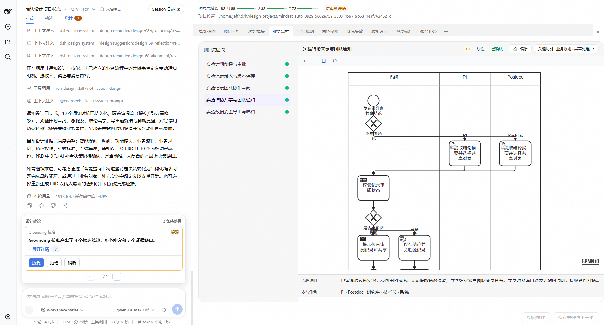
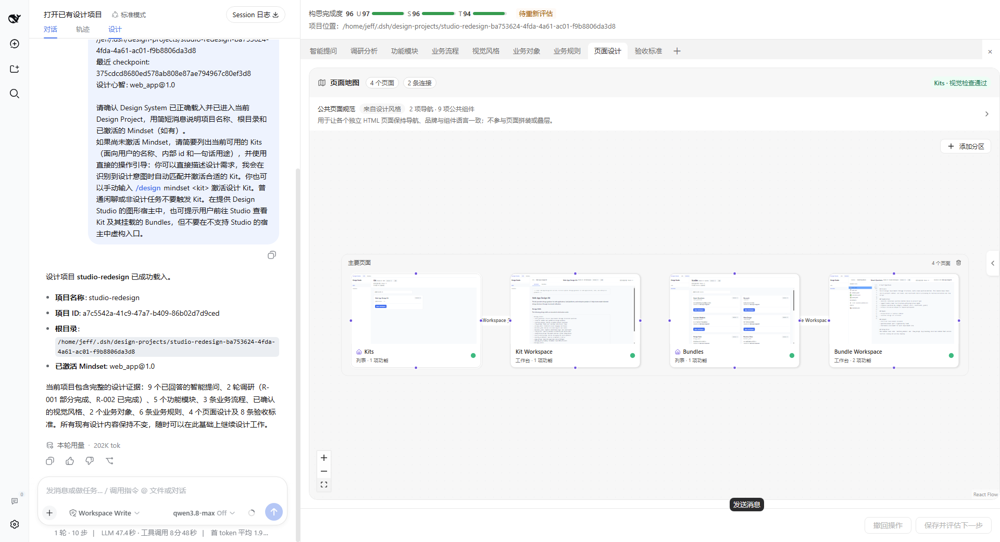
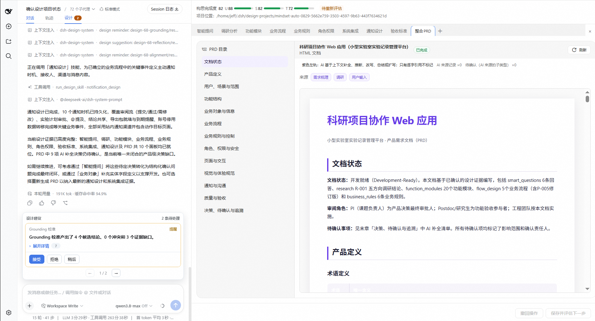

# Usage guide

English · [简体中文](usage.md)

State your goal in a familiar Agent Host, use a Design Panel to inspect and edit the result, then let AI continue from the saved design. Complete [getting started](getting-started.en.md) first; see [host compatibility](hosts.en.md) for each host's entry points. This page starts with everyday collaboration in a Design Project, then covers content authoring in Studio.

## 1. Choose a project and goal

DSH supports `/yugoo new <name>`, `/yugoo open <id|name|path>` and `/yugoo status`; Companion uses the installed `yugoo` skill and project operations. Project files are independent of chat, so you can reopen them from another session.

The project entry point is `yugoo`, invoked using the host's native syntax. Use the [host guide](hosts.en.md) to choose the entry point for your current plugin version.

For example, create a project in DSH with `/yugoo new research-platform`; if you need to select the Web App Kit manually, use `/yugoo kit web_app`. In other hosts, you can say, "Use Yugoo Design to create a client project delivery platform and select the Web App Kit." See the [command reference](commands.md) for all subcommands, parameters, prerequisites and error handling, and the [host guide](hosts.en.md) for host-specific syntax.

Describe the result you need, for example:

```text
Map out the client project delivery platform's feature modules and explain important exceptions.
Research similar products and retain citations.
Generate the core business flows.
Generate high-fidelity page prototypes from the existing design.
Assemble the current design into a PRD.
```

The main Agent chooses methods using the Kit's Mindset, the current goal and existing evidence. If you have a clear goal, request the result directly. If you are unsure where to begin, ask it to suggest design activities suited to the situation and explain what each helps resolve. You do not have to complete every interview or run every Bundle in a checklist.

You do not need complete requirements at the start. Describe the real situation, the result you care about and the scope of this round, for example:

```text
We discuss customer changes in chat, and delivery scope often grows as the discussion goes on.
Start with a change-handling flow we can discuss, and explain the options.
Designers can organize feedback; the project lead confirms additions to scope and delivery dates.
Leave contract billing and financial management out of this round.
```

You provide business context and make tradeoffs; AI develops the design using the current Kit's professional methods. When you cannot answer a question, ask for an example, an explanation of the impact or a provisional option you can revise. Unconfirmed information should remain explicit as unknowns or assumptions.

## 2. Inspect and edit a Panel

Use the current design's Panel to inspect structure, diagrams and artifacts, edit available fields and save. The Panel and a diagram's detail form operate on the same data. Actual controls and editing capabilities depend on the installed Bundle/Panel declarations.

After a successful save, you can request the next design step directly; you do not need to close and reopen the Panel each time to prove it saved. Reopen to check the actual fields during first-time verification or when you suspect content was not retained. Follow the UI diagnostics for validation errors, concurrent-edit conflicts or unfinished follow-up processing. A click alone does not establish a successful save.

For example, after AI opens a feature-module Panel, remove features the first draft does not need and adjust priorities. Then ask, "Based on the saved scope, develop the customer change-request flow." In the flow Panel, continue discussing who records feedback and who confirms scope and delivery dates. This turns discussion into results you can keep editing, rather than guessing again from chat descriptions each round.

Tie feedback to specific objects and actual effects:

```text
This sends every change to the project lead. I want designers to handle layout adjustments
within scope directly; only new pages or business capabilities need a scope discussion.
Adjust this branch and check whether the existing rules need revision.
```

Direct Panel edits suit definite fields and relationships. Use conversation alongside them when you need to explain reasons, compare options or coordinate changes across designs. Save Panel edits you want AI to see first, then identify what needs further thought.

After a successful save, continue discussing those changes in the original session. If AI does not continue or still refers to old content, first check whether the original session received the change, then use [troubleshooting](troubleshooting.md) to inspect save notifications and follow-up processing. If message status is unclear, inspect existing tasks before submitting again.

## 3. Handle suggestions

Grounding, Reflection and Alignment can raise questions or suggest research and clarification. View, accept, reject or defer suggestions through the entry points your host provides. A suggestion does not modify Design Files. Revise through the owning Bundle when a design needs to change. For clarification or research, you can first ask questions or search in the host conversation, or explain why no further action is needed.

For example, after you allow designers to handle changes within scope directly, review may prompt you to consider their effect on committed delivery dates. Check which designs the suggestion cites, then decide whether to revise, explain an existing rule or defer it. Do not treat a suggestion as a confirmed new requirement based only on its wording. See the [client-project tutorial](web-app-demo.en.md#4-use-a-suggestion-to-expose-an-unresolved-tradeoff) for the full situation, and [knowledge connections and review](concepts.md#知识关联与审查) for review perspectives and capability limits.

Installed versions that support autonomous review let you choose whether background checks run through review settings. Turning off autonomous review still allows explicit review requests. Follow [host compatibility](hosts.en.md) for the actual entry point and background capabilities.

If background execution is unavailable, or native asynchronous review still occupies the main conversation, first choose either "turn off automatic GRA" or "review synchronously in the main conversation this time." Synchronous review temporarily occupies the conversation and requires user confirmation. Without a choice, do not change policy or run a review. Manual checks remain available after automatic GRA is disabled. See [background capabilities and review fallback](hosts.en.md#background-capabilities-and-review-fallback) for limits by host version.

For example: "Turn off automatic review, but keep manual checks available"; or "Manually check the current features and flows now. I accept that this review will synchronously occupy the conversation; do not accept any suggestions yet." Finish the design changes planned for this round before reviewing that version, to avoid revising immediately after a review and triggering another.

### View and update UST

The Agent assesses clarity (U/S/T) against the current goal and actual design evidence, recording scores and reasons. It is not a count of executed Bundles or a gate requiring full marks before continuing.

```text
Update U/S/T from the currently saved design. Explain the factual basis for each dimension
and the most important gaps. Save the result through the assessment tool;
do not regenerate designs or start GRA for the purpose of scoring.
```

The latest successful result is stored in the project's `design_records/clarity.json` and tracked by Git. A failed report preserves the previous result; a missing result means not yet assessed, rather than a zero score. Assess again after the design evidence changes. Reuse is allowed when inputs are unchanged; a new report is not required after every tool call. See [project files](project-files.md#ust-具体记在哪里) for fields and version handling.

### View KAG and index status

KAG helps locate design objects, relationships and evidence. In DSH, click 「Yugoo设计」 (Yugoo Design) at the top of the conversation to open the Design Panel, then 「关联图谱」 (Related graph) at the bottom. In Companion, enter the connected project's full workspace and use the same bottom entry, alongside 「设计文件」 (Design Files) and 「场景体验」 (scenario experience).

This requires a selected project and graph-reading support from the host. A single Panel preview does not show the full workspace's bottom navigation. If your entry point has no graph view, ask the Agent to query design sources and relationships; that alone does not call for rebuilding the index. Read the graph together with node details and sources. Similarity links and Agent explanations do not establish confirmed business relationships. This is the project's knowledge graph, distinct from Studio's Bundle relationship graph.

If an update is indicated, ask the Agent, "Check the current project's graph status. Reuse a matching index if one exists; refresh once only if it is actually stale, and say whether the update completed or was merely accepted." `due` means an update is pending, not running. If it fails or is temporarily unavailable, you can still read Design Files directly. Judge graph status separately from GRA and UST; see [troubleshooting](troubleshooting.md#kag-或主动审查没有结果) for specific states.

#### Read design evidence from the graph

Start with 「概览」 (Overview) to locate design records, then expand the relevant content locally from node details. When inspecting an aggregated link, expand its two sides and check the original endpoints, file locations and evidence. Expanding globally helps reveal the overall structure; local expansion helps focus on one question. A collapsed line may collect several pieces of evidence; a higher count does not make a relationship more reliable.

| What you see | How to interpret it |
| --- | --- |
| Containment or reference relationships | Locate content hierarchy or explicit references in the original text; follow sources back to the Design Files |
| Semantic-similarity lines | Discover potentially related content; they do not directly prove dependency, causality or a business conflict |
| Explanations such as support, implementation, constraint, sequence or contradiction | Check the meaning, source, direction, status and evidence at both ends separately; Agent-proposed explanations still require verification |
| Isolated nodes, unknown relationships or many links | These alone do not establish a design defect, missing relationship or business importance |

Use search, filters, zoom and local expansion to narrow what you read; these operations do not change design facts. The graph has reading, indexing and display budgets. If partial coverage is reported, the current view does not prove that unseen content is absent. For a complete judgment, ask the Agent to explain the queried version, filters and pagination scope, then reread the relevant Design Files. To change a design, return to the Panel or Bundle that owns the content. Layout positions and candidate relationships do not replace business decisions.

### View a scenario experience

Select 「场景体验」 (scenario experience) at the bottom of the full design workspace to examine scattered flows, rules and interfaces within a specific situation. For example: "A customer unexpectedly asks for another page. How does the designer assess the impact, and where does the project lead confirm the arrangement?"

If no experience exists, click 「让 AI 推荐体验情境」 (ask AI to suggest a situation to explore). If one already exists, use 「新增场景」 (add scenario) to propose another. First agree with AI on what you want to experience and which question it should help answer, then have it generate the experience from saved designs. Once generated, choose it from the scenario list and inspect sources and demonstration assumptions under 「体验说明与设计依据」 (experience notes and design evidence).

Interactions within the experience are demonstrations only; they reset when you switch and do not directly modify Design Files. If a step, wording or rule needs work, click 「在主对话讨论当前内容」 (discuss the current content in the main conversation), explain the change, then revise through the relevant Design Panel. After the design changes, the old experience remains available to revisit. If it is marked stale, choose 「按最新设计刷新」 (refresh from the latest design). This lets findings return to the design discussion instead of ending at a prototype.

### Decide what to do next

A useful next-step suggestion explains what is missing, why it affects your goal and what the proposed action will help clarify. It may open another Panel, add research, compare options or return to an existing design for revision. A GRA finding can inform the discussion; whether to adopt it and how to act still depends on the current request.

If the host displays a U/S/T clarity assessment, read it with its reasons and the corresponding design version. New context may lower scores, and an unused Bundle does not automatically become remaining work. A successful save or completed review does not itself mean a current assessment exists. If the assessment is missing, failed or from an older version, do not decide the next step from an old score; see [assessment troubleshooting](troubleshooting.md#清晰度或下一步建议没有更新).

You can say explicitly, "Change this first," "Leave this question for later," "Give me a draft first" or "The current scope is sufficient." When the design meets this round's purpose, summarize decisions, retain unresolved matters and hand it off. An application design can be assembled into a PRD; other domains use their own deliverable forms.

## 4. Manage and recover projects

A Design Project is independent of chat. Common DSH entry points are below. Companion performs the same project operations through its installed Skill or shared project tools, using its own syntax.

| What you want to do | Current DSH entry point | Result |
| --- | --- | --- |
| Check the current project and Kit | `/yugoo status` | Inspect the current session's selection |
| List projects | `/yugoo list` | Find an existing project |
| Select a Kit | `/yugoo kit <kit>` | Choose a Kit when setting up a project; use the file-maintenance steps below to update an existing project |
| Open an existing project | `/yugoo open <id\|name\|path>` | Bind the project to the current session |
| Close the current binding | `/yugoo close` | Retain project files and end the current session's selection |
| Migrate an existing Design Project | `/yugoo migrate <path>` | Retain the original; validate and adapt in a new project |
| Reconstruct from documents, screenshots or source | `/yugoo reconstruct <path>` | Keep materials read-only; save results in a new Design Project |

New projects default to `YuGoo/Projects` under the current operating system's Documents directory. An explicitly configured path takes precedence; existing projects are not moved automatically. WSL uses the Linux user's directory rather than redirecting to Windows Documents. Project Git checkpoints record design changes and remain after a session closes.

In release `0.2.3`, selecting a Kit for the first time copies the complete Kit and mounted Bundle files to the project's `design_kit/kit` and `design_kit/bundles`. The Agent, Panels and validation then read the project's own files. Library edits or removal do not change existing projects. To use newer methods from the library, ask the Agent to compare files, explain the differences and preserve project customizations, then use normal validation, saving and Git to record the changes. For older projects, follow the corresponding content-recovery instructions.

The project operation `delete` removes the registration record while retaining actual project files; it does not delete files or empty a directory. If project content is missing, or an older project cannot locate its original Kit or Bundles, follow [updates and original-content recovery](kit-sharing.en.md#update-and-restore-project-content) rather than substituting newer library content as the original. See [project files and version management](project-files.md) for file layout, backups, moves and migration boundaries, and the [command reference](commands.md) for full parameters.

In conversation, ask to "compare the changes before and after this save," "explain when this rule changed" or "read the design at this checkpoint and compare it with the current version." The Agent locates evidence through read-only Git queries. It does not need to copy the full history, and viewing an old version does not automatically roll back the current design. Reverting a change is a separate operation whose scope must be explicit.

## 5. Reconstruct a design from existing materials

When taking over an unfamiliar repository, adding design documentation for an existing application or preparing a redesign, first organize "how it currently works" into a design you can inspect and revise. Reconstruction creates results in an independent Design Project so you and AI can compare them with the implementation, understand effects and discuss the next changes.

There are two different inputs. You do not need to copy old Design Files into ordinary materials as a workaround:

- **Migrate a Design Project:** if you already have Yugoo `design_files/`, use `migrate <old-project-root>`. Retain the original, bring content recognized by the target Kit into a new project, then validate and adapt as needed.
- **Reconstruct a design from materials:** if you have documents, screenshots or source code, use `reconstruct <absolute-materials-path>`. The Agent reads evidence and generates new design results. It does not copy an old project or reinvent the product from imagination.

For example, in DeepSeek Harness:

```text
/yugoo reconstruct /data/product-materials
```

In a Companion host, request directly:

```text
Use Yugoo Design to reconstruct the existing application's design from D:\Materials\studio-app.
Keep the materials read-only. First understand the actual entry points and behavior, then choose
a suitable Kit. Reconstruct only designs supported by evidence and relevant to this goal;
do not run every Bundle. Preserve existing visuals and assets, and distinguish observed facts,
inferences and unknowns. Give me editable Panels and explain coverage and unconfirmed areas.
```

A directory can mix documents, screenshots and code, or you can specify a single file. Git is not required. Readable formats depend on the host; unsupported formats need explicit conversion. Screenshots do not prove backend rules, and plans in documents do not prove an implementation exists.

### Start from a code repository

Use the repository root as the materials path. If you only care about a subsystem or user flow, specify that scope as well. For example, request through the installed `yugoo` entry point:

```text
Reconstruct the existing application's design from D:\Projects\studio-app.
This round focuses on customer change submission, designer impact assessment
and project-lead confirmation.
Check actual entry points, relevant handling and data reads/writes to organize features,
flows and business rules. Where real interfaces exist, preserve their layout and assets
and give me design results I can verify and edit.
Distinguish behavior supported by code, intent stated in documents and unknowns.
Do not execute or modify the original product code.
```

In DSH, you can also enter `/yugoo reconstruct D:\Projects\studio-app` and then explain this round's scope. Replace paths with absolute paths accessible to the current host. A source directory is not a Design Project to `open`.

The command first creates and selects a new project. The Agent then learns about the product, chooses a suitable Kit and continues reconstruction. It examines evidence around relevant entry points, including handling logic, data, permissions and interfaces, selects Bundles with substantive content, and saves results in the new project through normal validation and saving. A source directory, dependency or test file alone does not prove a feature is connected. An area that has not been inspected cannot be declared absent.

The original repository remains read-only. Reconstruction does not copy the whole repository, create a source mirror or execute its code. Necessary original visual assets may be reused by their respective deliverables. If you supply only one file, reading is limited to that file and does not automatically expand to neighboring directories. Explain in the results any behavior that can only be known at runtime, unreadable formats or interfaces that cannot be represented faithfully.

### Check results and continue designing

Ask the Agent to report saved design dimensions and files, corresponding source locations, actual inspection scope, and remaining discrepancies, unknowns and uninspected areas. You can ask directly: "Explain which design corresponds to each key entry point in the customer change-request flow, and what remains unverified." Creating a project, listing an execution plan or generating a page directory does not establish that the corresponding results have been reconstructed.

Compare key entry points, flows, pages and cross-Bundle references with the original materials, then edit and save through ordinary Panels. Passing format validation does not establish browser verification or complete fidelity. Without a runtime comparison, do not claim the interaction is identical to the original application. Once the current behavior is confirmed, state which rules or experiences you want to change and continue in the same Design Project. Design edits do not automatically modify the original repository.

See the [command reference](commands.md) for full parameters and migration prerequisites, and [project file management](project-files.md) for file and history handling. Technical conventions for asset copying, preview resources, optional KAG and final checks are collected in [reconstruction execution notes](../design-command-agent-entry.md#reconstruction-execution-notes).

## 6. Studio: inspect, customize and check Kits

Studio manages the methods and panels used during design; the everyday Design Panel edits your design results. In Companion, open Studio from settings to reuse the current service connection in a separate browser page. DSH uses the Studio entry point provided by the host.

**Version scope:** the in-place editing, source import and project-owned content described below correspond to release `0.2.3`. Complete Studio authoring checks are still in progress. Check the [host guide](hosts.en.md) and [release status](preview-status.md) for tested scope and known issues; use the matching instructions for older entry points.

### Inspect Kits and Bundles

Open a Kit from 「套件」 (Kits) on the left, read its Mindset and inspect the mounted Bundle identities. 「原始文件」 (raw files) provides the actual file tree, including complete frontmatter, mount projections and reference resources. The reading view supports browsing; the raw view preserves file content.

Find a Bundle under 「技能包」 (Bundles) to inspect its methods, output contract, schema, validation, language resources and Panel declarations. Details also show which Kits reference it. A local Kit mount reads the current saved content for that Bundle identity. Copying only a Kit retains those references; copy a Bundle separately and change the mount when you need independent methods or interactions.

### Edit and customize independently

Select a Kit or Bundle and choose 「编辑」 (edit) to open its current content under the same identity. To keep the original methods and develop an independent alternative, choose 「复制」 (copy) to create a new identity. Entry points supporting creation from scratch also offer 「新建 Kit」 (new Kit) and 「新建 Bundle」 (new Bundle).

1. Edit 「原始文件」 (raw files) in the authoring workspace, inspect differences and save explicitly. Saving retains the current identity without publishing a local version or remounting content.
2. Handle unsaved content before switching files or leaving. After refreshing, reopen the same object and check its saved text. You can save incomplete source; loading or previewing reports the actual definitions still needed.
3. Use 「挂载管理」 (mount management) to organize capabilities by Bundle identity and read their current content. For independent methods or Panels, copy the relevant Bundle and mount that copy in the Kit. Source versions provide provenance rather than a number to change on every save.
4. Check changes with sample previews, then select the prepared Kit in an independent new project. Inspect its complete methods and resources, generate an output, edit it, save and reopen it. Existing projects keep using their own files. To update one, ask the Agent to compare the library with its `design_kit`, preserve customizations and apply changes within the host's write permissions using ordinary validation and Git. See [sharing and project maintenance](kit-sharing.en.md).

Renaming in the title changes the display name, not the Kit/Bundle's technical identity. Removal checks Bundle references and moves the selected content to the operating system's trash; use the system's restoration entry point to recover it. npm publication, runtime component releases and Design Files saving/publication retain their separate processes.

### Preview and trial-run

| Operation | What it helps check | Meaning of saving and execution |
| --- | --- | --- |
| Panel preview | Layout, fields and declarations with a Bundle sample | Uses an isolated sample; does not start a model or modify a Design Project |
| Preview after editing Panel YAML | Declarative UI changes and diagnostics | Saving method source and interacting with a sample are separate |
| Native trial run | Whether methods generate results, and the resulting Panel | After connection checks pass, starts a real host task in an independent test project |
| Everyday Design Panel save | Changes to the current project's design results | Uses project validation and version records so later design work can use the result |

A Bundle's 「面板预览」 (Panel preview) reads `reference/preview.json` first. If no usable sample exists, it displays diagnostics; an empty interface is not a complete experience. Declarative Panels allow YAML editing. Native Panels are implemented by a Provider and do not offer an editable `panel.yaml`.

Start a trial run from the Bundle title. Save the source you want to test first; the trial reads that saved content. For an initial run, the native Agent can prepare concrete synthetic inputs and execute. You can also edit test inputs and explicitly run again, retaining separate results and original inputs for each run. A queued task or reachable connection does not mean completion. Do not treat unknown execution status as success or start duplicate runs.

「演示保存」 (demo save) and 「撤销修改」 (revert changes) in the trial-run Panel demonstrate only saved UI state in the current browser. They do not publish Design Files or notify the Agent to continue. Refreshing restores the actual generated result. Verify durable saving and continuation in a normal Design Project.

### Components and sharing

Installed versions with a 「面板组件库」 (Panel component library) let you query declarative components from the same version, inspect synthetic examples and copy complete declarations. The library supports component selection and learning. New components still require registration and release in the shared runtime; you cannot install arbitrary executable UI here.

Studio can serve as a visual workbench for content maintenance: view samples, interact with Panels, identify presentation or interaction issues, revise and inspect again. Versions with host-conversation authoring let you send the current object and request to the original host Agent, inspect proposed changes in the same source and preview, then decide whether to save. Without that connection, a development Agent can maintain complete methods, data contracts and Panels in a separate authoring source, then return to Studio for inspection. See [extension development](extending.en.md) for the authoring workflow.

Use the existing import entry point to select a source ZIP, folder or single `SKILL.md`. A Bundle needs its method file; a Kit needs `mindset.md` and `kit.yaml`. Import retains original files and creates an independent identity. Other missing or incomplete definitions can be completed in the existing editor. Legacy archive JSON can also be decoded and imported through the same source entry point. Inspect the specific diagnostics for format or file-integrity problems; cancelling selection changes nothing. A standalone Bundle still needs explicit mounting in a Kit. Import does not execute scripts, grant execution trust or change existing projects.

Save the content you want to share, then choose export from the object menu to download its current source ZIP. A Kit includes complete files and resources for its mounted Bundles; unfinished methods can also be shared for further work. Source and license metadata are optional, while existing LICENSE, NOTICE and attribution files must be retained. See the [sharing guide](kit-sharing.en.md) for archive formats, dependencies and recipient checks.

When maintaining Studio integration, read [Studio domain](../../packages/studio/README.md) and [Studio UI](../../packages/studio-ui/README.md). To pass design results to implementation, use the [design-to-development handoff](../design-development-handoff.md).

## 7. Interface overview

The three screenshots below come from an existing example project. They show the real Chinese-language Web App Kit interface in DeepSeek Harness at the time of capture, illustrating how conversation and Design Panels work together. Current layout, controls and editable scope depend on the installed host, Bundle and Panel; see [host compatibility](hosts.en.md).

### Discuss a flow: who acts, and what happens next

Use a swimlane flow to work through roles, steps and branches, placing rules that need confirmation where they apply. Explanations and suggestions in the conversation remain visible beside the flow, making it easier to identify a specific change.



*Business flow: conversation, review suggestions and a swimlane flow share one workspace.*

### Inspect pages: follow the user's task

A page map brings pages, sections and navigation relationships together, helping you check where users enter and where they go next. With page prototypes, you can further discuss whether the information is sufficient and the interaction is coherent.



*Page design: inspect a page map, thumbnails, sections and navigation in the same workspace.*

### Assemble the proposal: review designs together

Use the PRD's table of contents, body and sources to inspect how the design is organized into a document. If you find omissions or inconsistencies, return to the design activity that owns the content to discuss and revise it.



*Assembled PRD: inspect the contents, document and sources while continuing the design discussion.*
