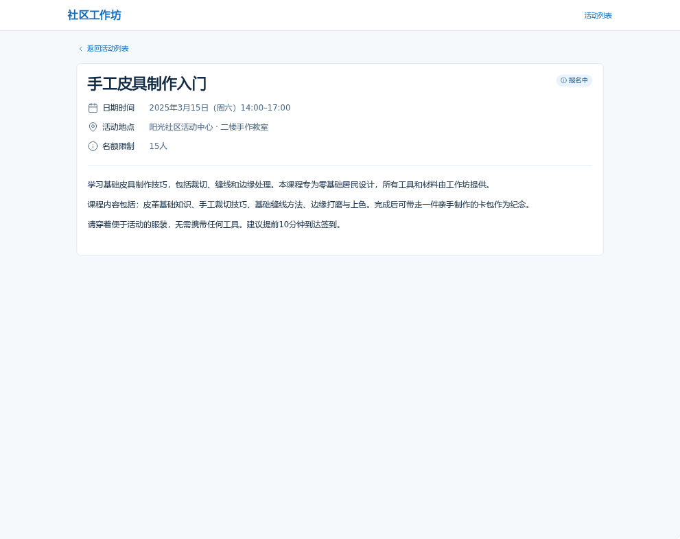
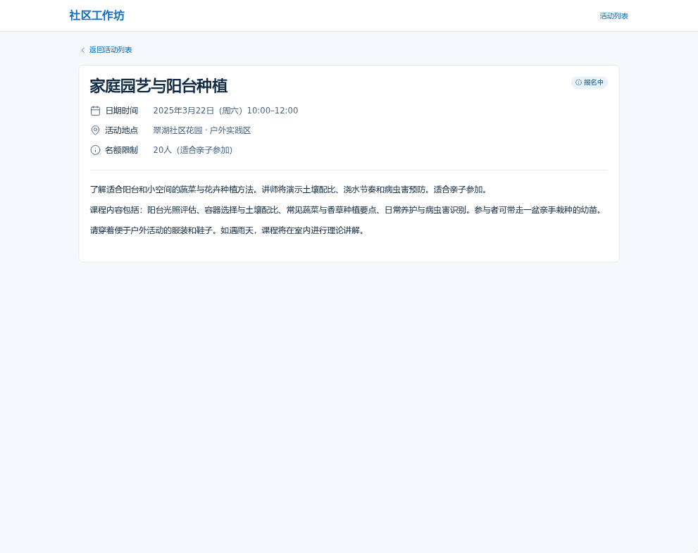

# Web App 协作教程：设计工作室的项目交付平台

跟随一个六人设计工作室的练习，使用语构设计系统（Yugoo Design）把业务想法展开为可以讨论、修改和继续完善的设计。本例使用合成业务情境，截图展示 DeepSeek Harness 中的实际对话与设计面板，动图包含局部放大。对话和结果供练习参考，实际可用操作见[宿主指南](hosts.md)。

先走完一轮协作：**讨论目标 → 对着面板理解和修改 → 保存后让 AI 沿着新判断继续**。页面地图、UI 原型、调研、场景体验和 PRD 可以在需要时继续展开；下面按问题分别说明，不要求把每个部分依次做完。

希望从已有内容开始，可先将[工作室示例项目](../../examples/design-team-delivery/README.md)复制到仓库外，再迁移为自己的设计项目。

## 准备：打开项目，说明处境

先按[开始使用](getting-started.md)安装并启用插件。DeepSeek Harness 的当前项目入口示例为：

```text
/yugoo new design-team-delivery
/yugoo kit web_app
```

其他宿主使用已安装的 `yugoo` 技能或项目工具入口，直接请求“新建 design-team-delivery 设计项目，使用 Web App 设计套件”。完整参数见[命令参考](commands.md)。选好 Web App Kit 后，可以这样提出目标：

```text
我们是六人的设计工作室，同时服务几个客户。需求和修改意见都在聊天里，
经常做到最后才发现范围已经变了。我想设计一个项目交付平台：
AI 帮忙整理反馈、提示影响，关键承诺仍由我们决定。
先和我想清楚一次客户修改请求应该怎样处理，展开可以讨论的设计。
这轮先不做合同收费和财务管理。
```

如果已有交付清单或客户反馈，把去除私人信息的材料交给宿主 Agent。没有明确的约定可以保留未知，先从你知道的事情开始。

## 1. 在问题面板中补充关键背景

当缺少会影响方案的背景时，AI 可以打开智能提问（Smart Questions）面板。问题卡片应帮助你看清具体选择，例如：

| 当前需要了解的问题 | 练习中的回答 | 对设计的影响 |
| --- | --- | --- |
| 客户提出修改后，谁判断是否超出范围？ | 设计师可沟通和记录，项目负责人确认新增范围。 | 客户反馈和正式范围确认需要区分。 |
| 谁可以承诺交付时间？ | 项目负责人。 | AI 与设计师都需要把相关影响交给负责人判断。 |
| 已经有明确交付清单吗？ | 通常有页面清单，但细节会在设计中继续讨论。 | 需要保留原交付依据，并允许逐步澄清。 |

你在面板中选择或补充回答，保存后继续。已有明确背景时，也可以直接要求展开流程，不需要先填完问卷。

此时合理的下一步建议可以是：“先把客户提出修改到安排执行的过程画出来，区分记录意见、判断范围和确认交期。这样能看清谁在什么地方作决定。”


## 2. 从功能卡片找到这一轮的范围

如果还不清楚平台包含哪些能力，可以先展开功能模块面板。针对当前目标，可以讨论客户反馈收集、交付范围记录、变更处理和交付审阅；暂不展开财务管理。

你查看卡片的情境、行为、输入与结果，指出哪一项解决了实际问题，哪些内容暂时不需要。可以要求：

```text
先保留反馈记录、范围对照和变更确认。
我们暂时不需要自动制定全团队排期，但要能看出一次修改会影响哪个交付节点。
请根据这个范围展开客户修改请求的流程。
```

这次选择收拢了设计范围。下一步围绕一个明确操作展开，而不是让 AI 为所有模块同时生成细节。

## 3. 对着流程，把真实工作方式表达出来

AI 展开业务流程面板，用泳道图区分客户、设计师、项目负责人与系统。一个初步方案可以呈现：记录反馈、对照交付范围、判断影响、确认安排、通知客户和执行修改。

示例的 P-001 采用纵向泳道。先查看完整流程，理解从客户提出意见到系统记录决定的路径，再放大“直接处理”与“负责人确认”的分支，核对范围和交期影响分别怎样判断。

如果初步方案让每项修改都经过负责人，你可以补充实际情况：

```text
已有范围内的布局调整可以由设计师直接处理，不必每次找负责人。
新增页面或业务能力才需要讨论范围。客户在群里说“可以”也不一定是正式确认，
需要记录具体确认了什么。
```

请 AI 据此修订流程分支，并通过业务规则 Bundle 维护对应判断。你继续查看和编辑具体条件，保存，再请 Agent 基于已保存的内容继续。修改稳定字段或文字可以直接用面板；涉及解释和跨部分影响时，用对话补充原因。

| 设计内容 | 需要表达清楚的判断 |
| --- | --- |
| 客户反馈 | 先保留原意、来源与关联交付内容，不直接当作团队已承诺的新任务。 |
| 范围内修改 | 设计师可以处理，仍需关注是否影响交期。 |
| 新增范围 | 交给负责人评估和确认。 |
| 确认记录 | 需要知道确认对象和内容，不能只留下一个脱离上下文的“已确认”。 |

面板显示保存成功后，继续讨论这项修改对流程和规则的影响，不必等待评分更新。若修改没有保留，或 Agent 仍引用旧内容，按[保存与续作排查](troubleshooting.md)检查对应环节。

查看清晰度评估（U/S/T）时，可以展开理由和下一步缺口，而不只看分数。例如，示例中一项具体缺口是：负责人退回补充后，设计师在哪个页面完善判断、怎样重新提交？已有流程描述了这条回路，三页原型还没有覆盖完整操作。这样的理由能帮助你选择下一轮工作；原型与场景体验本身不是业务测试通过的证明。


## 4. 用一条建议，发现尚未想清楚的取舍

在支持主动审查（GRA）的宿主中，可以阅读建议指出的依据，再决定如何继续。工作室示例保存过一条一致性审查（Grounding）建议：[智能提问](../../examples/design-team-delivery/design_files/smart_questions/smart_questions.json)已经要求影响已承诺节点时由负责人确认，而[业务规则](../../examples/design-team-delivery/design_files/business_rules/business_rules.json)中的 BR-001 只检查是否新增页面或业务能力，漏掉了交期例外。建议的要点是：

> 即使没有新增范围，只要影响了已承诺的交付节点，也需要负责人确认安排。
> 请对照问答和流程，把这项已有判断补进业务规则的直接处理条件。

这条建议指出的是已有判断没有在不同设计中表达一致，而不是替你新增一项业务决定。你可以在对话中重申：

```text
范围和交期分开判断。即使没有新增范围，只要会影响已承诺节点，
也应交给负责人重新确认安排。
```

这次演示在人工采纳后，请 AI 修订了相应规则：BR-001 的直接处理条件补入“不影响已承诺交付节点”，BR-002 则明确新增范围或影响节点时需要负责人确认。你可以对照流程与保存后的规则检查结果；读到建议本身不会改写设计。后台审查入口按[宿主范围](hosts.md)使用，也可以在原会话明确请求对照现有设计检查。

这类对照帮助你把“范围内可以直接处理”表达得更准确，也可以进一步讨论尚未明确的交期责任。三种审查视角见[核心概念](concepts.md#知识关联与审查)。


知识图谱（KAG）则帮助你查找相关内容与来源。例如，在底部“关联图谱”选择客户修改请求流程或反馈详情页面，可以查看它们引用的 BPMN、HTML 产物，再回到面板核对。图谱与审查各自提供线索；上面的规则建议来自设计文件之间的对照，并不是图谱自动作出的决定。

## 5. 按需要展开数据、AI 能力与页面

有了上述决定，你还可以让方案更具体。例如，先看页面地图，检查负责人从哪里进入、怎样找到原范围和影响；确认主要路径后，再生成具体 UI，判断信息和操作是否方便。

```text
沿用已保存的分工与范围规则，展开客户反馈、范围对照和变更确认的页面地图。
先解释负责人怎样看见原范围、影响和拟确认内容。
页面关系确认后，再生成对应原型，让我查看和体验主要操作。
```

如果接下来的判断依赖外部信息，可以展开调研分析（Research）。例如，想了解现有协作工具怎样保留客户反馈、版本和确认依据，可以先请 AI 拟定调研问题与方向，修改计划后再确认开始。示例中的 R-001 围绕“收集反馈不等于作出承诺”“AI 建议与人工确认”“退回补充时保留上下文”三个方向，保存了来源、发现和结论。阅读时区分参考产品的做法、调研建议与本项目已经确认的规则，不把一种产品惯例直接当成自己的需求。


场景体验把已有设计放进一个具体情境中，适合继续讨论“客户要求新增页面，同时影响已承诺节点”时应该怎样处理。它可以结合流程、规则和页面呈现当前方案；从面板底部“场景体验”进入，操作见[使用指南](usage.md#查看场景体验)。页面原型则聚焦具体界面和跳转，两者各有用途。


其他问题也可以按需展开：

| 需要继续想清楚的事 | 在相应面板中检查 |
| --- | --- |
| 反馈、交付物、变更与确认怎样关联 | 业务数据中的对象、关系与字段含义。 |
| 客户、设计师、负责人各自可以做什么 | 角色权限中的可见与操作范围。 |
| AI 怎样帮忙而不替团队作承诺 | AI 能力中的职责、提示词、Skills、工具及人工确认边界。 |
| 用户怎样查看意见和决定 | 页面地图与原型中，从反馈到范围依据、影响和确认的路径。 |
| 怎样判断后续实现符合设计 | 对已选行为编写可观察的验收条件。 |

例如，应用中的 AI 可以归纳客户反馈、提示相似请求，并起草影响说明；是否纳入范围、承诺哪一天交付，由授权的人决定。这是在设计你将来应用中的 AI，具体职责和执行方式需要在该应用设计中说明。

对话可以继续提出下一步建议：先补缺少的范围依据，或先用一个页面检查负责人作决定时是否看得见必要信息。选择取决于当前障碍，不由面板数量或最低分决定。各设计活动的用途见[官方 Kit 用户指南](official-kits.md#web-app从业务想法到可以讨论和实现的应用设计)。

<details>
<summary>补充查看：业务对象、关系和规则</summary>


</details>

## 6. 整合当前设计，保留依据与未决问题

当这轮已经足以供团队讨论，可以请求：

```text
请把当前项目交付平台的设计整合为一份 PRD。
保留功能、流程、规则、数据、权限和 AI 能力的来源。
说明哪些是已确定的决定、哪些仍是暂定或未解决的问题，
不要为了文档完整而补出我们没有讨论过的承诺。
```

示例的 PRD 已按本轮设计重新整合，包含当前纵向流程、三页原型、视觉风格预览和调研依据。可以先阅读产品定义、用户与范围、业务规则和待确认内容。以后继续设计时，先保存本轮独立设计，再请求重新整合，让文档与设计保持一致。

在 PRD 面板中浏览目录和正文，检查“范围内修改也可能影响交期”的判断是否贯穿流程、规则和交互，并核对插图是否对应当前设计。发现问题时，回到事实所属的 Bundle 修订，再更新整合文档。PRD 是派生输出，不替换独立设计来源。

进入实现时，只为当前开发任务准备有来源的说明，例如“实现客户反馈登记与负责人确认”。按[设计到开发交接](../design-development-handoff.md)准备 spec 和验收依据，不要求一次实现整个项目。


*PRD 草案沿用正式章节组织，合成业务数据和未确定内容均保留标记；其中的验收草案仍需团队确认，不是已经通过的测试结果。*

## 7. 保存后继续，下一次再打开

下一次继续时，打开同一项目，沿着已经保存的内容讨论。例如请求：

```text
继续 design-team-delivery 项目。沿用我已保存的范围和交期规则，
说明负责人确认安排时需要看见什么，再建议本轮值得完善的部分。
```

需要比较前后的判断时，可以请求“查看最近一次修改，解释哪些流程和规则发生了变化”。项目保存设计文件、产物和版本历史；关闭面板后仍可再次打开。历史查看、恢复及从材料重建见[日常使用](usage.md#4-管理与恢复)，项目命令与全部参数见[命令参考](commands.md)。

如果 Agent 给出清晰度评估（U/S/T），请结合其依据理解当前的理解度、结构化与可验证性。你可以追问“为什么这里还不清楚，哪项具体决定最值得讨论”；分数帮助定位缺口，不要求为提高分数补齐全部面板。解释见[清晰度说明](../ust-score-explanations.md)。

希望看清某项判断与其他内容的关联时，打开面板底部“关联图谱”，选择相关对象并查看其来源，再回到流程或规则判断是否需要调整。也可以直接请 Agent 对照原设计解释。图谱连线提供查找依据的线索，仍需结合实际文件阅读；操作见[查看 KAG](usage.md#查看-kag-与索引状态)。

## 练习后检查什么

- 你能解释这轮方案，明确哪些取舍来自自己、哪些仍需讨论。
- 你给出的背景实际改变了流程、规则或 AI 职责，而不只留在聊天中。
- 你保存的修改能在下一轮讨论中沿用；页面原型供体验设计，业务服务还需后续实现。
- 一条关联建议帮助发现了有意义的问题，没有自动替你作决定。
- 整合成果保留来源和未知项，项目以后可以打开继续。

希望改变今后构思的方法或面板，可继续[最小定制教程](custom-kit-tutorial.md)；本页的具体工作方式也可以替换为你自己的业务，不需要照搬练习答案。

## 历史实测：社区活动浏览与详情

以下保留此前候选的原始实测说明与截图，展示已记录的页面生成、反馈、修订和浏览结果。它与上方工作室教学案例是不同项目，验证范围仍按原文理解。

<details>
<summary>展开历史候选的过程、截图与验证范围</summary>

### Web App 演示：两项社区活动的浏览与详情

这是合成项目的实际验证记录和体验步骤，不是已发布版本的安装承诺。
请先通过受支持宿主的安装入口启用 yugoo-design 与官方 Web App Kit；
当前 npm 发布状态见[预览状态](preview-status.md)；本页保留原合成案例的验证边界，
不能把历史候选结果当作最新 npm 版本的宿主验收。实际安装支持范围以对应版本说明为准，
不使用开发启动器作为用户安装步骤。

#### 目标与范围

示例只有两项社区活动：手工皮具制作、家庭园艺。当前体验切片只有
“活动列表 → 对应详情 → 返回列表”，不包含报名提交、登录、支付或真实数据库服务。
详情中的日期、地址和活动说明都是合成内容。

可以向自己的宿主 Agent 提出这样的请求（示例表达，不保证每次生成相同页面）：

```text
为社区工作坊设计两项活动的浏览体验：手工皮具制作和家庭园艺。
先明确关键问题和本次范围，再制作活动列表和详情原型。
列表只显示这两项活动；点击不同活动应显示各自详情，详情可以返回列表。
这轮不实现报名、登录或支付。不要把未知信息当成已经确认的事实。
```

#### 已经走过的设计闭环

1. 原生宿主 Agent 生成官方 questions Bundle。用户在真实 Panel 回答问题，
   修改说明并保存；关闭、重开后答案和说明保留。
2. 生成样式与两个节点的 Page Map。用户确认页面生成后，Producer 生成列表
   和详情 HTML；不是假数据接口或测试代码替代模型生成。
3. 实际体验发现额外活动、越界报名按钮以及第二项活动显示错误详情。
   用户反馈被用于同一项目的修订，早期失败没有被后来成功覆盖成“从未出错”。
4. 修订后 Producer 读取完整 Bundle 输出契约，调用现有逐文件 HTML 校验及
   Page Map 校验，再发布新 checkpoint。主 Agent 不能绕过 Bundle 写入 Design Files。
5. 在已安装的官方宿主中实际点击：皮具卡片 → 皮具详情 → 返回 → 园艺卡片
   → 园艺详情 → 返回。两项身份正确，没有第三项活动或报名按钮。

问题阶段对未来账户和数据存储的回答，不代表这轮浏览原型已实现这些能力。
当前两页切片与未来完整应用要求应同时保留，不能把暂未实现误写成已经完成。

#### 自己体验时检查什么

- 不只看截图：点击两张卡片，分别检查标题、内容和返回位置。
- 编辑答案后保存并重开，确认不是仅修改了屏幕上的临时状态。
- 反馈应指出具体页面、操作、预期与实际结果，让 Agent 修订对应 Bundle。
- 对声明的 HTML 与 Page Map 使用该 Bundle 已有的验证入口；验证通过不替代
  实际点击，也不证明后端功能已经实现。
- 如需继续报名或登录，先明确新增设计范围，再进行下一轮，不从当前截图推断。

#### 业务截图与呈现边界

下面两张详情图直接拍摄实际浏览器的业务 iframe，未修改图片内容。
图片只包含业务预览，不包含宿主登录地址、内部工作区、模型配置或会话日志。



选择皮具卡片后显示对应标题、时间、地点、容量和说明。



选择园艺卡片后，同一详情页显示园艺数据，并提供返回活动列表入口。
日期、地点、容量及“报名中”角标均为合成示例文案；角标不代表实现了报名服务。

用于这组业务截图的 native 对照使用同一已发布设计内容，并显式采用已有 native
Page 展示入口。它证明这两页业务视图，不证明所有官方 Panel 已迁移为声明式内容，
也不把 native 对照冒充为默认声明式模式。照片、字体或其他资源的来源应另外说明；
此例的图形为内联 SVG，系统字体回退不是随包分发字体文件的声明。

#### 不由这个例子证明的事项

实际页面生成使用 Producer 串行完成，本例没有验证 Worker 委派链。
也不证明生成式 A2UI、全部十四个 Panel、跨平台桌面支持、真实报名服务、
完整开发交接或整个发行候选已经通过验收。

另见[非 Web Kit 演示](non-web-kit-demo.md)和[设计到开发的交接指南](../design-development-handoff.md)。

</details>
